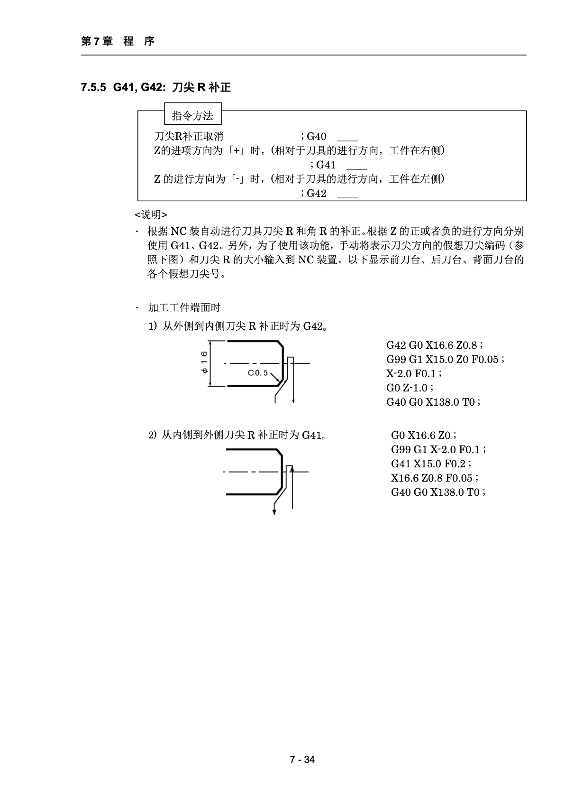
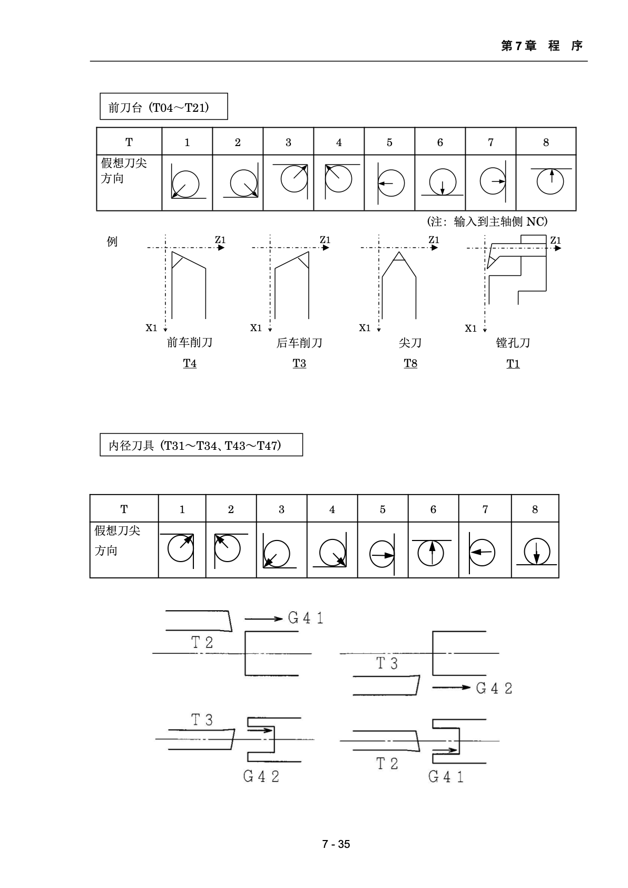
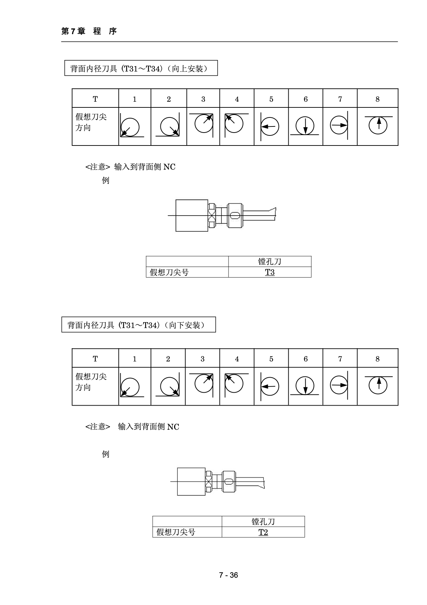
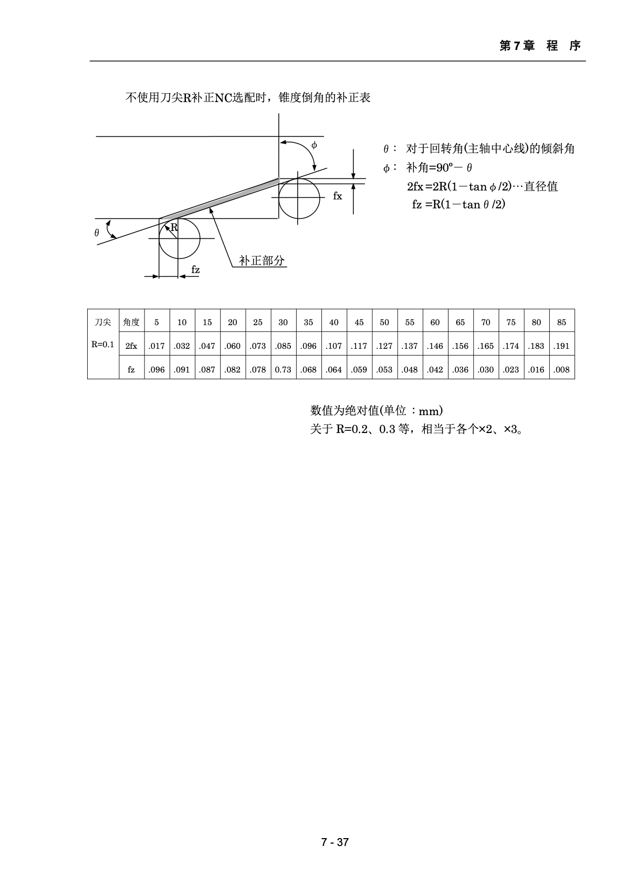

# 津上走心机 G41 / G42 刀尖 R 补正：左右判断与调机实操指南

> **资料依据与适用范围**：依据津上《S205A/S206A 说明书》（`3281-LTQ0C-05`，封面 `FANUC 0iTF Plus` / `27610B～` / `23.04`；注：原文件名 `3001～` 与前言 `0i-TD` 存在版本差异，实际按钮与参数以本机铭牌及是否开通“刀尖 R 补正 NC 选配”为准）。
>
> **核对原页**：`§4.1` 纸面 `4-8`、`4-10`、`4-14`（原 PDF 第 `63`、`65`、`69` 页）；`§4.3.9` 纸面 `4-32`～`4-33`（原 PDF 第 `87`～`88` 页）；`§4.3.11` 纸面 `4-77`～`4-80`（原 PDF 第 `132`～`135` 页）；`§4.3.18` 纸面 `4-93`～`4-95`（原 PDF 第 `148`～`150` 页）；`§5.5`～`§5.6` 纸面 `5-9`～`5-20`（原 PDF 第 `172`～`183` 页）；`§7.3` 纸面 `7-5`～`7-7`（原 PDF 第 `273`～`275` 页）；`§7.5.3` 纸面 `7-31`～`7-32`（原 PDF 第 `299`～`300` 页）；`§7.5.5` 纸面 `7-34`～`7-37`（原 PDF 第 `302`～`305` 页）；`§7.7` 纸面 `7-62`（原 PDF 第 `330` 页）。
>
> **配套资源**：双击浏览器打开离线交互动图 [G41_G42交互动图.html](G41_G42交互动图.html)；关于简单轮廓日常保留 `G40` 手算刀位的约定，见 [我的加工学习与编程工作流](../学习总整理/我的加工学习与编程工作流.md)。

---

## 一、如何快速判断 `G41 / G42` 与假想刀尖号 `T`（核心重点）

### 1.1 黄金判断法：站在轮廓线上，看刀尖圆心在左手还是右手

`G41` 是刀尖圆弧半径**左**补正，`G42` 是**右**补正，`G40` 取消这项补正。判断左右最直观的办法不是背“工件在哪边”，而是直接看**刀尖圆心在哪边**：

> **把自己想成站在图纸的成品轮廓线上，脸朝着刀相对工件前进的方向：**
> - **刀尖圆弧的圆心该在你左手边 → 就用 `G41`**（刀具往左偏让开成品轮廓）
> - **刀尖圆弧的圆心该在你右手边 → 就用 `G42`**（刀具往右偏让开成品轮廓）

*(与津上手册 `§7.5.5` 纸面 `7-34` 原文的对应关系：手册写“相对于刀具的进行方向，工件在右侧用 `G41`；工件在左侧用 `G42`”。因为工件与刀具必定分居轮廓线两侧，所以“工件在右侧”与“刀尖圆心在左手边”**100% 等价**，按圆心/刀具在左或右判，更贴合左/右补正的本意。)*

### 1.2 唯一防反前提：先把视图摆正（不能画镜像！）

按“圆心在左还是右”判断前，必须保证图纸/草图满足右手坐标系（从 **`+Z` 箭头逆时针转 90° 到 `+X` 箭头**），否则左右会镜像翻反。

津上 S205A/S206A 主轴前刀台最稳妥的摆法，直接沿用手册 `§7.3`（纸面 `7-5`）与 `§7.5.5`（纸面 `7-34`～`7-35`）的标准视图：
- **导套与棒料在左，右端面在右**：往棒料内部走为 **`+Z` 朝左（`←`）**；
- **前刀台在主轴下方**：往外退刀为 **`+X` 朝下（`↓`）**。
  *(检验：从 `←`（`+Z`）逆时针转 90° 正好指向 `↓`（`+X`），视图不镜像。如果你习惯把前刀台画在工件**上方**、又把棒料放左边，那是镜面翻转视图，直接套“左手/右手”必反！)*

**为什么走心机和普通刀塔车床正好反过来？**
- **普通刀塔车床**：主轴卡盘固定在左，刀架从右端往卡盘走是 **`-Z` 进给**，前/后置刀架对应外圆常用 **`G42 + T3`**。
- **津上走心机**：导套与前刀台 Z 向其实固定不动，真实物理运动是**主轴夹着棒料沿 `+Z1` 向右推出导套**，前刀台只沿 `X1` 径向进退。反映到编程坐标系里，从右端往里车外圆成了 **`+Z` 进给**——人站在轮廓线上朝左看，前刀台圆心在**左手边**，所以用 **`G41 + T4`**！

### 1.3 走心机 6 种常见走刀“看圆心左右”速查表

均在标准视图（`+Z` 朝左 `←`、`+X` 朝下 `↓`）下，人站在轮廓线上、脸朝刀尖前进方向：

| 加工场景 | 刀尖相对工件前进方向 | 站轮廓线上朝前进方向看，**刀尖圆心在哪边**？ | 选用代码 |
|---|---|---|---|
| **前刀台从右端往里车外圆**（`+Z`） | 朝左 `←` | 刀在工件下方 = 前进方向**左手边** | **`G41`** |
| **前刀台后车刀从里往右拉车外圆**（`-Z`） | 朝右 `→` | 刀在工件下方 = 前进方向**右手边** | **`G42`** |
| **前刀台从外向内切倒角与端面**（手册 `7-34` 例 1） | 朝上/右上 `↗ ↑` | 刀在端面右侧 = 前进方向**右手边** | **`G42`** |
| **前刀台从内向外车端面与倒角**（手册 `7-34` 例 2） | 朝下/左下 `↓ ↙` | 刀在端面右侧 = 前进方向**左手边** | **`G41`** |
| **前刀台镗内孔**（`+Z` 往里车下孔壁） | 朝左 `←` | 刀在孔内（下孔壁上方）= 前进方向**右手边** | **`G42`** |
| **背面内径镗刀**（手册 `7-35` 下图，往右进刀） | 朝右 `→` | 车上孔壁：刀在下 = **右手边** → **`G42`**<br>车下孔壁：刀在上 = **左手边** → **`G41`** | 按所车孔壁判 |

> **现场 1 秒防呆口诀**：死记一个锚点——**津上主轴前刀台往 `+Z` 车外圆 = 圆心在左 = `G41`**。只要**走刀方向掉头（`+Z` 改 `-Z`）**，或**外圆换成同方向镗内孔**（刀具跳到了工件实体另一侧），`G41` 和 `G42` 就立刻**对调**。

### 1.4 津上 S205A/S206A 全刀台假想刀尖号 `T1`～`T8` 原厂对照

开启 `G41/G42` 不仅要代码对，还必须在补正画面填入正确的**假想刀尖方向号 `T`**（`1`～`8`，表示“圆心相对对刀点 `P` 在哪个象限/方向”）。手册 `§7.5.5` 原页对照如下：

| 刀台 / 安装方式 | 常用刀型 | 假想刀尖号 `T` | 补正输入通道 | 手册来源 |
|---|---|---|---|---|
| **前刀台（T04～T21）** | **前车削刀**（正车外圆/端面） | **`T4`** | 主轴侧 NC | 纸面 `7-35`（原 PDF 303 页） |
| **前刀台（T04～T21）** | **后车削刀**（反车 `-Z`） | **`T3`** | 主轴侧 NC | 纸面 `7-35`（原 PDF 303 页） |
| **前刀台（T04～T21）** | **尖刀**（仿形/V型刀） | **`T8`** | 主轴侧 NC | 纸面 `7-35`（原 PDF 303 页） |
| **前刀台（T04～T21）** | **镗孔刀**（正面内径） | **`T1`** | 主轴侧 NC | 纸面 `7-35`（原 PDF 303 页） |
| **内径刀具（T31～T34、T43～T47）** | 正/反装内径镗刀 | 按刀尖朝向选 **`T2`** 或 **`T3`** | 对应通道 NC | 纸面 `7-35` 下半页 |
| **背面内径刀具（T31～T34）** | **镗孔刀（向上安装）** | **`T3`** | **背面侧 NC** | 纸面 `7-36`（原 PDF 304 页） |
| **背面内径刀具（T31～T34）** | **镗孔刀（向下安装）** | **`T2`** | **背面侧 NC** | 纸面 `7-36`（原 PDF 304 页） |







---

## 二、实际调机设置与验证步骤（5 阶段现场检查表）

> **总原则**：平时怎么装刀、怎么调中心高、怎么对 `X/Z`，用 `G41/G42` 时**一模一样**；只多做两件事：**在 `OFS/SET` 补正画面填对 `R` 和 `T`**，以及**按 `MC.LOCK → WARM UP → 留余量首件` 三关验证防偏反撞刀**。

### 阶段 1：装刀、对中心高与常规 `X / Z` 对刀（和平时完全一样）

1. **按标准伸出量装刀**：如前刀台 `□12` 标准刀用刀具设置仪定位伸出 `20 mm`（手册 `§4.3.9.1` 纸面 `4-32`～`4-33`，原 PDF `87`～`88` 页）。
2. **先调准中心高**：在机外测量刀具中心高，把差值写入对应刀位的 `T` 轴补正（`§4.3.11.2` 纸面 `4-80`，原 PDF `135` 页；**注意：`T` 轴固定数据出厂已设好，严禁修改**，纸面 `4-78` 原 PDF `133` 页）；精车要求高时按 `§4.3.18`（纸面 `4-93`～`4-95`，原 PDF `148`～`150` 页）用 `[HEIGHT]` 试切大小径校准中心高。
3. **常规 `X / Z` 对刀（通用 FANUC 规范）**：用**假想刀尖 `P`**（刀尖最高切线对端面、最上母线试切外径）正常输入形状补正 `X / Z`。**不要自己手动把 `0.4` 算进 `X / Z` 里**，否则开启 `G41/G42` 后系统会重复偏置。

### 阶段 2：在 `OFS/SET` 补正画面输入 `R` 与 `T`

1. **先选对通道**：按面板 `DISPLAY` 区的 **`MAIN`**（主轴侧）或 **`BACK`**（背面侧）。津上手册明确规定 `T□□○○` 的补正号 `○○` 在主轴和副轴系统中**分开显示与输入**（`§4.1` 纸面 `4-8` 原 PDF `63` 页；`§7.7` 纸面 `7-62` 原 PDF `330` 页）。
2. **进入补正画面**：按 **`OFS/SET`** 键（`§4.1` 纸面 `4-14` 原 PDF `69` 页），进入刀具**形状补正（GEOM）**界面（具体软键位置核对本机屏幕）。
3. **对准程序调用的补正号 `○○`**：核对程序里 `T□□○○` 的**后两位 `○○`**（前两位 `□□` 是刀座号，后两位 `○○` 才是读哪一行补正）。例如 `T0404` 填在 **04 号**；如果程序写成了 `T0400`，`00` 代表补正取消，`R` 和 `T` 都不会起作用（`§7.7` 纸面 `7-62`，不要与 `M00/M01` 写在同一行）。
4. **填两栏 + 查一栏**：
   - **`R` 栏（形状）**：填刀片盒标称的**刀尖圆弧半径**（如 `0.4`、`0.2`，单位 `mm`；**填半径值，不是直径**）。
   - **`T` 栏（假想刀尖号）**：按第 1.4 节对照表填写（如前刀台前车刀填 **`4`**，后车刀填 **`3`**，背面向上装镗刀填 **`3`**、向下装填 **`2`**）。
   - **检查磨耗（WEAR）页的 `R` 栏**：确认是 **`0.000`**，防止上一把刀残留的磨耗 R 叠加。

### 阶段 3：`MC.LOCK` 设备锁定单段查坐标（不动真轴，先排报警与方向错）

依据手册 `§5.5.1`（纸面 `5-9`～`5-11`，原 PDF `172`～`174` 页）：

1. 关闭前后门 → 打开操作面板画面 → 将 **`MC.LOCK`（设备锁定）**设为**开**（手册注明同时将 `DRY RUN` 设为**开**）→ 按亮 **`SINGLE BLOCK`（单程序段）**。
2. 按 **`MODE MEM`** → **`PROG`** → 按软键 **`[检测]`**，逐段按 **`CYCLE START`**。
3. **重点盯两件事**：
   - **是否报刀尖 R 相关报警**：常见触发原因有 ① 机台未开通刀尖 R 补正 NC 选配；② `G41/G42/G40` 写进了 `G02/G03` 圆弧段；③ 凹圆弧半径 $\le R_\varepsilon$；④ 补正状态下连续多段无坐标移动的程序段。
   - **盯紧 `G41/G42` 建立段的坐标变化**：开启补正那一行，画面坐标应该往**工件外侧（空气侧）**多让出一个 `R` 量级；如果坐标往工件肉里缩，说明 `G41/G42` 或 `T` 号反了，立刻停下来改对！
4. **手册红线警告**（纸面 `5-11` 原 PDF `174` 页）：**必须等一个循环完全执行完毕**再把 `MC.LOCK` 关回**关**；运行中途关闭 `MC.LOCK` 会导致屏幕指令坐标和机床物理位置错位，极易引发撞机！

### 阶段 4：`WARM UP` 无棒料空运行（真轴空走，查实际干涉）

`MC.LOCK` 轴不移动，看不出刀背撞斜坡或退刀刮夹头；依据手册 `§5.5.2`（纸面 `5-12`～`5-15`，原 PDF `175`～`178` 页）：

1. 确认主轴内**无棒料**、送料机按 **`STOP`**、关闭前后门。
2. 操作面板画面把 **`WARM UP`（预热）**设为**开**（送料机转矩关时不报警，也不喷切削液）。
3. `MODE MEM` → 保持 **`SINGLE BLOCK` 开**、**关闭 `DRY RUN`**（纸面 `5-15` 步骤 13）→ 把 **`FEED RATE OVERRIDE`（倍率）**拧到较低位置（如 `25%`～`50%`；注意拧到 `0%` 时轴不动且无法分度，纸面 `5-19`）→ 逐段按 **`CYCLE START`**，隔门观察刀尖建补正、过凹弧、降坡后锥和 `G40` 退刀全过程，确认与导套、夹头、相邻刀具均无碰撞。
4. 检查完毕立即将 **`WARM UP` 设回关**。

### 阶段 5：带料首件试切与尺寸微调排障

1. **带料试切前核对**（手册 `§5.6` 纸面 `5-18`～`5-20`，原 PDF `181`～`183` 页）：
   - 按 MDI 用切断刀/挡料定好棒料头位置（轻推棒料，严防撞坏切断刀）；
   - 逐项核对 **`WARM UP` = 关、`BLOCK SKIP` = 关、`DRY RUN` = 关**，光标回到程序开头（`EDIT` + `RESET` 后切回 `MEM`），送料机转矩 `ON`，倍率调回 `100%`；可开 **`OPT.STOP`** 配合程序里的 `M01;` 每道工序停一次测量（`§4.1` 纸面 `4-10` 原 PDF `65` 页）。
2. **首件防报废技巧（现场通用经验）**：
   - 新程序第一次带料切 `G41/G42` 轮廓时，可在对应补正号的 **`WEAR`（磨耗）`X` 栏临时加 `+0.200`～`+0.300 mm`（直径值）**留保护余量；切完单件先测圆柱、倒角、圆弧、后锥的相对比例——确认没有偏反啃刀，再把临时偏置减回去精修到公差中值。
3. **首件实测偏差排查表（不要乱改 `R`！）**：

| 实测现象 | 真正原因 | 正确调机改法 |
|---|---|---|
| **所有外径统一偏大/偏小**（如 Ø12、Ø16 同偏 `+0.02`） | `X` 方向对刀或让刀偏差 | 只调 **`WEAR` 磨耗 `X`**（常规减 `0.02`，以本机方向为准），**不动 `R` 和 `T`** |
| **所有台阶 Z 长度统一偏长/偏短** | `Z` 方向对刀偏差 | 只调 **`WEAR` 磨耗 `Z`**，**不动 `R` 和 `T`** |
| **圆柱与长度都准，唯独倒角/锥面/圆弧差 `0.15`～`0.8 mm`** | `T` 号填错、`G41/G42` 写反、`R` 输成直径、或刀片实物 R 装错 | **停机核查 `T` 号、`G41/G42`、形状 `R` 和刀片盒规格**，绝不靠乱改 `X/Z` 硬凑 |
| **圆柱与长度都准，仅倒角或圆弧微差 `0.01`～`0.02 mm`** | 刀片实际圆弧公差或轻微磨损 | 在 **`WEAR` 磨耗 `R`** 做 `0.01` 级微调并复测 |
| **中途换用不同 R 的刀片**（如 `R0.4` 换 `R0.2`） | 仅刀尖圆弧半径改变 | **程序一个字不用改！** 重对 `X/Z`、把形状 **`R`** 改成 `0.2`、磨耗 `R` 清零，单件复测即可 |

---

## 三、几何原理、算例验算与核心教学代码

### 3.1 为什么“直段无误差，升坡欠切、降坡过切”？

以主轴前刀台 `T4`（$R_\varepsilon = 0.400\text{ mm}$）为例。在 `(r, Z)` 实体平面（`+Z` 朝左、`+r` 朝下），无补偿 `G40` 时，假想刀尖 $P$ 与真实圆心 $O$ 永远锁死刚性平移关系：
$$r_O = r_P + 0.400,\qquad Z_O = Z_P - 0.400$$

以下面 8 段外圆精车轮廓（毛坯 $\varnothing 16\text{ mm}$，教学假设）为例，精确计算开/关补正的法向误差：
1. **升坡 45° `C1.0` 倒角（`P1→P2`）**：外法向 $\vec{n}_{12} = (\frac{\sqrt{2}}{2},\, -\frac{\sqrt{2}}{2})$。若开 **`G40`**，圆心到倒角线距离 $= 0.4\sqrt{2} = 0.566\text{ mm} > 0.400\text{ mm}$，法向**欠切 $+0.166\text{ mm}$**（`C1.0` 缩水成 `C0.766`）。开启 **`G41`** 后，系统自动把 `P2` 圆心偏到 `(r=6.400, Z=0.834)`，刚好贴合 `C1.0`。
2. **`R2.0` 凹圆弧（`P3→P4`，`G03`）**：圆心在 `(r_c=8.000, Z_c=4.000)`。开启 **`G41`** 后圆心按同心圆弧 $R_{\text{圆心}} = 2.000 - 0.400 = 1.600\text{ mm}$ 走刀；开 **`G40`** 在 45° 中点同样**欠切 $+0.166\text{ mm}$**。
3. **降坡 26.57° 后锥（`P5→P6`，$\Delta r = -1.000,\; \Delta Z = +2.000$）**：外法向 $\vec{n}_{56} = (\frac{2}{\sqrt{5}},\, \frac{1}{\sqrt{5}})$。若开 **`G40`**，圆心到斜坡距离骤降为 $0.4 \times \frac{2}{\sqrt{5}} - 0.4 \times \frac{1}{\sqrt{5}} = 0.179\text{ mm} < 0.400\text{ mm}$，直接**过切 $-0.221\text{ mm}$（啃坏工件！）**；开启 **`G41`** 后，系统自动将圆心在 Z 向推后 `0.494 mm`，贴合斜坡零误差。

**几何自检（3 项全过）**：
- 凹圆弧余量：$R_{\text{凹弧}}(2.000) > R_\varepsilon(0.400)$，差值 `1.600 mm` 安全；
- 副偏角净空：后锥斜角 $26.57^\circ$，选用 35° VNMG 刀片（副偏角约 $52^\circ > 26.57^\circ$）刀背不蹭坡（80° CNMG 副偏角仅 7° 会撞坡）；
- 建/消补正防啃根：`P0→P1` 建补正段与端面最小净空 `0.000 mm`；`P6→P7` 故意加 `1.0 mm` Ø14 稳刀段再径向退刀消 `G40`，避免省掉稳刀段直接退刀在 Ø14 根部啃出 `-0.042 mm` 凹坑。

### 3.2 共用点号的绝对/增量双表与闭环反算（主例 `G41`，`P0`–`P8`）

#### 表 1：绝对点位表（X 为直径编程，$r = X \div 2$）

| 点号 | 位置或动作 | 实体坐标 `(r, Z)` / mm | 程序坐标 `(X, Z)` / mm | `G41` 圆心 `O(r, Z)` / mm | 数字来源 |
|---|---|---|---|---|---|
| `P0` | 安全起刀点（`G40` 态） | `(4.000, -1.000)` | `X8.000 Z-1.000` | `(4.400, -1.400)` | 教学假设（端面外 1 mm） |
| `P1` | `C1` 倒角起点（建 `G41`） | `(5.000, 0.000)` | `X10.000 Z0.000` | `(5.283, -0.283)` | 轮廓定义 + 计算偏置 |
| `P2` | 45° `C1` 倒角终点 | `(6.000, 1.000)` | `X12.000 Z1.000` | `(6.400, 0.834)` | 轮廓定义 + 计算转角 |
| `P3` | Ø12 圆柱终点 / `R2` 起点 | `(6.000, 4.000)` | `X12.000 Z4.000` | `(6.400, 4.000)` | 轮廓定义 + 相切点 |
| `P4` | `R2` 凹圆弧终点 / 台阶角 | `(8.000, 6.000)` | `X16.000 Z6.000` | 弧终 `(8.000, 5.600)` → 转角 `(8.400, 5.600)` | 轮廓定义 + 外角过渡 |
| `P5` | Ø16 圆柱终点 / 后锥起点 | `(8.000, 7.500)` | `X16.000 Z7.500` | `(8.400, 7.594)` | 轮廓定义 + 计算转角 |
| `P6` | 26.57° 降坡后锥终点 | `(7.000, 9.500)` | `X14.000 Z9.500` | `(7.400, 9.594)` | 轮廓定义 + 计算转角 |
| `P7` | Ø14 稳刀直段终点 | `(7.000, 10.500)` | `X14.000 Z10.500` | `(7.400, 10.500)` | 防退刀啃根稳刀段 |
| `P8` | 径向安全退刀（消 `G40`） | `(8.500, 10.500)` | `X17.000 Z10.500` | `(8.900, 10.100)` | 退离 Ø16 毛坯外 + 消补正 |

#### 表 2：走刀顺序与带符号增量表（$\text{增量} = \text{终点} - \text{该段实际起点}$）

| 走刀段 | `ΔX / U` (直径差) | 实体 `Δr` | `ΔZ / W` | 对应程序行（含起点定位） |
|---|---|---|---|---|
| 入口定位 | — | — | — | `G00 X8.0 Z-1.0 ; (P0)` |
| `P0 → P1` | `+2.000` | `+1.000` | `+1.000` | `G41 G01 X10.0 Z0.0 F0.05 ; (P0→P1 建G41)` |
| `P1 → P2` | `+2.000` | `+1.000` | `+1.000` | `U2.0 W1.0 ; (P1→P2 C1倒角)` |
| `P2 → P3` | `0.000` | `0.000` | `+3.000` | `W3.0 ; (P2→P3 Ø12直段)` |
| `P3 → P4` | `+4.000` | `+2.000` | `+2.000` | `G03 U4.0 W2.0 R2.0 ; (P3→P4 凹圆弧R2)` |
| `P4 → P5` | `0.000` | `0.000` | `+1.500` | `G01 W1.5 ; (P4→P5 Ø16直段)` |
| `P5 → P6` | `-2.000` | `-1.000` | `+2.000` | `U-2.0 W2.0 ; (P5→P6 26.57°后锥)` |
| `P6 → P7` | `0.000` | `0.000` | `+1.000` | `W1.0 ; (P6→P7 Ø14稳刀段)` |
| `P7 → P8` | `+3.000` | `+1.500` | `0.000` | `G40 G01 U3.0 ; (P7→P8 退刀消G40)` |

- **闭环反算**：
  - $X_0 + \sum U = 8.000 + (+2 + 2 + 0 + 4 + 0 - 2 + 0 + 3) = 17.000\text{ mm} = X_8$
  - $Z_0 + \sum W = -1.000 + (+1 + 1 + 3 + 2 + 1.5 + 2 + 1 + 0) = 10.500\text{ mm} = Z_8$

### 3.3 核心教学代码（`G41` 主例 + 手册 `G42` 原例）

#### A. 主例 `G41` 外圆精车（教学片段，非已验证量产程序）
> **入口状态**：主轴侧前刀台 35° 外圆精车刀（刀号、干加工转速 `S`、精车进给 `F0.05` 为教学假设/待确认），已粗车留精余量，主轴正转已开，当前位于 `P0(X8.0 Z-1.0)`；模态 `G40 G99 G18`；刀补画面已设 `R = 0.400`、`T = 4`。

```gcode
(① 入口与建立 G41：P0 -> P1)
G00 X8.0 Z-1.0 ;            (P0 安全起刀点，保持 G40)
G41 G01 X10.0 Z0.0 F0.05 ;  (P0->P1 沿直线进给建立左偏补正，切向贴靠 C1 起点)

(② 前段轮廓：升坡倒角 + 圆柱 + 凹圆弧：P1 -> P4)
U2.0 W1.0 ;                 (P1->P2 45° C1 倒角，G41 自动补偿本应欠切的 +0.166 mm)
W3.0 ;                      (P2->P3 Ø12 圆柱直段)
G03 U4.0 W2.0 R2.0 ;        (P3->P4 凹圆弧 R2.0，G41 自动按圆心半径 R1.6 走弧)

(③ 后段轮廓：外转角 + 后锥 + 稳刀直段：P4 -> P7)
G01 W1.5 ;                  (P4->P5 经 0.4 mm 外角过渡切至 Ø16)
U-2.0 W2.0 ;                (P5->P6 26.57° 降坡后锥，G41 自动防过切 -0.221 mm)
W1.0 ;                      (P6->P7 Ø14 稳刀直段，让圆心完全离开后锥区)

(④ 直线退刀与取消 G40 + 工序停点：P7 -> P8)
G40 G01 U3.0 ;              (P7->P8 径向退刀至 X17.0 并安全取消刀尖 R 补正)
M01 ;
(----------)
```

#### B. 津上手册原例（`§7.5.5` 纸面 `7-34` / 原 PDF `302` 页：加工端面时 `G42` vs `G41`）

```gcode
(1. 从外侧到内侧切倒角+端面 -> 圆心在右手边，用 G42)
G42 G0 X16.6 Z0.8 ;         (Q0->Q1 建 G42 到倒角延长线)
G99 G1 X15.0 Z0 F0.05 ;     (Q1->Q2 切 C0.5 倒角)
X-2.0 F0.1 ;                (Q2->Q3 端面车过中心到 X-2.0 消中心尖)
G0 Z-1.0 ;                  (Q3->Q4 离端面)
G40 G0 X138.0 T0 ;          (Q4->Q5 退刀消补正；交互动图视窗退至 X18.0 示意)

(2. 从内侧到外侧车端面+倒角 -> 圆心在左手边，用 G41)
G0 X16.6 Z0 ;
G99 G1 X-2.0 F0.1 ;
G41 X15.0 F0.2 ;
X16.6 Z0.8 F0.05 ;
G40 G0 X138.0 T0 ;
```

### 3.4 附：若本机未开选配而保持 `G40` 手算倒角/锥度

依据手册 `§7.5.5` 纸面 `7-37`（原 PDF `305` 页），不用刀尖 R 补正时按以下两式修正假想刀尖起点与终点（$\theta$ 为斜面对主轴中心线倾角，余角 $\varphi = 90^\circ - \theta$）：
$$2f_x = 2R\left(1 - \tan\frac{\varphi}{2}\right)\text{（直径值）},\qquad f_z = R\left(1 - \tan\frac{\theta}{2}\right)$$

> **原表勘误提示**：下图 `7-37` 原表 `R=0.1`、`30°` 一行的 `fz` 错印为 `0.73`，按上式 $0.1\times(1-\tan 15^\circ)$ 实算应为 **`0.073`**，查表时注意勿抄错。



---

## 四、3 个最硬核易错点与上机前待核清单

1. **误把普通车床的 `G42 + T3` 直接套到走心机前刀台**：津上走心机 `+Z` 入料车外圆是往 `+Z` 方向走，必须用 **`G41 + T4`**；写反会向工件内偏 $2R_\varepsilon$（例如 `0.8 mm`）造成严重过切甚至撞刀。
2. **圆弧段开关补正、原地写 `G41/G40`、或降坡结束不稳刀就取消 `G40`**：`G41/G42/G40` 只能在有位移的直线段（`G00/G01`）执行；降坡后锥末端若不加稳刀直段（如 `W1.0`）直接退刀消 `G40`，会在根部啃出凹坑；端面车削必须越过中心（如 `X-2.0`，超出 $-2R_\varepsilon$）消除中心尖。
3. **几何边界与本机选配核对**：
   - 凹圆弧必须满足 $R_{\text{工件凹弧}} > R_\varepsilon$；降坡锥必须核对刀片副偏角大于斜面倾角；
   - **上机前待确认项**：本机是否开通刀尖 R 补正 NC 选配、实际刀号与 `T□□○○` 补正号、主轴/背面通道、转速 `S` 与精车进给 `F`，并完整经过 `MC.LOCK`、`WARM UP` 空运行与首件测量后才可转入连续加工。
