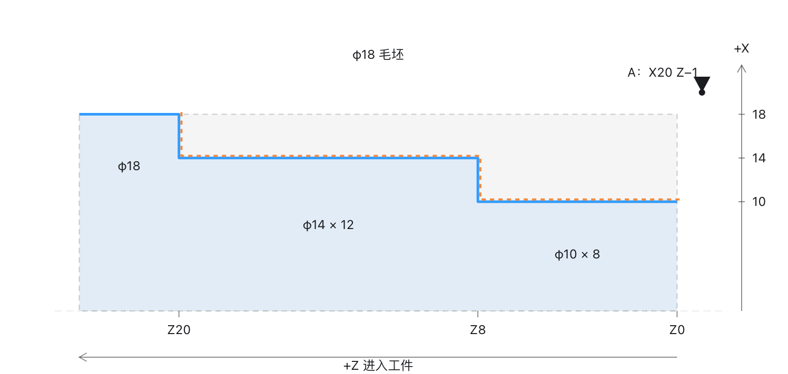

# G71 粗加工循环：格式、走刀与台阶轴实例

适用范围：以津上 S205A/S206A 的主轴侧 X/Z 坐标为学习背景，补充 FANUC 0i-MODEL F 的双行式 G71 规则。津上 3281-LTQ0C-05 手册列出 G71，但所查编程正文未展开其格式。现场手册的封面、文件名和前言存在版本差异，以下不能直接等同于已核实的现场程序。

本文自拟尺寸、切深与进给只用于理解及仿真。默认公制、G18 平面、X 直径编程、G99 每转进给，且未启用刀尖 R 补正；尖角表示名义轮廓。选刀、补正、主轴、材料、夹持、导套、冷却和双通道条件均须另行建立。

## 1. G71 替你完成什么

G71 是车削粗加工复合循环。在 ZX 平面中，它读取一段成品轮廓，结合每层切深和精加工余量，自动安排主要沿 Z 方向的分层粗车。符合条件时可处理直线、台阶、锥面和圆弧轮廓；内径应用还要重新判断余量方向与进退刀条件。

与此前的 G90 对照：G90 写一个目标 X，主要表示完成这一刀循环；多刀的 X 值通常要自己逐个安排。G71 则写轮廓和分层规则，由系统生成多刀。它不会自动识别实际毛坯形状，也不会替代精加工和测量。

## 2. 双行式格式

```gcode
G71 U切深 R退刀量;
G71 P起始段号 Q结束段号 UX向精加工余量 W轴向精加工余量 F粗车进给;
N起始段号 G00或G01 ...;
...成品轮廓...
N结束段号 ...;
```

| 位置与地址 | 含义 | 本例 |
|---|---|---|
| 第一行 U | 每层切深，按半径量 | U0.5：单边切深设定 0.5 mm |
| 第一行 R | 每层切削后的退刀量 | R0.3 |
| 第二行 P | 成品轮廓第一段的 N 号 | P100 对应 N100 |
| 第二行 Q | 成品轮廓最后一段的 N 号 | Q160 对应 N160 |
| 第二行 U | X 方向精加工余量，随 X 的直径/半径编程约定 | 直径编程 U0.2：单边留 0.1 mm |
| 第二行 W | Z 方向带符号的精加工余量 | W−0.1 |
| 第二行 F | 粗车进给，单位取决于进给模式 | G99 下 F0.08 为 0.08 mm/rev |

**两个 U 含义不同，是最容易混淆的地方。**第一行 U0.5 是单边切深；第二行 U0.2 是直径余量。假设某层实际由 X16 切到 X15，直径减小 1 mm，单边切深才是 0.5 mm。第一行切入方向由轮廓首段确定，教学中使用正的切深数值。

R0.3 不是圆弧半径，也不是“退到 X0.3”。在这里 R 表示循环退刀量；同一字母放在 G02/G03 中才有圆弧参数的含义。本格式的切深和退刀量采用手册规定的半径量约定。

部分系统有单行式 G71、不同地址或兼容格式。不能只把两行合并，也不能把其他系统的 D、I、K 等地址加进此格式。

## 3. P/Q 中写成品，不写每层粗车

例如目标为 φ10 外圆，第二行 U0.2 已经负责留量，轮廓应写 X10，而不是先改成 X10.2。否则系统还会再加余量；随后 G70 也会按错误的轮廓加工。

P/Q 是程序段号的引用，不是切削次数、尺寸或停留时间。P100 Q160 表示读取 N100 至 N160，包含首尾两段。中间 N 号不必连续，但应避免重复或指向错误范围。

理解执行顺序：执行带 P/Q 的 G71 → 系统读取这一段形状生成粗车 → 完成循环 → 继续 Q 段之后的程序。不是先按普通程序把成品轮廓切一遍，再开始粗加工。

## 4. Type I 与 Type II

| 项目 | Type I | Type II |
|---|---|---|
| P 指向的第一段 | 指定 X/U，不指定 Z/W | 同时指定 X/U 与 Z/W |
| 主要轮廓限制 | X、Z 均须保持单调变化 | Z 须保持单调，X 可反向形成凹部 |
| 凹部或口袋 | 不适用 | 在功能、刀具及轮廓条件满足时适用 |
| 粗车后退刀 | 45°方向退刀 | 沿轮廓退刀，底部等处还有相应规则 |

Type I 首段示意：

```gcode
N100 G00 X10.0;
```

Type II 若想选中两轴、但不沿 Z 移动，FANUC 本手册给出的办法是零增量：

```gcode
N100 G00 X10.0 W0;
```

不要随手写 Z0 代替 W0。若循环起点在 Z−1，Z0 是实际向端面移动 1 mm；W0 才是不发生 Z 位移。此版本 Type II 需要相应选项，代码表中有 G71 不足以证明现场具备 Type II。

“单调”允许轴在某些段保持不变，但不能沿同一轴走过去又折回来。例如本例轮廓 X10→14→18，Z0→8→20 均不反向，适合 Type I。若 X10→14→12，就出现 X 回折；Type II 可处理某些这种凹部，但仍不能据此允许 Z 往返。圆弧中途的极值也要纳入判断，不能只看端点。

P 首段还应明确写 G00 或 G01。G00 表示该接近段按快速定位，G01 则按切削进给；两者不是可随意互换的装饰字。本例首段在端面之外，才用 G00。Type I 的 45°退刀按切削进给执行，之后再快速返回，不能把整段退刀都画成快速。

## 5. 台阶轴实例：φ18 毛坯加工 φ10 与 φ14



沿用津上原图的观察方向：工件右端面为 Z0，+Z 向左深入工件，X 是直径。此处描述刀尖相对工件的路径。

成品目标为 Z0～8 的 φ10，Z8～20 的 φ14，Z20 后保留 φ18。循环起点 A 为 X20、Z−1：名义上位于端面前 1 mm、毛坯外侧单边 1 mm；这个间隙仅用于教学，不能替代整把刀与周边结构的检查。

```gcode
N10 G18 G99;
N20 G00 X20.0 Z-1.0;
N30 G71 U0.5 R0.3;
N40 G71 P100 Q160 U0.2 W-0.1 F0.08;
N100 G00 X10.0;
N110 G01 Z0.0 F0.05;
N120 Z8.0;
N130 X14.0;
N140 Z20.0;
N160 X18.0;
N170 G00 X20.0 Z-1.0;
N180 G70 P100 Q160;
N190 G00 X20.0 Z-1.0;
```

| 程序段 | 读法 |
|---|---|
| N10 | 选 ZX 平面和每转进给；公制、补正等前提已另行建立 |
| N20 | 到循环起点 A |
| N30 | 设定单边切深 0.5、退刀量 0.3；本行不单独完成粗车 |
| N40 | 读取 N100～N160，以 F0.08 粗车并留余量 |
| N100 | 定义 Type I 轮廓首段：X10、Z−1；不表示粗车第一刀就直接到 X10 |
| N110～N120 | 从端面前到 Z0，再到 φ10 段末端 Z8 |
| N130 | 在 Z8 向外走到 X14，形成第一个名义台肩 |
| N140 | 沿 φ14 外圆走到 Z20 |
| N160 | 在 Z20 向外走到 X18，结束成品轮廓 |
| N170 | 在进入精加工前明确到达本例起点 |
| N180 | 重用相同成品轮廓作 G70 精加工 |
| N190 | 明确后续定位模式和位置 |

粗车圆柱段的名义留量为 φ10.2、φ14.2，精车后才到 φ10、φ14。台肩的粗加工位置约为 Z7.9、Z19.9，分别给 Z8、Z20 留出 0.1 mm 的轴向材料。

末端成品 X18 加上直径余量会得到名义 X18.2，已经在 φ18 毛坯之外，该处没有相应实料可留。不能把余量线画成真实存在的材料边界。转角、末层以及台肩接近段的真实负荷，也不能全按“每刀均匀吃 0.5 mm”估计。

起点 X20 比毛坯 X18 大，系统从循环起点与轮廓安排层次，可能包含空气刀；本例不据此列出所谓精确刀次数，也不保证第一刀一定切到 X17。图和动画用于解释分层、退刀、余量与轮廓关系，不是现场控制器的逐刀仿真。

## 6. 为什么本例 W 是负数

余量符号由坐标方向与材料所在一侧决定，不由“粗车”二字决定。这里向 +Z 加工，台肩若应在 Z8，粗车先到 Z7.9，保留靠近 Z8 的材料，因此 W 写−0.1。

普通卧式车床教材常采用向 −Z 深入工件。将本例的坐标方向整体转换后：起点 Z−1 改为 Z+1，台肩 Z8/Z20 改为 Z−8/Z−20，粗车台肩为 Z−7.9/Z−19.9，W 相应改为+0.1。X 及本例外圆 U 的正号不随这次 Z 方向转换而改变。

这只是同一名义几何的坐标转换说明，不能只改一个 W 就把程序用于另一台机床；首段、全部 Z/W、退刀及实际轴定义都要一并核对。内孔或反向轮廓还需重新判断 U 的符号。

## 7. 粗修轮廓与 G70 精加工

本 FANUC 版本的 G71 在分层后还可沿带余量的目标形状进行一次粗修；相关设置会影响是否执行该动作。它仍属于粗循环，不能把“看到沿轮廓走一遍”理解为余量已经全部去除，也不应为套合教学动画而修改参数。

G70 的作用是重新执行 P/Q 的成品轮廓，不再套用 G71 所给的粗加工余量。两者的进给读取位置不同：本例 G71 用 N40 的 F0.08，忽略轮廓 N110 的 F0.05；G70 则在执行 N110 时使 F0.05 生效，并由后续未重写 F 的 G01 段继承。N100 是 G00，本来就不以 F0.05 控制快速速度。

同理，此版本在粗循环中忽略轮廓内的 F/S/T，精循环会读取轮廓中的这些功能。实际需要换刀时，应把选刀、补正和安全接近单独规划；本教学片段没有实现粗精换刀。

## 8. 常见问题先检查哪里

| 现象 | 优先核查 |
|---|---|
| 切深比想象的大一倍 | 第一行 U 是半径切深，是否误当直径差 |
| 精车前留量不对 | 第二行 U 的直径约定、正负号，以及轮廓是否重复加余量 |
| 台肩长度偏到另一边 | +Z/−Z 方向和 W 的符号是否对应 |
| 首段或轮廓报警 | P/Q 是否存在；首段是否写 G00/G01、是否有 X 移动；Type I/II 地址是否正确 |
| 轮廓非单调 | 逐段检查 X/Z 和圆弧极值，不凭只看图形端点下结论 |
| 改轮廓 F 后粗车不变 | G71 使用粗循环段的 F；轮廓 F 用于后续精加工 |
| 退刀靠近台肩或周边结构 | 核查起点、退刀路径、刀形、刀杆及导套/夹头关系 |
| 带料结果与动画不同 | 教学示意不含实际毛坯、刀尖 R、补正和控制器完整算法 |

若现场报警，记录完整报警号、原文及通道再排查；不靠修改参数、取消保护或盲目复位来“让程序通过”。实际试切前还须按本机流程完成程序和补正检查、运动验证与首件测量。单段模式的停点也不能由图中拐点自行推定。

## 9. 从零件图组织一段 G71

先把图样上的直径、长度和转角对应到坐标点。本例从右端向左依次得到：φ10 段末端为（X10，Z8），第一台肩外端为（X14，Z8），φ14 段末端为（X14，Z20），第二台肩外端为（X18，Z20）。先把这些成品点连成轮廓，再决定分层和余量，会比边猜切深边修改成品坐标更清楚。

随后判断粗车范围。G71 的轮廓不是整张零件图的机械照抄：钻孔、螺纹、窄槽和切断等工序应按各自刀具与工艺另外安排。即使凹部可以用 Type II 表达，也要确认刀具能进入、退出并承受相应方向的切削。循环能够计算刀路，不等于某一把刀能够完成所有形状。

再选择起点和留量。起点应与实际毛坯及周边结构对应；不能因为程序能计算就把起点放在料内。切深和进给需要按材料、刀片、伸出量、夹持与机床条件确定，本例数值仅帮助辨认参数。精加工余量既要能覆盖粗车后的表面与变形，也要让精车刀具承受得住，不能从本例直接推广为固定标准。

最后分别审查粗车和精车结果。粗车后检查各圆柱段是否保留了预定余量、台肩是否位于正确一侧；精车后再按图纸测量直径、有效长度、台肩和根部形状。若尺寸异常，应先分辨是轮廓坐标、余量符号、补正还是切削状态所致，而不是同时改动几个地方。图样没有给公差时，只能报告实测尺寸，不能自行判定产品合格。

## 10. 四问自测

1. 第一行 U0.5、第二行 U0.2，分别对应多大的单边切深与单边余量？
2. 本例 φ10 的 P/Q 成品轮廓应写 X10，还是 X10.2？
3. +Z 深入、成品台肩 Z20、W−0.1 时，名义粗车台肩在哪？
4. 本例粗车与 G70 的切削进给各取哪个 F？

答案：1. 单边切深设定 0.5 mm，单边精加工余量 0.1 mm。2. X10；余量另由 G71 给出。3. Z19.9。4. G71 取 N40 的 F0.08，G70 从 N110 起取 F0.05，单位均按本例 G99 为 mm/rev。

## 来源与核对范围

- 津上 S205A/S206A，3281-LTQ0C-05：程序原点与 X 直径约定，纸面7-6（原 PDF 第274页）；G70/G71 代码表，§7.5，纸面7-25（第293页）。已核对应原图。
- FANUC 原厂编写的 0i-MODEL F 车床操作手册 B-64604EN-1/01：§4.2.1 G71，纸面52～65（原 PDF 第66～79页）；§4.2.4 G70，纸面74～77（第88～91页）。[制造商网站保存的原厂手册](https://www.vmclathe.com/wp-content/uploads/2024/06/Fanuc-controller-%E5%8F%91%E9%82%A3%E7%A7%91%E8%8B%B1%E6%96%87.pdf)。该资料用于补充格式和原理，现场 0iTF Plus 仍须核实对应版本、代码制和选项。
- 工件、程序、余量选择和图示为自拟教学内容；未指定实际材料、刀具及验证结果，不构成完整生产程序。
