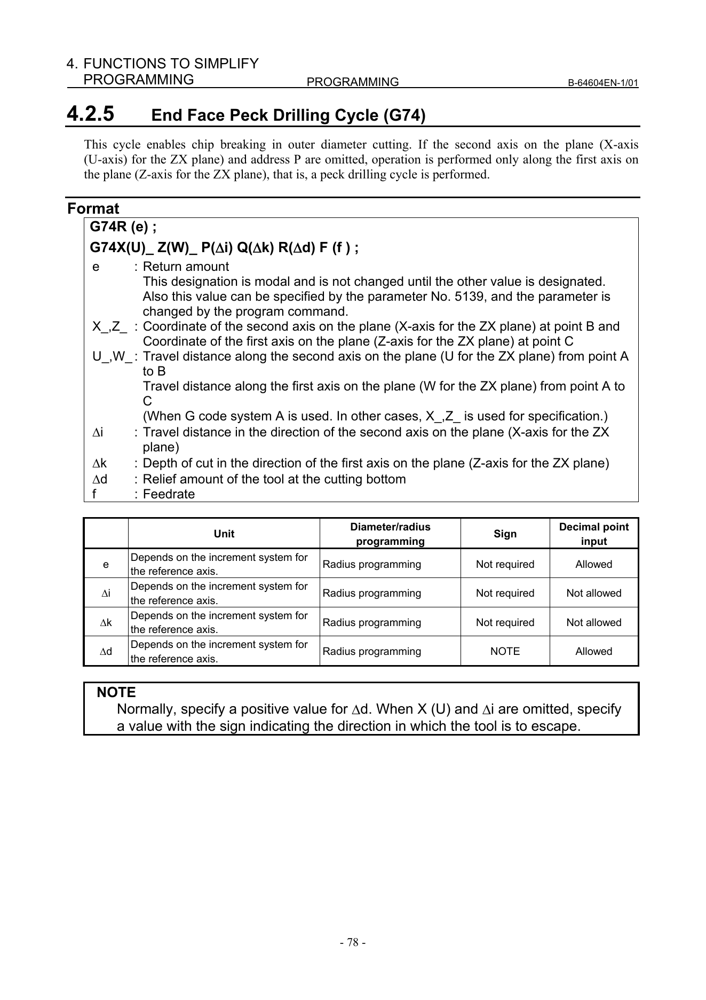
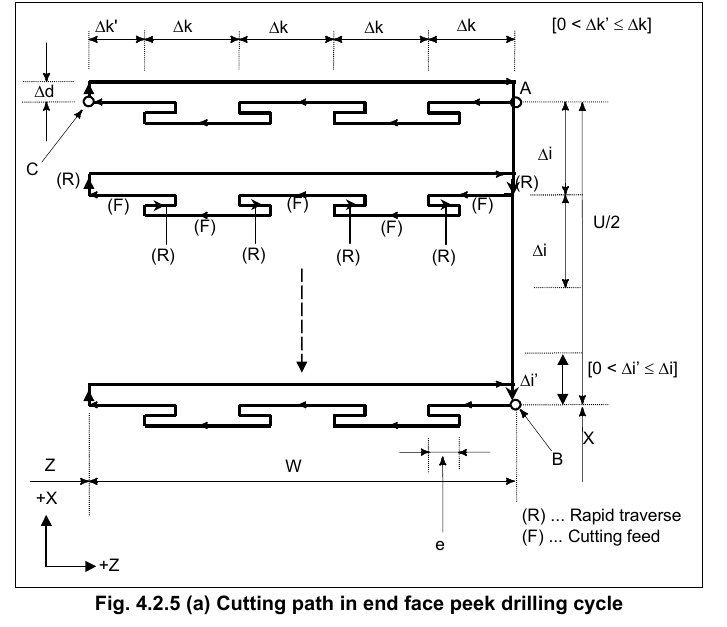
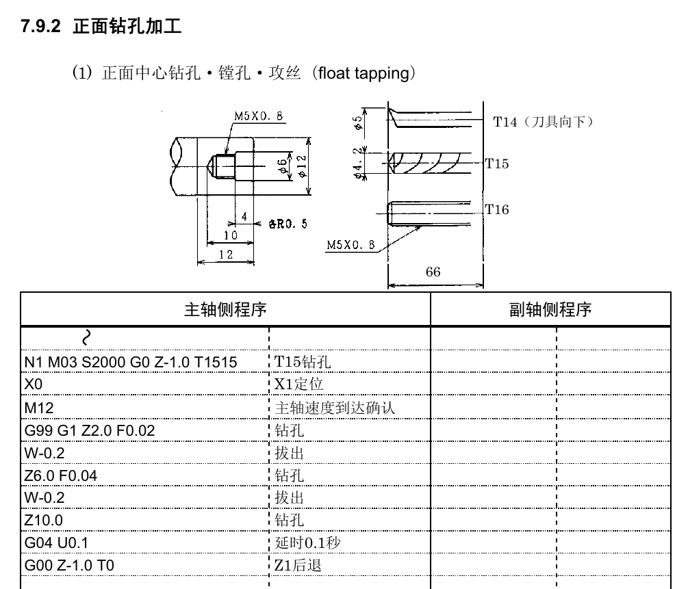
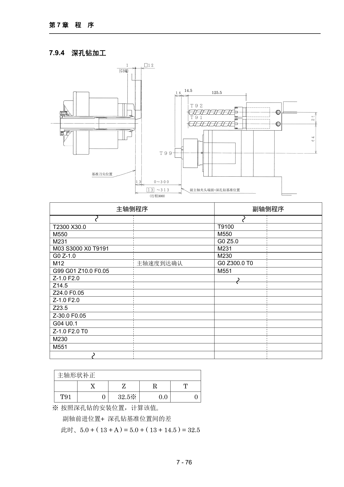
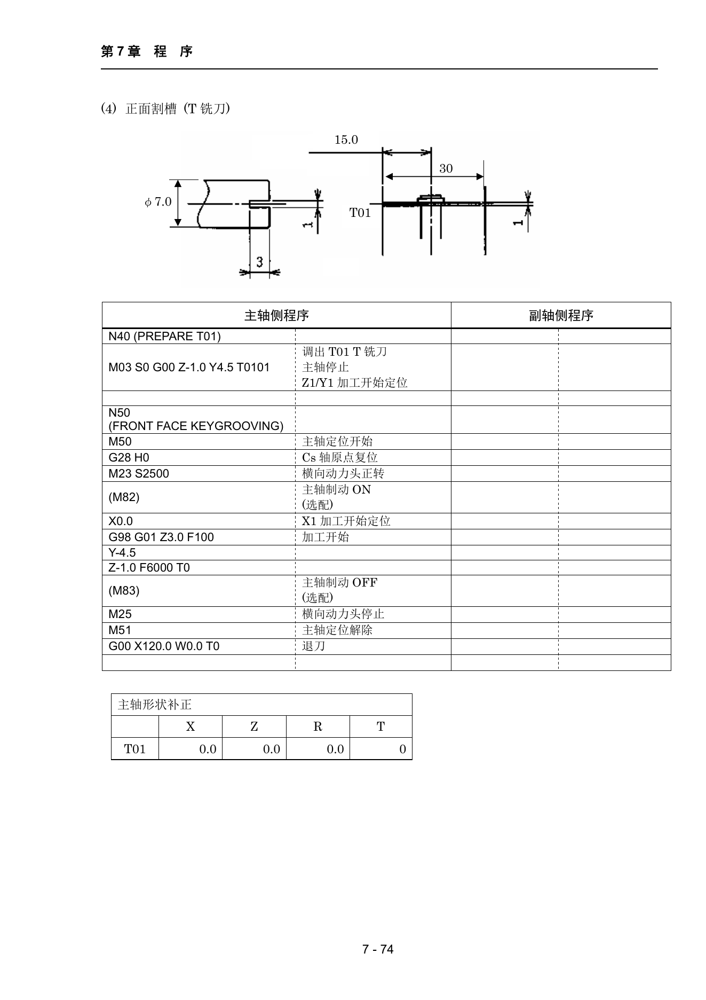
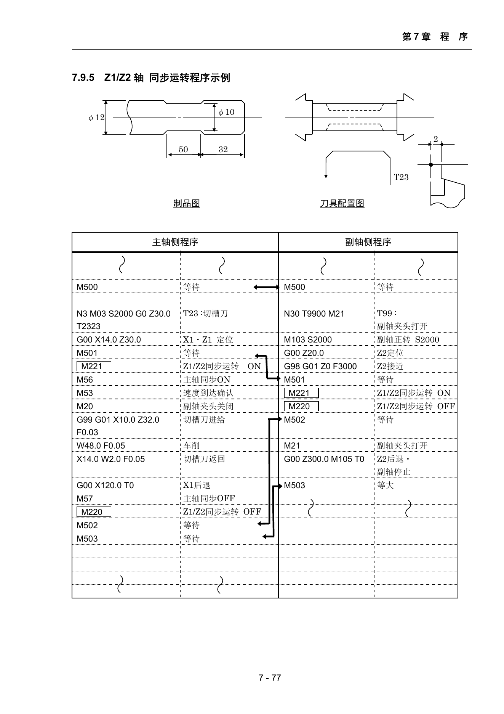

# G74 手册原图与实例对照

核查日期：2026-10-27。配合 [G74端面切槽循环详解](G74端面切槽循环详解.md) 阅读；[原图与讲解合订PDF](../output/pdf/G74_手册原图与实例对照.pdf) 保留原页，便于逐页核查。

## 一、手册里究竟有没有直接讲G74的图文

结论分两份资料说：

1. **津上 S205A/S206A，3281-LTQ0C-05：**§7.5的G代码表明确列G74“端面切断循环”，主、副轴侧均有。本次已核查编程模块相关页与加工实例§7.9-7.10（原PDF332-366页，含原图），未找到调用G74的原程序或G74专属刀路图。
2. **FANUC车床控制器操作手册：**本地B-64604EN-1/01 §4.2.5直接给出G74双行格式、参数表、刀路原图和文字说明。这是讲解循环动作的直接来源。
3. **津上手册有很有价值的相关原例：**§7.9.2(1)用普通G1、W-0.2手写分段断屑钻孔；可以对照理解G74单列啄钻，但不能称它为G74原例。

| 原页内容 | 精确来源 | 在本资料中的作用 |
|---|---|---|
| G74名称 | 津上 §7.5，纸面7-25（原PDF293） | 确认本机手册列有此代码 |
| G74格式及刀路 | FANUC §4.2.5，纸面78-79（原PDF92-93） | 直接解释P/Q、两个R、A/B/C和循环运动 |
| 正面钻孔 | 津上 §7.9.2(1)，纸面7-67（原PDF335） | 用实际手写进退段理解断屑与模态 |
| 深孔钻加工 | 津上 §7.9.4，纸面7-76（原PDF344） | 理解全退出、双通道与安装基准的额外条件 |
| 正面割槽（T铣刀） | 津上 §7.9.3(4)，纸面7-74（原PDF342） | 区分端面铣槽与回转工件端面环槽 |
| Z1/Z2同步例 | 津上 §7.9.5，纸面7-77（原PDF345） | 区分同步车削与G74 |

此处“原PDF页”采用各原文件的页序；津上模块节选页序另由source.json映射，不用节选页号冒充原始页号。

## 二、直接来源：FANUC的G74原格式和刀路图



来源：FANUC B-64604EN-1/01，§4.2.5，纸面78（原PDF92）。

```text
G74 R(e);
G74 X(U)_ Z(W)_ P(Δi) Q(Δk) R(Δd) F(f);
```



来源：同手册图4.2.5(a)，纸面79（原PDF93）；上图从完整原页裁取，坐标、箭头与标签保持原样。[完整原页](手册原图/fanuc-093.png)。

| 原图标注 | 中文解释 | 读图时注意 |
|---|---|---|
| A | 循环起点，(X始，Z始) | 不自动等于毛坯表面 |
| C | 第一列切到目标Z的位置 | (X始，Z终) |
| B | 最后X与起始Z平面的交点 | (X终，Z始)；图中路径末端到B |
| e | 第一行R：Z向小回退 | 图中回退标为快速运动；之后直接工进到下一最深点 |
| Δk | Q：Z向每啄名义新增深入量 | 标在相邻最深点之间，不从回退点重新计新增深度 |
| Δi | P：X向实际径向换列距离 | X直径编程时，相邻X读数通常相差2Δi |
| Δd | 第二行R：槽底X向让刀 | 与Z断屑回退方向不同；R0时该附加动作归零 |
| Δk′、Δi′ | 最后一啄/末次换列的剩余量 | 原图写明0<剩余量≤名义增量 |
| U/2 | X直径差对应的物理径向总跨度 | 不把U直接当半径量 |
| W | 从起点到切削终点的轴向跨度 | 可能包括端面外的起始间隙 |
| (R)、(F) | 快速移动、切削进给 | 图中的(R)不是程序R地址 |

原图可读成：**沿Z工进一个Δk → 沿Z退e → 工进至下一最深点 → 到底按Δd沿X让刀 → 沿Z退出 → 沿X换列**。最后一列退出后，原图路径末端落到B，未画B返回A。

方向必须看清：这张FANUC原图+Z向右，因此向左切入为-Z；主笔记的津上教学例按本机坐标图采用+Z向左入料。两者切入方向的正负号不能照抄。图画的是刀具相对工件，不直接等同走心机部件的实际移动方向。

原表还明确：P/Q不许输入小数点，其整数单位依参考轴增量系统；两个R允许小数。X/U及P省略时，只沿Z执行啄钻。公制IS-B下P1000/Q1000的1 mm解释是主笔记的明确假设，不是所有设备的固定换算。

## 三、最适合对照的津上原例：正面分段断屑钻孔



来源：津上 §7.9.2(1)，纸面7-67（原PDF335）；裁取标题、工件/刀具图及N1钻孔段，[完整原页](手册原图/tsugami-335.png) 还含后续镗孔与攻丝，它们不属于下面的G74对照。

原页中T15为φ4.2钻头，另列T14镗孔刀、T16丝锥及M5×0.8孔形。这里仅解读T15钻孔段。该页未给材料条件；S2000与进给值保留为原例数值，不作为通用切削推荐。

原程序保持原行与G0/G1拼写：

```gcode
N1 M03 S2000 G0 Z-1.0 T1515
X0
M12
G99 G1 Z2.0 F0.02
W-0.2
Z6.0 F0.04
W-0.2
Z10.0
G04 U0.1
G00 Z-1.0 T0
```

| 原行 | 当前模态与动作 | 与G74学习的关系 |
|---|---|---|
| `N1 M03 S2000 G0 Z-1.0 T1515` | 原页标T15钻孔，建立转速、刀具及轴向起点 | 循环起点的概念；不据此推断其他刀具的接近路径 |
| `X0` | 继承G0，对中 | 省略G74的X/P不会自动对中，需先建立X位置 |
| `M12` | 原页注“主轴速度到达确认” | 原例的状态前提，不属于G74参数 |
| `G99 G1 Z2.0 F0.02` | 每转进给，以F0.02切至Z2 | 首次从Z-1走到Z2，轴向行程3 mm |
| `W-0.2` | 继承G1/F0.02，退至Z1.8 | 断屑小回退概念；原例此处是工进退刀 |
| `Z6.0 F0.04` | 继承G1，进给改为0.04，切至Z6 | 新最深点比Z2深4 mm；实际工进4.2 mm |
| `W-0.2` | 继承G1/F0.04，退至Z5.8 | 第二次小回退 |
| `Z10.0` | 继承G1/F0.04，切至Z10 | 新最深点再增加4 mm |
| `G04 U0.1` | 原页注延时0.1秒 | 不把这里的U当位移；也不把G74的Q当延时 |
| `G00 Z-1.0 T0` | 快速轴向后退，保留原例T0 | 原例退出段 |

### 能对应到G74的部分

W-0.2能帮助理解首行R的“Z小回退距离”；Z2、Z6、Z10能帮助理解“相邻最深点”和每段新增切深。X0能帮助理解G74单孔形式省X/P前，必须先完成对中。

### 不能直接压成一条G74的部分

- 从Z-1起算，原例的新增深入量为3、4、4 mm，不是固定Q。
- F由0.02变为0.04，不是整个循环一个固定F。
- 原例有孔底`G04 U0.1`；所引G74格式未给这种孔底延时地址。
- 原例`W-0.2`继承G1、按当前F工进退回；FANUC G74原图的小回退标为快速运动。距离与目的相近，不代表运动方式完全相同。

因此，可以用这个原例理解G74封装了哪些重复动作，但不能把它直接改成一条固定Q/F的G74，再称“原程序等价”。本次没有把厂家原例改写成新的可运行G74程序。

## 四、其他相关图文怎样配合读

### 深孔钻加工：看装置、基准与完整退刀



来源：§7.9.4，纸面7-76（原PDF344）。此页是双通道、T91/T92深孔装置和安装补正的实例，主轴侧用G99 G01及逐行Z进退，没有G74或G83。原例中`Z-1.0 F2.0`仍继承G01，不应讲成G00快退。

该例能说明深孔加工除“分次深入”外，还依赖刀具安装位置、主副侧配合和退刀条件。它不是G74完整生产用法的替代来源。

原页可见待核点：`Z23.5`之后确实写`Z-30.0 F0.05`。这里原样保留负号，不默改成Z30.0，也不将其解释成已确认的正常深入段。页内T91的Z32.5补正依赖该例尺寸，不能当作通用值。若实际使用这份原例，应先核对控制器/厂家资料及现场安装条件。

### 正面割槽（T铣刀）：看工艺名称与循环区别



来源：§7.9.3(4)，纸面7-74（原PDF342）。原例含主轴定位、横向动力头和`G98 G01 Z3.0 F100`、`Y-4.5`。这是T铣刀在端面铣槽，不是G74在回转工件上分列加工端面环槽；“正面割槽”的标题不能用来证明它是G74实例。

### 同步切槽刀实例：看通道与同步条件



来源：§7.9.5，纸面7-77（原PDF345）。原例用T23切槽刀配合Z1/Z2同步，出现`G99 G01 X10.0 Z32.0 F0.03`与后续`W48.0 F0.05`，并非G74。该页用于说明“用了切槽刀”与“用了切槽循环”是两件需要分别核对的事，不在此脱离原图重排双通道或M功能。

## 五、与主笔记的整合方式

1. 先读本页第二部分的G74原图，弄清P、Q、两个R和A/B/C。
2. 读津上335页的N1原例，算出Z2→1.8→6→5.8→10，理解断屑和模态继承。
3. 回到主笔记固定X的自拟G74单列例，比较固定Q的最深位置序列。
4. 再读主笔记φ10-φ16端面环槽例，加入刀宽、参考角与X径向换列计算。
5. 用344/342/345页辨析深孔装置、端面铣槽及双轴同步条件。

主笔记的φ10-φ16、刀宽1.5 mm、X16→14→13、Z-1→Z4、P1000/Q1000均为自拟教学条件。原厂图文、原例数值与这些推导始终分别标明。

## 来源

- 津上TSUGAMI S205A/S206A，3281-LTQ0C-05，23.04；页序来自技能模块source.json。封面/前言的控制器版本与文件名机号存在差异，实际应用前核实适用机型、控制器及选配。
- FANUC B-64604EN-1/01，0i-MODEL F车床操作手册，§4.2.5，纸面78-79（原PDF92-93）。[本地原文件](../G75学习资料/参考资料/FANUC_0i-F_车床操作手册_B-64604EN-1.pdf)。它提供本次直接原图，不冒称为津上手册内的图或F Plus确切版本。
- 本次保留了原页与程序文本，解释和计算另列；没有给出可直接投产的程序或新增材料切削参数。
