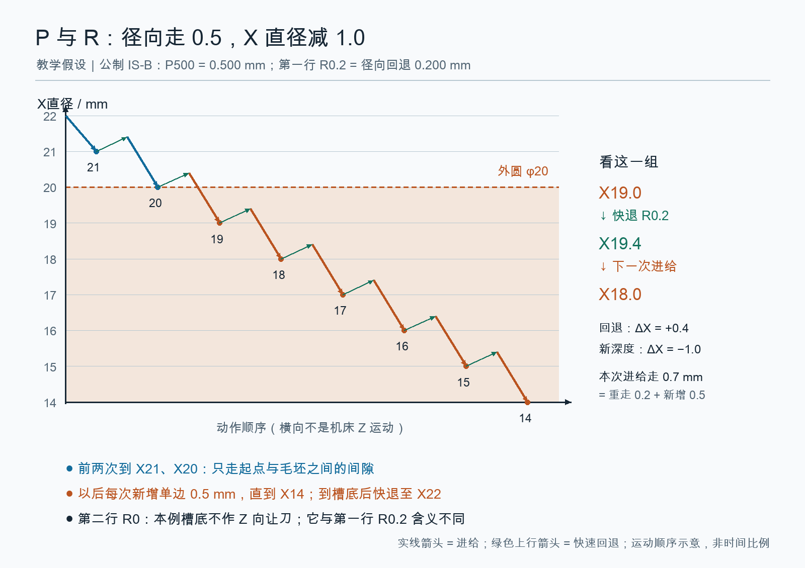
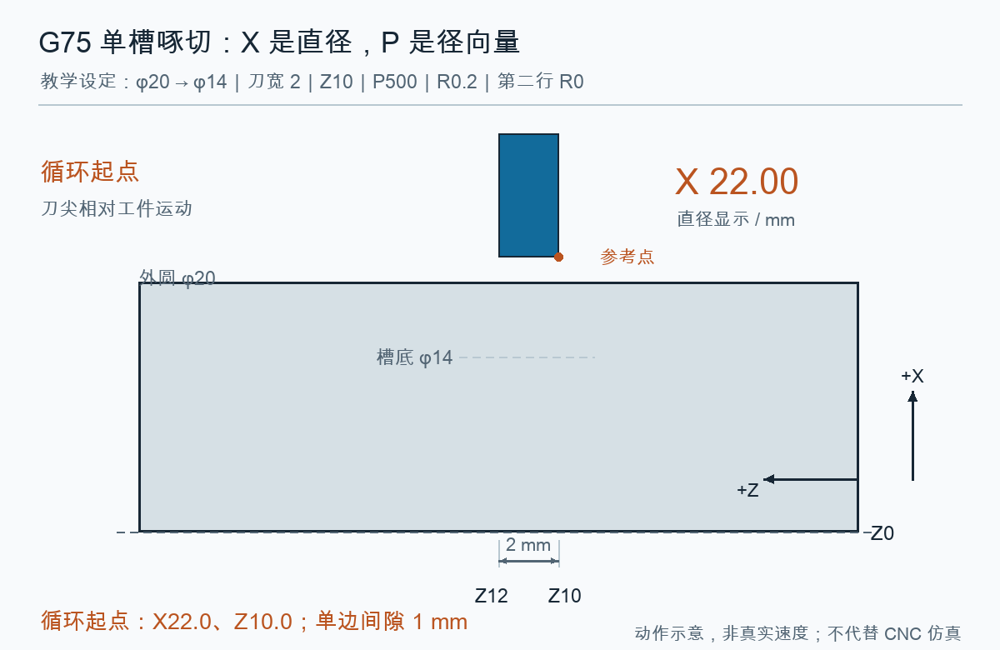
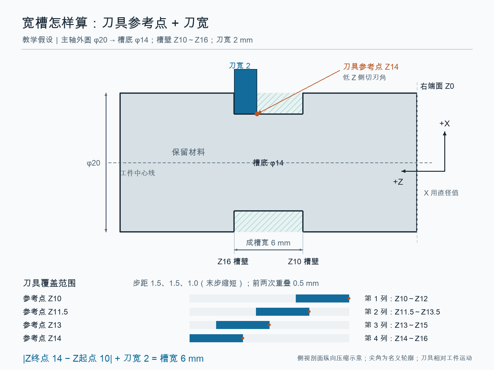

# G75 切槽循环：格式、刀宽计算与啄切运动

学习背景：津上 TSUGAMI S205A/S206A，主轴侧 X/Z 相对运动。采用 FANUC 车床常见双行式 G75；本资料把津上手册确认的内容、FANUC 控制器规则和自拟教学计算分开标注。

以下统一假设：公制，ZX 平面，X 直径编程，参考轴增量系统 IS-B，P/Q 的一个整数单位为 0.001 mm，G99 每转进给，未使用 G41/G42 刀尖圆弧半径补偿。工件右端面为 Z0，+Z 向左进入工件，+X 向外。图示是刀具相对工件的轨迹；走心机上的真实 Z 运动不能简单理解为刀架纵向移动。

封面为 FANUC 0iTF Plus，而所附手册前言仍提 0i-TD，存在版本差异。本资料用于理解与仿真；真实机床的代码制、增量系统、刀具基准与功能须按对应版本核对。

## 1. 先抓住 G75 的两个动作

G75 把径向切槽拆成若干次进刀与小退刀，便于断屑；需要加工宽槽时，在一列切到目标直径并径向退出后，再沿 Z 移到下一列，重复啄切。

可以这样记：**P 管径向一啄多深，Q 管沿 Z 下一列隔多远，X 管槽底直径，Z 管最后一列刀具参考点。**

| 场景 | 使用方式 | 要点 |
|---|---|---|
| 槽宽等于刀宽 | 固定 Z，只沿 X 啄进 | 第二行省略 Z/W 和 Q |
| 槽宽大于刀宽 | 沿 X 啄切，再沿 Z 分列 | Q 与刀宽配合，避免留下未切除的肋 |
| 多条分离的等距槽 | Z 方向列距大于刀宽 | 间隔部分保留材料；不能把它误当连续宽槽 |
| 内径槽 | 径向切入方向与外径相反 | 重新核对内孔空间、刀具与退刀方向 |
| 切断 | 属于手册所列用途之一 | 完整切断还涉及中心区、接料与夹持，本例仅讲未切断的外径槽 |

G74 在本教学平面中主要沿 Z 啄进，G75 主要沿 X 啄进。这里讨论车床双行式格式；不同控制器和兼容模式可能采用其他格式。

## 2. 双行式格式

```text
G75 R(e);
G75 X(U)_ Z(W)_ P(Δi) Q(Δk) R(Δd) F(f);
```

括号内的 e、Δi、Δk、Δd、f 是解释用符号，实际程序中应填数值。X/U、Z/W 各选一种表达，不能把括号直接照录成轴指令。

| 地址位置 | 控制什么 | 按本文假设怎样读 |
|---|---|---|
| 第一行 R(e) | 每次径向啄切后的小回退量 | R0.2 = 径向回退 0.2 mm；X 直径读数回升 0.4 mm |
| 第二行 X | 径向切入终点 | X14.0 = 槽底名义直径 φ14 |
| 第二行 U | 从循环起点到 X 终点的增量 | 起点 X22 时，U-8.0 与 X14.0 对应；是直径差 |
| 第二行 Z | 最后一列刀具参考点的轴向坐标 | Z14.0 = 参考点最后到 Z14，不自动等于槽壁 |
| 第二行 W | 从起点 Z 到终点 Z 的增量 | 起点 Z10 时，W4.0 与 Z14.0 对应 |
| P(Δi) | 径向每啄的名义切入增量 | P500 = 0.5 mm 径向；连续最深 X 值相差 1.0 mm |
| Q(Δk) | 相邻列刀具参考点的 Z 移位量 | Q1500 = 1.5 mm 轴向列距，不是槽宽 |
| 第二行 R(Δd) | 到槽底后的让刀量 | 本例 R0，取消这一附加槽底让刀动作 |
| F | 切削进给 | G99 下 F0.04 = 0.04 mm/rev，数值仅作教学 |

**P/Q 是长度数值，不是 G71 中引用轮廓的 N 段号，也不是切削次数或停留时间。**

### P/Q 的单位和小数点

FANUC 这里的 P/Q 不允许输入小数点，其整数与参考轴增量系统有关。在本文公制 IS-B 的假设下：

```text
P500  → 500 × 0.001 = 0.5 mm（径向）
Q1500 → 1500 × 0.001 = 1.5 mm（轴向）
```

不能把 `P0.5 Q1.5` 当作本格式的通用写法，也不能在未核增量系统时认定任何机床上的 P500 都是 0.5 mm。P/Q 填正的量值，切入及排刀方向由起点与终点关系决定。

### 两个 R 分工不同

- 第一行 R 是径向断屑回退，发生在啄切过程中；本例外径加工时向 +X 回退。
- 第二行 R 是槽底的轴向让刀，不是槽底圆角 R、精加工余量或另一项径向回退。
- 宽槽分列时，原厂要求第二行 R 通常为正值，由循环的走向确定让刀方向。原图沿 −Z 排刀时，让刀朝 +Z；不能因此把正 R 永久解释为 +Z。
- 省略 Z/W 与 Q 的单槽写法，如果需要非零槽底让刀，应按原厂要求用符号指定逃刀方向。本例明确 R0，避免附加侧向切入槽壁。

第一行回退量 e 有保持性；FANUC 还说明该指令会改变相应回退量的参数存储值。因此每段教学例都显式给出 R0.2，现场须按对应控制器管理这一状态，不靠猜测上一程序遗留值，也不需要为本教程手工修改参数。

控制器依据：FANUC B-64694EN-1/01，§4.2.6，纸面66–67；同格式的 B-64604EN-1/01，§4.2.6，纸面80–81（该 PDF 第94–95页）。[F Plus 原厂手册镜像](https://manualmachine.com/fanuc/0ifplus/24332568-operators-manual/)，[F 型原厂手册镜像](https://www.vmclathe.com/wp-content/uploads/2024/06/Fanuc-controller-%E5%8F%91%E9%82%A3%E7%A7%91%E8%8B%B1%E6%96%87.pdf)。

## 3. 图例一：2 mm 刀加工一个 2 mm 槽

自拟尺寸：φ20 外圆，槽位 Z10～12，槽宽2，槽底φ14。矩形刀宽2，刀具参考点设在靠右端面一侧的刃角，即低 Z 边；刀占据 [Z参考点，Z参考点+2]。暂忽略刀尖圆角，按名义尖角几何教学。

### 核心片段

```gcode
N10 G99;
N20 G00 X22.0;
N30 G00 Z10.0;
N40 G75 R0.2;
N50 G75 X14.0 P500 R0 F0.04;
N60 G00 X22.0;
```

这几行的前提是：当前刀具与补正已核对，工件与夹持已建立，主轴已按正确方向和经过审核的转速旋转，冷却状态适当，且 N20/N30 的接近路径已确认无干涉。没有加入未经确认的 T、S、M、夹持和双通道同步指令，不能独立上机运行。

| 行 | 当前状态与动作 | 解释依赖 |
|---|---|---|
| N10 | 明确 G99 每转进给 | 主轴处于正确旋转状态；津上 §7.5.9 |
| N20 | 沿 X 定位至直径坐标22 | 路径与整把刀具间隙已经核实 |
| N30 | 定位低 Z 参考角到 Z10 | 刀宽2，所以刀具名义覆盖 Z10～12 |
| N40 | 建立径向断屑回退量0.2 | 只有设定行，还没有给加工终点 |
| N50 | 在固定 Z10 处径向啄切至 X14 | 不写 Z/W 和 Q；P500 按本例等于径向0.5 |
| N60 | 明确后续 G00 与 X22 退出位置 | 不把下一行裸 X 数值当作某种自动重复循环 |

### 从直径读数换成真实径向距离

```text
材料中的槽深 = (毛坯直径 − 槽底直径) / 2
             = (20 − 14) / 2 = 3 mm

循环起点至槽底的径向行程 = (22 − 14) / 2 = 4 mm
起点与材料的径向间隙     = (22 − 20) / 2 = 1 mm
```

P 从循环起点开始划分啄切，不会自动把毛坯表面识别成起算点。因此在本例精确尺寸假设下，起点的1 mm空隙也占两个0.5 mm啄切增量。前两次最深位置 X21、X20 没有切入新的材料，后六次才增加材料切深。

| 第几啄 | 最深 X/mm | 若非最终啄，回退后 X/mm | 这一啄增加的材料径向切深/mm |
|---:|---:|---:|---:|
| 1 | 21.0 | 21.4 | 0 |
| 2 | 20.0 | 20.4 | 0，刚到名义外表面 |
| 3 | 19.0 | 19.4 | 0.5 |
| 4 | 18.0 | 18.4 | 0.5 |
| 5 | 17.0 | 17.4 | 0.5 |
| 6 | 16.0 | 16.4 | 0.5 |
| 7 | 15.0 | 15.4 | 0.5 |
| 8 | 14.0 | 到底后径向退出 | 0.5 |



例如第三啄到 X19.0 后，径向回退0.2，直径坐标变成 X19.4。下一啄工进到 X18.0，实际工进径向距离是 (19.4−18.0)/2 = 0.7 mm：其中0.2 mm重走已加工范围，新增切入0.5 mm。

**不能把回退量 e 从 P 中扣除后，当成每啄的新切深。**原厂刀路的相邻最深位置按 P 递增；也没有在这一步额外画出“快速接近上一槽底”的动作。



动图为刀具相对工件的局部剖面示意；时间、加减速及断屑效果未按真实机床模拟。可在对话中的运动演示里逐步查看或回看各段。

如果起点到终点径向4 mm，改成P600即0.6 mm，名义累计深度会是0.6、1.2、1.8、2.4、3.0、3.6、4.0 mm；最后只走剩余0.4 mm，并不越过 X14。这是对本例尺寸与末刀余量的计算，不是材料切削参数建议。

## 4. 图例二：2 mm 窄刀分列加工 6 mm 宽槽

自拟目标仍为φ20外圆、槽底φ14，但槽范围扩为 Z10～16，宽6。刀宽2，仍以低 Z 边刃角为参考点。



要让远侧槽壁在 Z16，最后一列刀具参考点应为：

```text
最后参考点 = 远侧槽壁 − 刀宽 = 16 − 2 = Z14
参考点总移位 = 14 − 10 = 4 mm
名义槽宽 = |最后参考点 − 最初参考点| + 刀宽
         = |14 − 10| + 2 = 6 mm
```

这个加刀宽的式子以本文刀具参考角、前进方向与矩形刀刃为前提。如果改用刀具中心或另一刃角对刀，两个 Z 值都要重新推导。

```gcode
N10 G99;
N20 G00 X22.0;
N30 G00 Z10.0;
N40 G75 R0.2;
N50 G75 X14.0 Z14.0 P500 Q1500 R0 F0.04;
N60 G00 X22.0;
N70 G00 Z10.0;
```

前置状态与例一相同，F0.04只是教学占位值。本例 N60/N70 明确保证后续回到指定 X/Z，不能由这两行倒推 G75 在所有控制器版本上都会自动回最初 Z。

### 分列与覆盖计算

| 列次 | 刀具低 Z 参考角/mm | 2 mm 刀的名义覆盖/mm | 从上一列移动/mm |
|---:|---:|---|---:|
| 1 | 10.0 | 10.0～12.0 | 起始列 |
| 2 | 11.5 | 11.5～13.5 | 1.5 |
| 3 | 13.0 | 13.0～15.0 | 1.5 |
| 4 | 14.0 | 14.0～16.0 | 1.0，剩余量 |

前三次参考位置为10、11.5、13，若再完整前进1.5会到14.5，超过终点14，因此末次按剩余1.0到Z14。共4列，不是“槽宽6÷列距1.5=4，所以从Z10再走4步”；第1列本身占一个刀位。

一般按本例规则计算：

```text
列数 = ceil(|Z终 − Z始| / q) + 1
     = ceil(4 / 1.5) + 1 = 4
```

这里 ceil 表示向上取整；末列被终点限制。末次列距可小于 Q，其余量关系与原厂刀路图相符。

每一列先在当前 Z 处啄切到 X14，再径向退出到起始 X 水平，随后在材料外侧沿 Z 换列。**不应把它理解为刀具一直停在 X14 的槽底，侧向拖行完整6 mm。**第二行R0使本例没有附加槽底轴向让刀。

相邻前几列重叠2−1.5=0.5 mm，末列重叠1 mm。对于名义矩形刀，Q≤刀宽能保证几何覆盖不留肋；它不是刀具允许侧向受力、排屑顺畅或槽底平整的工艺保证。刀片圆角、刃形、挠曲、切削负荷和精加工路线仍会改变最终表面与尺寸。

如果误把第二行写成 Z16，本例刀具参考角将走到16，最后一刀覆盖到18，成槽名义总宽变成8 mm。

### 程序增量写法对照

当起点严格为 X22、Z10，第二行可以按代码制 A 的增量关系理解为：

```gcode
G75 U-8.0 W4.0 P500 Q1500 R0 F0.04;
```

U−8是直径变化，不能写成径向槽深−3，也不能写成起点至槽底的径向距离−4。W4是参考点移位，不是成槽总宽6。

## 5. 顺带理解：同一个 Q 也能留下分离槽

若仍为2 mm刀，把参考点设为 Z10→Z22，列距 Q6000，即6 mm：参考位置为10、16、22；覆盖分别为10～12、16～18、22～24。它们是三条2 mm槽，中间各留4 mm材料。

```gcode
G75 R0.2;
G75 X14.0 Z22.0 P500 Q6000 R0 F0.04;
```

这仅为几何比较，前提仍为已建立 X22、Z10 起点及相同模态。不应把“给了首尾 Z”理解为系统自动连续清空两者之间所有材料。

## 6. 如何根据加工目标选 P、Q、R 和 F

这些尺寸是教学假设，不针对实际材料给出推荐值。

| 项目 | 决策依据 | 过大或误用的后果 |
|---|---|---|
| P 径向每啄量 | 材料、刀宽、槽深、刀片断屑槽、冷却、系统刚性 | 不能仅凭循环存在就保证断屑；过大可能长屑、卡屑或负荷高 |
| 第一行 R | 已加工范围内的退让与断屑需求 | R过大增加往返空行程；过小未必达到所需断屑效果 |
| Q 轴向列距 | 刀宽与连续槽/分离槽目标 | 连续槽列距大于有效刀宽可能留肋；过小增加重复切削 |
| 第二行 R | 底部让刀方向、槽壁空间和刀具可承受侧向负荷 | 不是默认越大越好，错误方向可能切伤槽壁 |
| F | 当前G98/G99、材料和刀片数据 | 同一数字换进给模式后含义不同 |
| 转速 | 材料、切削直径、刀片数据、夹持和装置限值 | 本文没有给通用转速或实际生产参数 |

仅作单位计算：若经过独立审核的转速是1000 min⁻¹，G99 F0.04对应名义径向进给速度40 mm/min。P0.5 mm对应的新深入部分用时0.5/40×60=0.75秒，但回退后还会重走0.2 mm，此外有空行程、加减速、换列等，因此不能据此直接得到整循环时间。1000 min⁻¹并非本教程的材料推荐值。

G75参数里没有本例意义上的“自动留精加工余量”地址。若自拟粗切目标为槽底φ14.2，需另行安排到φ14的精加工与两侧壁控制；X14.2相对φ14只留下径向0.1 mm。不要把第二行 R 当余量，也不要用 G70 P/Q 去引用这里的 P500/Q1500。

## 7. 读程序时最容易错的地方

1. **X是直径，P是径向量。**P500的0.5 mm径向量对应最深X直径值变化1 mm。
2. **第一行R也是径向量。**R0.2对应X读数改变0.4，不是0.2。
3. **起点间隙也在啄切行程内。**系统不会自行知道实际毛坯φ20。
4. **Q是参考点列距。**刀宽决定实际切除范围；最终Z一般不能直接照抄远侧槽壁。
5. **P/Q不带小数点的规则有版本前提。**本例以所引FANUC双行式资料为准，整数单位须核对增量系统。
6. **两个R既不是同一动作，也不是圆角。**第二行R0只令槽底附加让刀为零，第一行R0.2仍有效。
7. **本循环不能套用刀尖R补偿。**所引FANUC §4.2.6明确不可应用刀尖圆弧半径补偿；刀具几何/磨耗补正与G41/G42是不同事项。
8. **G75属于非模态循环指令组00。**不要模仿G90，在下一行只写X数值就期待自动再做一次G75；重做循环要明确指令并核对起点。G80是本机表中的开孔固定循环取消，不是本例必须追加的G75取消行。
9. **本机示例入工件是+Z。**通用车床教程常画−Z入工件，不能不看本机坐标图就照搬符号。
10. **步进演示是教学控制。**它不表示机床SINGLE BLOCK一定会停在每一次啄切或回退处。

## 8. 从纸面练习到真实首件，需要补齐什么

这里只列直接影响本例解释和切削结果的条件：

- 控制器确切型号/版本、代码制、ZX平面、公英制、X直径方式及P/Q增量系统。
- 主轴侧还是副轴侧；实际X/Z正向、工件坐标和循环接近点；双通道及邻近刀具状态。
- 材料与实际毛坯直径；图纸槽宽、位置、底径、公差及根部圆角。
- 槽刀有效宽度、刀尖圆角、参考角、几何/磨耗补正、可用切深与侧向负荷能力。
- 导套/夹头、伸出长度、支承和冷却；审核后的转速、进给与啄切条件。
- 实控下的循环结束位置、后续返回路径，以及单段与进给保持的具体行为。

先完成纸面刀路和图形验证，再按本机流程检查真实运动与干涉，之后以审核过的条件试切。首件核对槽位、槽宽、槽底直径、侧壁/根部与切屑；图纸未给公差时不能自行宣布合格。学习资料中的动画只反映名义几何与运动顺序，不代替控制器仿真或首件检验。

## 9. 依据与证据边界

### 津上手册明示

3281-LTQ0C-05，S205A/S206A：

- §7.3，纸面7-6（原PDF第274页）：程序原点，X直径指示及Z方向图。
- §7.3，纸面7-8（原PDF第276页）：X/U与Z/W绝对、增量关系。
- §7.5，纸面7-26（原PDF第294页）：主轴侧与副轴侧均列G75“外径、内径切断循环”。
- §7.5.9，纸面7-45（原PDF第313页）：G99 mm/rev与G98 mm/min。

本技能所附手册页未查到G75完整地址格式或G75原例。手册§7.9.5纸面7-77（原PDF第345页）的T23切槽刀实例是双轴同步加工，§7.9.6纸面7-78（原PDF第346页）切断实例使用G01；均不能改称G75原例。

### FANUC 控制器规则

- B-64694EN-1/01，0i-MODEL F Plus车床操作手册，§4.2.6，纸面66–67：[原厂正文的第三方镜像](https://manualmachine.com/fanuc/0ifplus/24332568-operators-manual/)。此网站不是FANUC官方网站，依据是其中的FANUC原始手册正文。
- B-64604EN-1/01，0i-MODEL F车床操作手册，§4.2.6，纸面80–81（该PDF第94–95页）：[机床制造商网站保存的原厂PDF](https://www.vmclathe.com/wp-content/uploads/2024/06/Fanuc-controller-%E5%8F%91%E9%82%A3%E7%A7%91%E8%8B%B1%E6%96%87.pdf)。此次查看了格式表和刀路原图，二者与F Plus的所查格式一致。

附：[本地核对用FANUC原厂手册](参考资料/FANUC_0i-F_车床操作手册_B-64604EN-1.pdf)。G75位于该文件第94～95页；它是F型资料，用于对照格式与刀路，不替代现场F Plus的确切版本资料。

原厂图文确认啄切、回退、槽底让刀和轴向分列，但所查段落没有明确表述整个循环结束是否把Z自动带回最初起点。本文不把“必回原Z”或“必停末列Z”写成已确认行为。宽槽动画仅演示到末列径向退出，完整教学片段以显式G00 X22、G00 Z10规定后续目标；现场应核对实控最终位置与完整返回路径。

φ20/φ14、2 mm刀宽、Z10～16、P500、Q1500、R0.2与F0.04均为自拟教学条件；槽宽、径向/直径换算、覆盖与次数为在这些条件下的计算。
