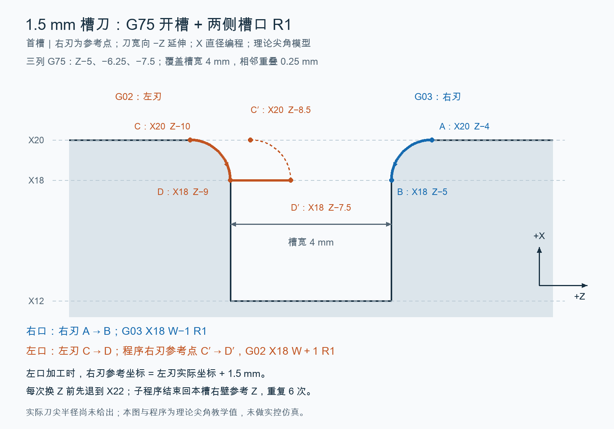

# 1.5 mm 槽刀：G75 + 两侧槽口 R1 + M98 六次

本稿按用户图纸和已确认的 **1.5 mm 刀宽**重写。它是理论尖角教学程序，未取得实际刀尖圆角半径，未作实际刀片补偿，也未做控制器仿真或首件验证。刀号、几何/磨耗补正、主轴方向与转速、冷却和装夹前置条件未包含在程序中。P500、R0.2、F0.04/F0.03 是教学数值，不是材料切削推荐。

编程假设：FANUC 双行式 G75、代码制 A、公制 IS-B、G18、X 直径编程、G99；图中右端面 Z0，+Z 向右；刀宽向 −Z 延伸，以右侧理论刃角为参考；左右刀刃在同一径向高度。实际槽刀还须具备所需切深、侧刃与圆弧仿形能力。当前保持 G40。

主程序见 `O0001_主程序_教学.nc`，子程序见 `O0100_含两侧R1_理论尖角教学.nc`。两者分别存为 O0001 与 O0100；不能仅凭本稿声明可直接上机。

## 首槽的几何

- 外径 φ20，槽底 φ12，径向槽深 4 mm。
- 首槽竖直侧壁 Z−5 与 Z−9；槽宽 4 mm，凸台宽 6 mm，槽距 10 mm。
- 两侧槽口均为外凸 R1：右口轮廓 X20/Z−4 → X18/Z−5；左口轮廓 X20/Z−10 → X18/Z−9。
- R1 的径向变化为 1 mm，所以 X 直径变化为 2 mm。

| 工序 | 右刃参考点 Z | 刀刃实际覆盖/运动 |
|---|---:|---|
| 第一次 G75 | −5 | −6.5～−5 |
| 第二次 G75 | −6.25 | −7.75～−6.25 |
| 第三次 G75 | −7.5 | −9～−7.5 |
| 右口 R1，G03 | −4 → −5 | 右刃直接切右口；X20 → X18 |
| 左口 R1，G02 | −8.5 → −7.5 | 左刃实际 Z−10 → −9；X20 → X18 |
| 返回定位 | −7.5 → −5 | 退到 X22 后，回本槽右壁参考点 |

三列的并集正好为 4 mm，相邻列重叠 0.25 mm。本稿使用三个单列 G75，且每次在 X22 处换列；避免依赖多列 G75 结束后的 Z 返回行为。

每次子程序的 W 代数和为 `−10−1.25−1.25＋3.5−1−3.5＋1＋2.5＝−10 mm`。主程序从 Z＋5 调用六次，槽位依次为 −5、−15、−25、−35、−45、−55；各次结束保持本槽右壁参考 Z，最后没有多移一个槽距。

## 核查范围与来源

已核对六次坐标累计、两条 90° 圆弧的半径几何，以及理论刀刃的覆盖关系；这不代替控制器仿真、整把刀具的干涉核查和实际首件测量。真实刀尖半径非零时，不能只保留这些坐标并期待成品 R1 精确成立，应按实际刀片重新计算刀位或在独立圆角工序正确建立补偿。

- 津上 3281-LTQ0C-05，§7.5.4，纸面7-31～7-32（原PDF299～300）：G02/G03 格式及各刀台图。该机床的实体刀台方向与本题图示分别核对。
- FANUC B-64604EN-1/01，§4.2.6，纸面80～81（本地PDF94～95）：G75 两行式、单槽省略 Z/W 与 Q、P 径向量及 G75 不应用刀尖R补偿。
- [FANUC B-64304EN/03 原厂通用操作手册正文](https://cnchospital.com.tr/wp-content/uploads/2021/12/B-64304EN_03.pdf)，§4.3，纸面38～41（PDF63～66）：G18 圆弧、X/Z 与 U/W 指令以及圆弧半径的表示；作为通用语法对照，不替代实控版本。
- FANUC B-64692EN/01，§5.30，纸面168～169：[原厂正文镜像](https://studylib.net/doc/26128265/b-64692en-fanuc-0i-model-f-plus-descriptions-)；M98 P060100 表示调用四位子程序 O0100 共六次。
