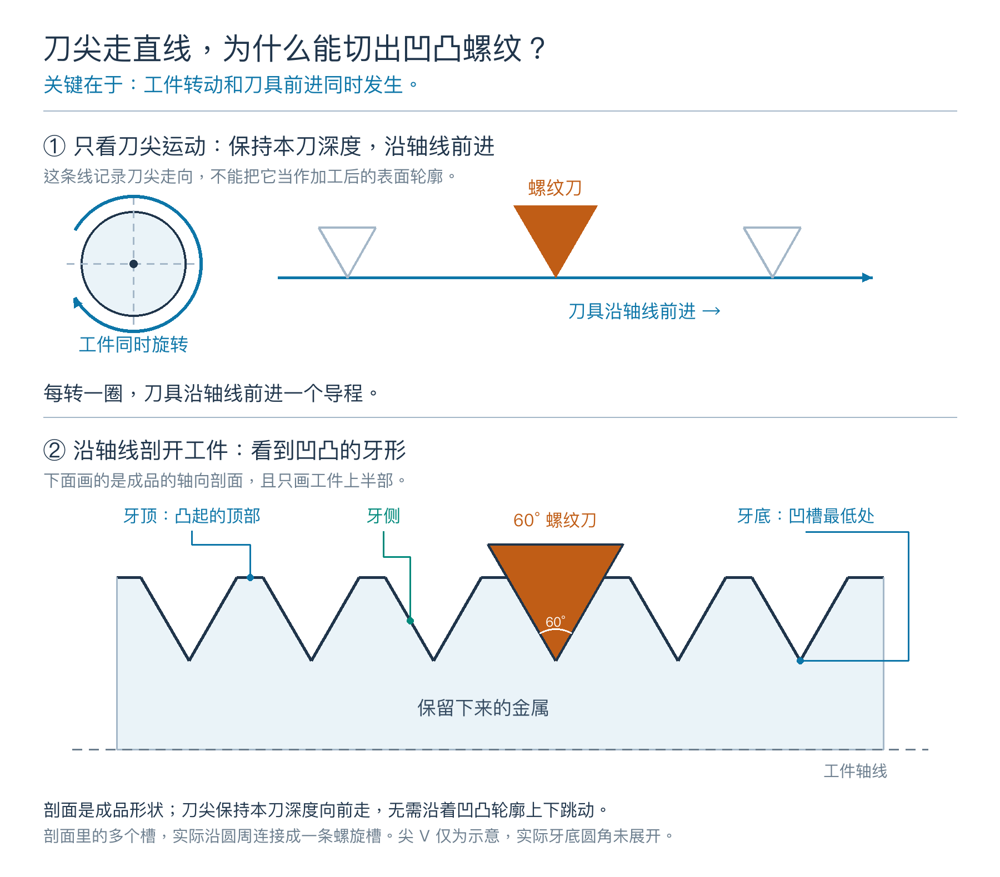
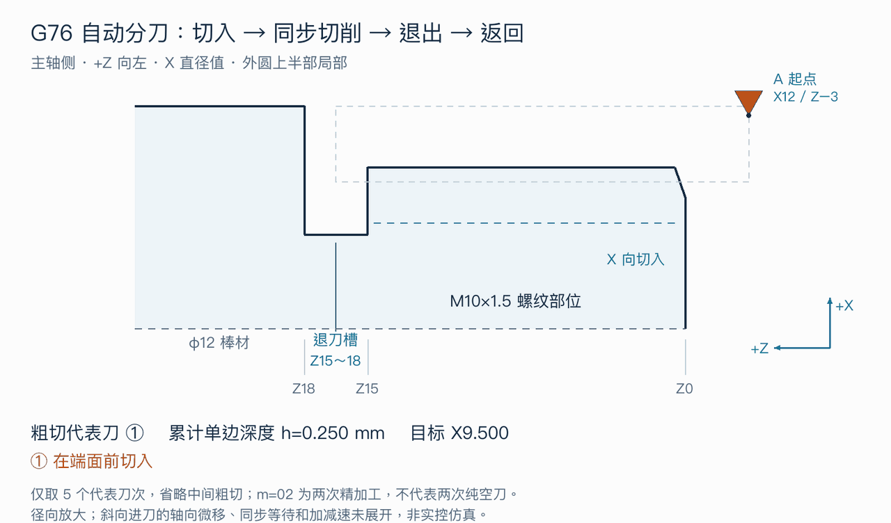
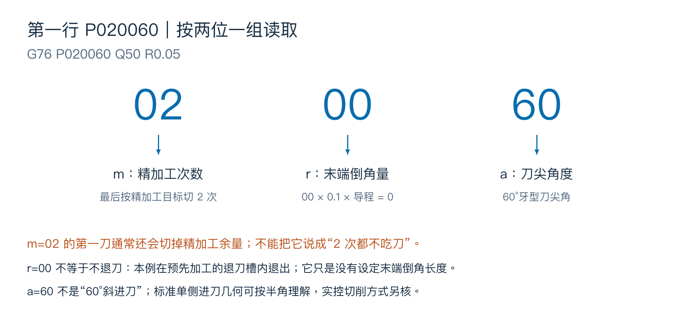
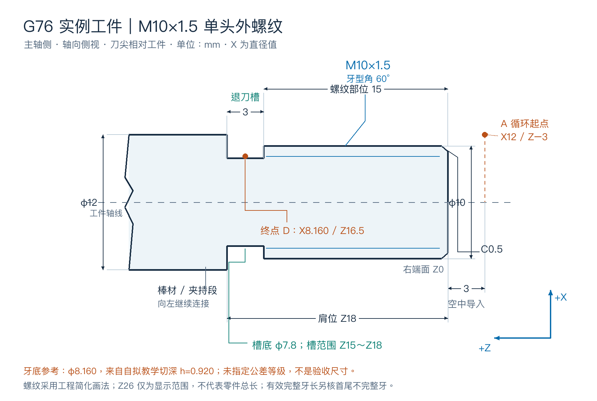
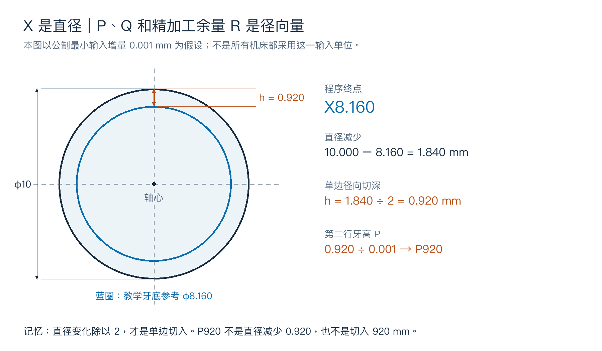
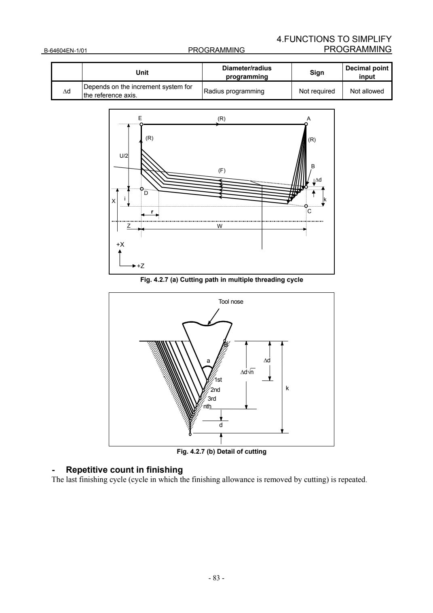

# G76 螺纹切削循环：图文、动图与 M10×1.5 实例

**先记一句：第一行定分刀规则，第二行定螺纹目标；X 按直径，牙高和切深按半径，F 是导程。**

本资料按津上 S205A/S206A 主轴侧、公制、X 直径方式讲解 FANUC **两行式 G76**。津上 3281-LTQ0C-05 的 G 代码表将 G76 列为“复合螺纹切削循环”，但本技能收录的正文未展开其参数格式；格式补充依据为 FANUC 原厂编写的 0i-F Plus B-64694EN-1/01 §4.2.7，并用本地 0i-F B-64604EN-1/01 §4.2.7 原页对照。二者的两行格式相同。

津上手册封面、前言与文件名存在控制器/机号适用性差异，因此这里是概念与程序审查用的教学例。M10×1.5 工件是自拟例，**不是津上原例，也不是已验证可投产程序**。实际机型、控制器版本、代码制、P/Q 输入增量、刀片和尺寸公差仍须与现场对应。

## 1. 它替你完成了什么

普通螺纹车削要重复：到本刀深度 → 与主轴同步切削 → 退出 → 返回 → 加深再来。G76 把多刀粗切和末精加工组织成一个复合循环；你给总牙高、首刀切深、最小切深、余量等条件，系统组织分刀。

| 指令 | 一次指令主要做什么 | 程序员还要安排什么 |
|---|---|---|
| G32 | 一段螺纹同步运动 | 各刀深度、切入、退刀与返回 |
| G92 | 一刀螺纹循环，含返回 | 逐行给各刀目标 X |
| G76 | 按条件组织多刀螺纹循环 | 给足两行参数、起点与空间，并核对尺寸与工艺 |

G76 不会仅凭“我要 M10×1.5”自动识别材料、查公差、选择刀片并保证合格。

## 2. 先看动作，再读参数

**先分清刀尖轨迹与加工后的牙形。**下方旧动图的光滑轮廓和矩形路线只用于说明切入、轴向切削、退出和返回；它省略了工件旋转及实际凹凸牙形，不能用来认识螺纹成品形状。



圆柱螺纹的主要切削段里，刀尖保持本刀深度，沿轴向前进；工件同时旋转，两者按导程配合，刀刃在材料上切出连续的螺旋槽。沿轴线剖开看，槽与槽之间就呈现保留下来的凸牙。刀尖无需沿每一个凸牙、凹槽上下跳动。G76后续各刀沿同一条螺旋继续加深，最终形成牙形。



本动图是刀尖相对工件的轴向侧视图：+Z 向左、+X 向上。它抽取 h=0.250、0.620、0.870、0.920、0.920 mm 五个代表切深，**省略中间粗切，不表示该程序实际只切五刀**。径向放大；单侧斜进刀带来的轴向微移、主轴同步等待、加减速与实际退刀动态未展开。矩形路线是动作顺序示意，不是 P60 的精确刀尖轨迹，也不是整机运动仿真。

观察时只记三件事：

1. 每刀同步切削都沿同一导程的螺纹逐步加深，不是每刀另刻一条独立螺纹。
2. 切完先向外退出，再在外侧返回前方；不沿螺纹底径反向拖回。
3. 粗切逐步加深，留出末精加工余量后，再按最终目标完成精加工次数。

走心机实际 Z 运动涉及主轴台/棒料与刀具的相对运动；此图不能用于判断是哪一个实体部件在沿图中箭头移动。图上的教学步进也不等于机床 SINGLE BLOCK 会在每一段停下。

## 3. 两行格式

```gcode
G76 Pmmrraa Q最小切深 R精加工余量;
G76 X牙底目标 Z轴向终点 R锥度量 P牙高 Q首刀切深 F导程;
```

这是解释用的地址模板，中文不能输入 NC。原厂形式写作：

```gcode
G76 P(m)(r)(a) Q(Δdmin) R(d);
G76 X(U)_ Z(W)_ R(i) P(k) Q(Δd) F(L);
```

括号是定义标记，不是要求输入这些括号；X/U、Z/W 为绝对/增量的选用写法，且与代码制有关。本例只用 X、Z 绝对目标。

### 第一行：分刀与精加工规则

```gcode
G76 P020060 Q50 R0.05;
```



| 地址 | 本例含义 | 容易误读的地方 |
|---|---|---|
| P 的前两位 02 | 末精加工循环总共执行 2 次 | 不是总切削 2 刀，也不是额外再加 2 刀后才精加工 |
| P 的中间两位 00 | 末端修牙/倒角的指令量为 0 | 不等于不退刀；本例在退刀槽内退出 |
| P 的后两位 60 | 刀尖夹角 60° | 不是“60°斜进刀”，也不是螺旋升角 |
| Q50 | 最小粗切深度 0.050 mm，径向量 | 不是 50 刀，也不是每刀都切 0.050 |
| R0.05 | 粗切后预留 0.050 mm 径向精加工余量 | 对应直径余量 0.100 mm，不是退刀距离 |

本例明确假设无小数点 P/Q 切深值的输入单位为 **0.001 mm**，例如 Q50=0.050 mm。FANUC 原表规定这些值的输入单位取决于参考轴的增量系统；现场须确认，不能把“所有机床都乘/除1000”当规则。P 的六位组合码不作长度换算。

中间两位 rr 的换算为：**末端修牙长度 = rr × 0.1 × 导程**。例如把 rr 设成 10，在 F1.5 时表示 1.0×1.5=1.5 mm；rr=12 表示1.2个导程，不是12 mm。实际修牙还涉及机床信号与控制功能。本例 rr=00 依赖预加工退刀槽，不能原样移到没有空间的台肩处。

所引两行格式的 a 可选 80、60、55、30、29、00。不要因为想用29.5°进刀，擅自在此写59或29.5。a 的定义是刀尖角；原厂单侧进刀图用它决定逐刀的侧向关系，60°牙型的半角为30°。真实刀尖安装、刀片牙型和控制器切法要配套核对。

**m=02 的实际意思：第一次末精加工通常去掉预留余量，第二次按同一个最终目标再切。**第二次常被口语称为修整/光刀，但可能仍因弹性让刀等原因出切屑。不能把两次都说成完全不吃刀。

### 第二行：目标螺纹

```gcode
G76 X8.160 Z16.5 R0.0 P920 Q250 F1.5;
```

| 地址 | 本例含义 |
|---|---|
| X8.160 | 最终牙底的程序目标直径；不是半径8.160 |
| Z16.5 | 刀尖基准对应的轴向切削终点，位于本例退刀槽内 |
| R0.0 | 圆柱螺纹，锥度量为零；有锥度时为带符号的半径差，符号须结合刀路原图 |
| P920 | 总牙高/径向总切深 k=0.920 mm |
| Q250 | 第一刀径向切深 Δd=0.250 mm |
| F1.5 | 导程1.5 mm/rev；单头 M10×1.5 的导程等于螺距 |

**同一个地址，换一行意义就变了：**第一行 P 是组合规则、第二行 P 是牙高；第一行 Q 是最小切深、第二行 Q 是首刀切深；第一行 R 是精加工余量、第二行 R 是锥度量。

P920、Q250、Q50 这些牙高/切深项按所引格式不允许小数点，R 允许小数点。不能把 P920 随手改写为 P0.920，或认为 R0.05 也必须写成 R50。

F 由螺纹导程决定，不能靠减小 F 来减轻车螺纹负荷。多头螺纹的导程=螺距×头数，但只改 F 并不会自动生成各头，还需起始相位等功能，此例不展开。

## 4. 实例工件：把图纸坐标接到程序



| 条件 | 本例采用的教学假设 |
|---|---|
| 工序 | 主轴侧、单头圆柱外螺纹，沿手册 M03/+Z 的刀具安装关系理解右旋 |
| 坐标 | 右端面Z0；进入棒料为+Z；X为直径 |
| 螺纹 | M10×1.5，60°牙型；未给公差等级 |
| 螺纹部位 | Z0～Z15；入口C0.5包含在该范围内 |
| 退刀槽 | Z15～Z18，宽3 mm，槽底φ7.8 |
| 后部棒材/台肩 | φ12，从Z18向左继续连接；Z26仅为图示范围 |
| 起点 | A：X12.0、Z−3.0 |
| 最终切削终点 | D：X8.160、Z16.5，在退刀槽内部 |
| 刀具 | 60°外螺纹刀，教学以T0606为刀号/补正号；真实刀尖几何与Z基准另核 |
| 材料与转速 | 可把45钢作为纸面工件材料占位；S600仅用于演算，不构成切削推荐 |

前序应已完成外圆、入口倒角及退刀槽；这份程序只讲螺纹工序，不含这些前序刀路、送料、夹头开闭、副轴接料或切断。

### 4.1 牙高与 X 的计算

这里只做60°外螺纹名义几何初估：

```text
螺距 p = 1.5 mm
外螺纹常用名义牙高估算 h ≈ 0.61343 × p
                        ≈ 0.92015 mm
教学取 h = 0.920 mm

教学牙底目标 X = 10.000 − 2×0.920 = 8.160 mm
P = 0.920÷0.001 = 920 → P920
```

该系数用于教学几何起算，不能代替刀片厂家建议和图纸公差。完整外牙牙型的牙顶、牙底圆弧/截短、刀片全牙/部分牙、实际大径和中径公差都会影响实际切削设定。实际大径也不能不看公差就指定为恰好10.000。



**循环起点 X12 不参与牙高计算。**X12 到名义φ10之间有1 mm单边空隙。不能算 (12−8.160)/2=1.920，然后误写 P1920。

本例的几何一致性检查是：

```text
X最终 + 2×牙高 = 8.160 + 2×0.920 = 10.000
首刀目标 X ≈ 10.000 − 2×0.250 = 9.500
粗切终了累计切深 = 0.920 − 0.050 = 0.870
粗切终了参考 X = 10.000 − 2×0.870 = 8.260
末精加工从参考 X8.260 到最终 X8.160：径向去除0.050
```

这是名义刀尖位置推导，不等于实测成品小径。改变X、P或刀具补正会影响整个进刀安排，不能只改一个数字而忽略其余几何关系。

津上 §7.10.2 的切削计算表在螺距1.5时列“高度”0.97 mm，并另给有色金属、铁材分刀数据。该表未说明牙型、刀尖圆角及高度计算依据，因此不能认定它与本例名义几何初估0.920 mm等价或直接互换；也不能把该表列出的刀次宣称为G76实际算法。

### 4.2 长度的三种含义

- 图样螺纹部位：0～15，共15 mm，且包含入口倒角。
- 本例指令轴向范围：−3～16.5，共19.5 mm。
- 实际有效完整牙长：要扣除入口、同步建立及末端不完整牙影响，并按图样检验，不能直接宣称等于15或16.5 mm。

Z16.5放在退刀槽内，是为最终退出留下几何位置；槽两边各有1.5 mm名义距离。它并未自动证明整把刀片、刀杆及退刀动态都能避开槽壁/台肩。Z−3也只是本教学假设，不是任何转速、导程下通用的同步导入量。

## 5. 程序与逐行说明

**进入本段前的状态：**现场确认采用本例的两行式G76、公制及X直径方式；主轴侧，主轴已停；螺纹刀已在批准的分度位置完成T0606及补正选择，再到达X12/Z−3的前方起点；工件坐标、实际刀尖Z基准、夹持/导套和冷却条件已确认；前序几何已完成；另一通道处于已核查的安全状态。刀具安装及旋向与本例一致。

下面是**螺纹工序教学片段**，没有整机开头、分度、送料、坐标建立与后续工序，不能单独当作完整自动生产程序。未把未知现场的分度位置或G300/G150流程填成通用值。

```gcode
(G76 M10X1.5 MAIN-PATH TEACHING FRAGMENT)
(PRESET: METRIC, X DIAMETER, T0606 ACTIVE)
(PRESET: OD CHAMFER GROOVE DONE, SPINDLE STOPPED)
(PRESET: TOOL AT X12.0 Z-3.0)
G18 G40 G99;
M08;
G97 S600 M03;
M12;
G00 X12.0 Z-3.0;
G76 P020060 Q50 R0.05;
G76 X8.160 Z16.5 R0.0 P920 Q250 F1.5;
G00 X12.0;
G00 Z-3.0;
M05;
(END OF THREAD OPERATION)
```

| 程序行 | 当前动作/意义 | 依赖条件 |
|---|---|---|
| G18 G40 G99 | ZX平面、取消刀尖R补偿、普通进给采用mm/rev | 现场对应代码制；几何/磨耗补正与G41/G42不同 |
| M08 | 本机切削液ON | 冷却系统、导套/棒料准备符合本机要求 |
| G97 S600 M03 | 固定600 r/min，主轴CW | 仅教学转速；旋向与刀具安装要匹配 |
| M12 | 主轴速度到达确认 | 津上主轴侧M代码定义 |
| G00 X12 Z−3 | 明确本循环起点 | 前置状态已在此处；不是从未知位置随意斜向接近 |
| 第一行G76 | 给精加工次数、修牙量、刀尖角、最小切深及余量 | 输入增量0.001 mm；此行不是开始切一刀 |
| 第二行G76 | 给最终目标和首刀切深、导程，执行多刀循环 | 端点、刀片、槽和相对空间已审查 |
| G00 X12 | 明确循环后的径向目标 | 本例外侧返回空间已核对 |
| G00 Z−3 | 明确回到前方 | 先确保径向让开，再返回 |
| M05 | 本机主轴停止，并使切削液OFF | 沿用本机定义，不仅仅是通用“停主轴”注释 |

本机G18/G40见纸面7-25（原PDF293），G76/G97/G99见纸面7-26（原PDF294）；M代码见纸面7-9、7-13（原PDF277、281）。公制输入在本机表中涉及选配，故把公制作为已核实的前提，没有擅加G21改变现场模式。

所引FANUC §4.2.7限制G76不能应用刀尖R补偿，因此本段使用G40；刀具几何与磨耗补正仍需正确设定。

若只作单位计算：600 rev/min×1.5 mm/rev=900 mm/min，为同步切削段名义轴向速度；程序仍写F1.5。名义φ10处Vc≈π×10×600÷1000≈18.85 m/min。这是S600的算术结果，不是45钢或任何刀片的推荐切削速度。

## 6. 为什么越往后每刀通常越浅

在所引两行式的单侧恒切削量分刀模型中，原厂图给出粗切累计深度与首刀切深的关系：

```text
h_n ≈ Δd × √n
```

它用于理解“使切削截面积大致保持”的分刀趋势，不是说每刀固定加一个相同深度。以首刀0.250 mm为例，在尚未受最小切深和末尾限制影响的理想阶段：

| 理想粗切序号 | 累计径向切深/mm | 本刀新增径向量/mm |
|---|---:|---:|
| 1 | 0.250 | 0.250 |
| 2 | 0.354 | 0.104 |
| 3 | 0.433 | 0.079 |

随着牙槽加深，同样径向再切一点会切掉更大的截面积，所以逐刀径向增量通常减小。接近Q50的限制时，系统不再无限递减；到粗切边界又要处理剩余量，之后才按R余量及m次数精加工。**不能只算一个平方根就宣布现场一定切几刀。**

FANUC某些资料还出现可选四种切法的G76。所查F Plus手册把它放在Series15格式章节，使用单行 `G76 X Z I K D A F P Q`。那一套P1/P2/P3/P4与这里第一行六位P不同，不能拼接使用。别把网上的一行式、两行式、Haas或其他系统G76混写。

原厂单侧分刀示意：



上图是FANUC原图自身的坐标观察方向，未改造成津上主轴侧+Z向左的工件图；用它看牙槽分刀形状，不照抄其Z符号到本例。

## 7. 十个常见误读

1. **把两行P当同一种量。**P020060是组合码，P920才是本例的牙高整数。
2. **把Q250当直径减少0.25。**它是径向切深0.250，对应首刀目标从参考φ10减少0.500。
3. **从X12算总牙高。**X12是循环间隙起点，不是切前外径。
4. **把第一行R当退刀距离。**它是末精加工余量；第二行R又是锥度量。
5. **把02叫作两次纯空刀。**第一次末精加工要去余量，随后才重复最终循环。
6. **把00当不退刀。**它只是修牙量为零；末端仍要退出，须有槽/空间。
7. **认为Z16.5就是有效牙长。**起点、程序行程、工件部位长和完整牙长是不同量。
8. **用G96或切削中改变转速。**本机说明螺纹不用一般恒线速；粗到精应保持同一转速与同步条件。其G50 S限速在手册中特别限定对G96有效，不能拿它兜住任意G97转速。
9. **沿用G92的模态写法。**G76是00组一次有效循环指令，P/Q/R等循环数据却可保持；新螺纹应显式写足两行，普通移动显式G00。不需要为本循环添G80。
10. **把动画步进当现场停车点。**单段、进给保持、修牙退刀功能与版本及机床设定有关，不能假设按进给保持就立即停在当前牙槽里，或在四段每个角都停车。按本机资料与实际功能验证。

## 8. 首件如何对应图纸核查

纸面和图形检查先核对：+Z方向、X直径方式、P/Q增量单位；T0606与实际刀尖基准；X/P所定义的大径参考；导入与退刀槽；单侧进刀导致的轴向变化；刀片、刀杆和台肩的整体间隙；另一通道位置。未解决这些依赖项时，资料不能升级为现场投产程序。

实际工艺还要给出材料、刀片厂家/型号、全牙或部分牙、根部圆角、公差等级、有效牙长和审核后的切削条件。按本机流程完成程序检查、空运行/运动核查与试切后，首件检查大径、中径、牙型/螺距、有效牙长、退刀槽、毛刺与表面；按图样用螺纹量规、螺纹千分尺或三针法等合适方法验收。只看小径达到X8.160，或普通螺母能够旋上，不能证明公差合格。

## 9. 自测与记忆

1. P020060 中的02是粗切总刀数吗？
2. Q250和Q50分别管什么？
3. X10到X8.160，单边切入是多少？
4. 第一行R0.05，粗切终了的参考X是多少？
5. 为什么F1.5不能为了“慢点切”改成F0.2？
6. 从−3切到16.5，是否等于完整牙长19.5 mm？
7. P的中间两位从00换成10，在导程1.5时修牙指令长度是多少？

答案：①不是，是末精加工共2次；②首刀径向0.250、最小粗切径向0.050；③0.920 mm；④8.260；⑤F是导程，改了就改变螺纹关系；⑥不是；⑦1.5 mm，仍需核对机床修牙功能。

**记忆顺序：一行“次数—修牙—刀角—最小—余量”，二行“X底—Z终—锥度—牙高—首刀—导程”。**

## 10. 原文来源和推导边界

### 津上手册明示

3281-LTQ0C-05，S205A/S206A：

- §7.3，纸面7-6、7-8（原PDF274、276）：程序原点、X直径、Z方向与地址。
- §7.4，纸面7-9、7-13（原PDF277、281）：主轴侧M03/M05/M08/M12及旋转说明。
- G代码表，纸面7-25～7-26（原PDF293～294）：G18、G40、G76等功能。
- §7.5.7.2，纸面7-43（原PDF311）：G92一刀循环，与G76区别用。
- §7.5.8～7.5.9，纸面7-44～7-45（原PDF312～313）：G97、恒线速限制及G98/G99。
- §7.9.1(2)，纸面7-65～7-66（原PDF333～334）：M6×1主轴螺纹原例，使用G92而非G76。
- §7.10.2，纸面7-94（原PDF362）：螺纹切削计算表；螺距1.5的表列高度0.97及材料分类分刀。
- 原PDF363：首尾不完整螺纹长度资料；本页无可见纸面页码，不自行命名为7-95。

### FANUC 控制器补充依据

- B-64694EN-1/01《0i-MODEL F Plus 车床操作手册》，§4.2.7，纸面68～73；§3.1，纸面16～18；G代码表纸面13。[原厂正文的第三方镜像](https://manualmachine.com/fanuc/0ifplus/24332568-operators-manual/)。网站不是FANUC官网，依据为其展示的FANUC原始正文。§6.4.7纸面268～270的Series15格式不与本例混用。
- B-64604EN-1/01《0i-MODEL F 车床操作手册》，§4.2.7，纸面82～87（该PDF96～101）；G代码表纸面15（PDF29）。[机床制造商网站保存的原厂PDF](https://www.vmclathe.com/wp-content/uploads/2024/06/Fanuc-controller-%E5%8F%91%E9%82%A3%E7%A7%91%E8%8B%B1%E6%96%87.pdf)。本地对照文件在上一份G75资料的参考资料中；此为F型资料，不能替代现场F Plus版本。

名义外螺纹高度系数0.61343另可对照西门子原厂《SINUMERIK 840C 图形编程系统（车削）》4.2，纸面4-11的外螺纹高度系数；仅用作几何数值交叉核对，不借用其控制代码：[西门子原厂资料](https://cache.industry.siemens.com/dl/files/201/107178201/att_26145/v1/Wop_d2_0797_de.pdf)。

### 本资料自拟/推导

M10×1.5工件的局部结构、15 mm部位、C0.5、3 mm槽、φ7.8、φ12、X12/Z−3、Z16.5、h0.920、S600、Q50/Q250/R0.05及刀号占位都是教学设计。X8.160、粗切参考X8.260、首刀参考X9.500、900 mm/min和18.85 m/min是上述假设下的计算，均非原厂为这个工件给出的生产条件。
