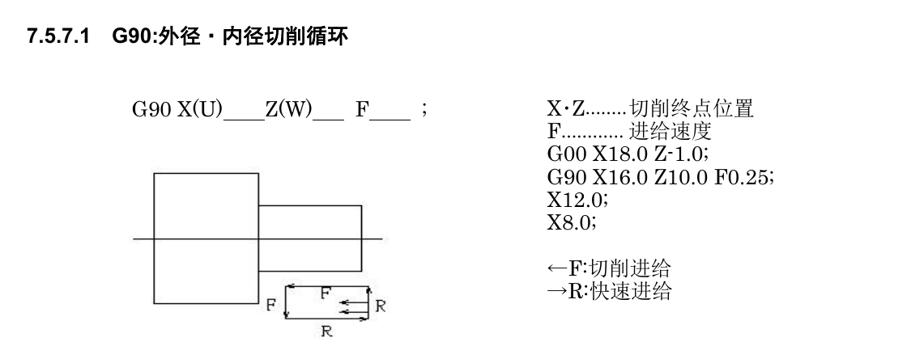
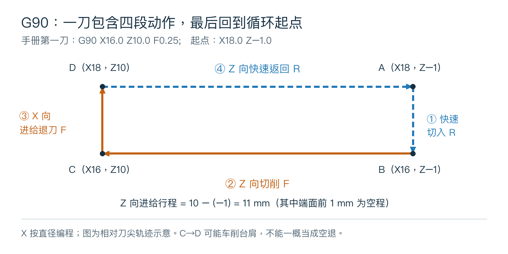
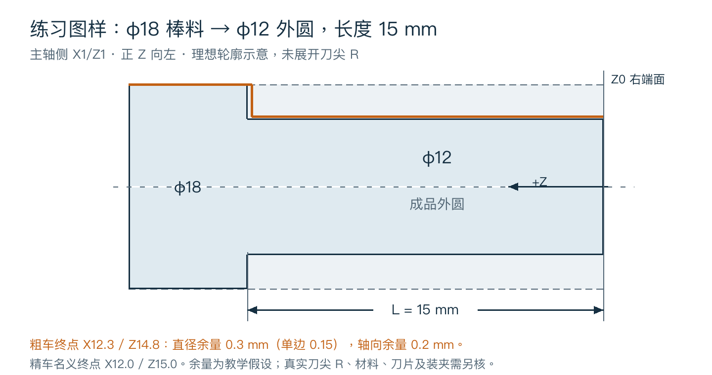

# G90 外径切削循环：津上 S205A/S206A 学习笔记

适用依据：3281-LTQ0C-05 手册，主轴侧 X1/Z1 的直线外径切削教学。手册封面标 FANUC 0iTF Plus；文件名机号、封面机号和前言中的控制器名称存在差异，实际执行前应核对机台型号、控制器及 G 代码制。

本笔记区分厂家原例和自拟练习。自拟尺寸、余量和 F 值用于理解与仿真；材料、刀片牌号、刀尖 R、刀号补正、转速、夹持、导套状态及双通道配合尚未指定，因此程序片段不构成完整生产程序。

## 1. 它做什么

在本机手册的代码体系里，G90 是外径/内径切削循环。每个循环把一刀的快速切入、纵向切削、横向进给退刀、快速返回封装在一个程序段中。

连续改变 X 值，可以实现多刀粗车。每刀切多深由程序编写者决定；单独给最终 X 值，不会自动分成多刀。G90 也可表达简单圆柱的精车刀路，但尺寸精度仍依赖真实刀具、补正及工艺验证。

## 2. 坐标和格式

本教程沿用手册方向：面对工件侧视图，右端面为 Z0，+Z 向左进入工件，X 用直径值表示。走心机图中画的是刀尖相对工件的轨迹，不能据此假定一定由刀架完成 Z 运动。

```text
G90 X目标直径 Z纵向切削终点 F进给量;
```

| 地址 | 含义 |
|---|---|
| X | X 方向绝对目标值；在这里是直径 |
| U | X 方向增量值，在这里也是直径变化量，与 X 二选一 |
| Z | Z 方向绝对切削终点 |
| W | Z 方向增量，与 Z 二选一 |
| F | 切削进给量，其单位由当前 G98/G99 决定 |

G99 下，F0.08 表示 0.08 mm/rev。若仅为算术演示，假设主轴为 1200 min⁻¹，轴向切削进给速度为 1200×0.08=96 mm/min。该转速不是针对某材料和刀片的推荐。

X 从 18 变成 17，直径减少 1 mm，单边切深为 (18−17)/2=0.5 mm。不要把直径差直接当作单边切深。

依据：程序原点，纸面 7-6（原 PDF 第274页）；地址功能，纸面 7-8（第276页）；§7.5.9，纸面 7-45（第313页）。

## 3. 手册原例，保持原文

```gcode
G00 X18.0 Z-1.0;
G90 X16.0 Z10.0 F0.25;
X12.0;
X8.0;
```



| 原行 | 含义 |
|---|---|
| G00 X18.0 Z-1.0; | 建立本例的循环起点 A |
| G90 X16.0 Z10.0 F0.25; | 完成第一刀，再回到 A |
| X12.0; | 继承 G90、Z10.0、F0.25，完成第二刀，再回到 A |
| X8.0; | 完成第三刀，再回到 A |

原例未在这几行写出材料、刀片和主轴转速，也未重新写 G99；F0.25 的单位应结合进入该段时的模式。X18 是起点，不能仅凭它认定毛坯为 φ18，也不能据此计算第一刀实际切深。



第一刀完整动作，坐标统一按 (X,Z) 写：

1. A(18,−1)→B(16,−1)：快速沿 X 到目标直径。
2. B(16,−1)→C(16,10)：按 F 沿 Z 切削。
3. C(16,10)→D(18,10)：按 F 沿 X 退刀。这一段可能车削台肩。
4. D(18,10)→A(18,−1)：快速沿 Z 返回。

一刀完成后停留的位置是循环起点 A，而不是切削终点 C。图中 R 表示 Rapid（快速移动），不是本直线例程中额外填写的 R 参数。

在无刀尖 R 补正的理想轨迹教学中，第一刀可展开理解为：

```gcode
G00 X18.0 Z-1.0;
G00 X16.0;
G01 Z10.0 F0.25;
G01 X18.0;
G00 Z-1.0;
```

以上用于理解动作，不等于厂家例程的完整替换程序。展开后的逐行单段停点，也不能直接套回固定循环内部。

依据：§7.5.7.1，纸面 7-43（原 PDF 第311页）。

## 4. 自拟仿真实操案例：φ18 → φ12，长度15



训练目标：从 φ18 圆棒右端加工 φ12 外圆，长度 15 mm，后部仍保留 φ18 肩部。工件右端面已经正确建立为 Z0。

教学起点 A：X20.0 Z−1.0。其刀尖名义径向间隙为 (20−18)/2=1 mm，轴向在端面前 1 mm。该间隙并不替代对整把刀、刀杆、导套和夹头的干涉检查。

粗车目标 X12.3 Z14.8：直径留 0.3 mm，即单边 0.15 mm；长度方向留 0.2 mm。余量是教学假设，并非厂家针对未知材料给定的工艺参数。

先练粗车核心段：

```gcode
N10 G99;
N20 G00 X20.0 Z-1.0;
N30 G90 X17.0 Z14.8 F0.08;
N40 X16.0;
N50 X15.0;
N60 X14.0;
N70 X13.0;
N80 X12.3;
N90 G00 X20.0 Z-1.0;
```

这里 N90 明确切换到 G00，结束 G90 模式。由于每刀已返回 A，这一行的目的主要是明确后续运动模式。

| 刀次 | 名义直径变化/mm | 单边切深/mm | Z切削终点/mm |
|---|---|---:|---:|
| 1 | 18→17 | 0.50 | 14.8 |
| 2 | 17→16 | 0.50 | 14.8 |
| 3 | 16→15 | 0.50 | 14.8 |
| 4 | 15→14 | 0.50 | 14.8 |
| 5 | 14→13 | 0.50 | 14.8 |
| 6 | 13→12.3 | 0.35 | 14.8 |

六刀都从 A 出发，并返回 A。第一刀不会因为起点是 X20 就切入单边 1.5 mm；真正毛坯是 φ18，所以第一刀实际名义切深是 0.5 mm。

粗车审查和测量通过后，精车的名义刀路可以这样表达：

```gcode
G90 X12.0 Z15.0 F0.06;
G00 X20.0 Z-1.0;
```

前提是仍处于本例 G99 模式、刀尖起点 A 正确，主轴与刀具等真实条件已另行建立。

在已经粗车的圆柱段，单边余量为 0.15 mm。但 Z14.8～15.0 的肩部此前没有粗车到位，精车刀在接近台肩及随后 C→D 时还要处理肩部材料。不能把整个精车过程的负荷都按“仅吃 0.15 mm”估计。刀具能否车肩、刀尖 R 和台阶根部形状、长度补正都应单独审查。

该片段未包括选刀、刀号/补正、主轴选择与启停、夹持、冷却、坐标建立、双通道状态以及程序结束，不可作为完整程序直接执行。

## 5. 再练一个台阶工件

自拟目标：右端 Z0～8 为 φ10，Z8～20 为 φ14，更后面保留 φ18。先粗出长的 φ14 段，再粗短的 φ10 段。

```gcode
G99;
G00 X20.0 Z-1.0;
G90 X17.0 Z19.8 F0.08;
X16.0;
X15.0;
X14.2;
G90 X13.2 Z7.8 F0.08;
X12.2;
X11.2;
X10.2;
G00 X20.0 Z-1.0;
```

这是粗车教学段：长段粗到 φ14.2、Z19.8；短段粗到 φ10.2、Z7.8。两段分别给名义成品留下直径 0.2 mm、肩部轴向 0.2 mm 的余量。短段的后三行继承 Z7.8，不能再按前面的 Z19.8 理解。每刀仍回到 X20、Z−1。

真正精车时，需要针对两个台肩和根部 R 编写并验证完整轮廓，不应把这个粗车片段当作成品程序。

## 6. 模态和增量最容易错的地方

- G90 尚有效时，下一行单独写 X16.0 是再做一刀循环，不是普通 X 定位。
- 用 G00、G01 等其他同组运动指令结束 G90。不要将其他类型固定循环的取消方式直接套到本例。
- 从 A(X18,Z−1) 执行 G90 U−2.0 W11.0，对应目标 X16、Z10。下一刀仍以返回后的 A 为增量基准；再写 U−2.0 不会自动变成 X14。
- 写最终 X12.0 只指定一刀的目标，不会自动推导前面的 X17、X16 等层次。
- G99 的 F 是 mm/rev；G98 的 F 是 mm/min。改变进给模式后，应重新核对 F 值和本机格式。
- 粗车可留余量，但 G90 不会替你自动设置余量或补做全轮廓精加工。
- 此次只展开手册明示的直线循环，不把其他系统的锥面 R 参数写法直接作为这台机的已确认用法。

补充来源：FANUC 原厂编写的 0i-MODEL F 车床操作手册 B-64604EN-1/01，§4.1.1.1，纸面35（该 PDF 第49页），说明同组模式取消，并指出单段模式下一次启动会执行四段动作。因此，不能以“已开 SINGLE BLOCK”为理由，假定 G90 会在每个拐点暂停。该控制器资料用于补充原理；现场 0iTF Plus 的确切行为仍须核对对应版本。

[FANUC 0i-MODEL F 原厂手册的制造商镜像](https://www.vmclathe.com/wp-content/uploads/2024/06/Fanuc-controller-%E5%8F%91%E9%82%A3%E7%A7%91%E8%8B%B1%E6%96%87.pdf)

## 7. 从仿真到首件，分阶段完成

| 阶段 | 本案例重点 | 进入下一阶段的依据 |
|---|---|---|
| 纸面和图形仿真 | 确认正Z方向、X直径值、每刀返回点、切削终点和模态继承 | 能逐段指出快速与进给；轮廓与图样一致 |
| 程序检查 | 按本机§5.5检查；设备锁定时各轴不运动 | 程序和补正审查通过；不能以画面通过替代真实运动验证 |
| 无棒料空运行 | 按§5.5.2核查真实刀具与导套、夹头的运动关系 | 行程、刀具和周边实际间隙得到核实；未用棒料实际切削 |
| 带料试切准备 | 确认真实材料、刀片、刀尖R、夹持/导套、补正、主轴方向与转速、冷却和通道状态 | 按本机流程恢复试切状态；门与送料等条件满足 |
| 首件测量 | 主轴和相关轴完全停止后，测粗车/精车直径、有效圆柱长度、肩部与根部R | 实测符合图纸公差，切削状态稳定 |

无棒料检查所用的 WARM UP 与实际切削状态要区分。手册在§5.5.2说明其会使相关送料检测无效，检查后应恢复关闭；实际加工前的步骤又要求 WARM UP、BLOCK SKIP 关闭，并在纸面5-20明确要求关闭 SINGLE BLOCK 和 DRYRUN。这里引用的是该手册所述阶段，不把无棒料检查状态当成带料切削状态。

不提供未经核实的夹紧力、导套间隙或现场按钮串行操作。测量至少覆盖圆柱前、中、后三处，例如本练习 Z2、Z7、Z13；再核对有效长度15、肩部和根部R。图纸未给公差，不能自行宣布 φ12.00 或长度15.00 的测量值具有某个合格范围。

## 8. 自测

1. 从 X20、Z−1 开始，执行 G90 X16 Z14.8 后，循环结束在哪？
2. φ18 毛坯第一刀到 X17，单边切深是多少？
3. G90 X17 Z14.8 后写 X16，第二刀的 Z 终点是多少？
4. 粗车 φ12.3，目标 φ12，单边余量是多少？
5. 为何 C→D 不能直接按快速空退考虑？

答案：1. X20、Z−1。2. 0.5 mm。3. Z14.8。4. 0.15 mm。5. 这一段是切削进给，且可能车削台肩材料。

## 来源定位

- 3281-LTQ0C-05：程序原点，纸面7-6（原 PDF 第274页）；字符功能，纸面7-8（第276页）。
- §7.5.7.1 G90，纸面7-43（原 PDF 第311页）。完整原页见 g90-手册原页311.png。
- §7.5.9 G98/G99，纸面7-45（原 PDF 第313页）。
- §5.2，纸面5-2（原 PDF 第165页）：空运行及试加工确认事项。
- §5.5.1，纸面5-9（原 PDF 第172页）：设备锁定时各轴不运动。
- §5.5.2，纸面5-12（原 PDF 第175页）：无棒料检查及检查后恢复 WARM UP。
- 实际加工前状态要求，纸面5-20（原 PDF 第183页）。

本资料中的工件尺寸、分刀、余量与 F0.08/F0.06 为自拟教学案例；原手册的 G90 例程单独保留，没有混写为同一来源。
