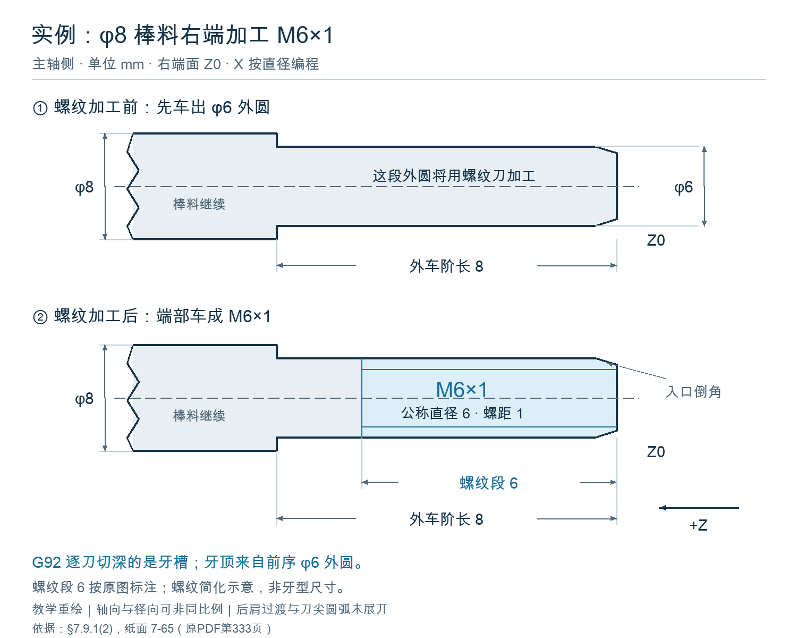

# 看一个工件，学会读 G92 程序

来源：津上 S205A/S206A，3281-LTQ0C-05，§7.9.1(2)，纸面7-65～7-66（原PDF第333～334页）。以下只讲主轴侧这两道工序。

## 1. 要做成什么样

拿一根φ8棒料，把右端先车成名义φ6的小轴，再在这个小轴端部车M6×1外螺纹。



| 图上标注 | 读法 |
|---|---|
| φ8 | 左侧棒料直径8 mm |
| φ6 | 螺纹切前的小轴名义直径6 mm，取自前序程序X6.0 |
| M6×1 | 公称直径6 mm、公制螺距1 mm；本例按单头螺纹解释，导程1 mm |
| 6 | 原图标出的螺纹段长度6 mm，不额外解释为保证的完整有效牙长 |
| 8 | 右端面到台肩的标注长度8 mm |

只加工棒料右端。原图未给切断位置与整体总长，不自行补成独立成品零件。

坐标沿用本手册：右端面Z0，+Z向左进入工件，X按直径给数值。尺寸图表示工件轮廓，不表示走心机实际由哪个部件移动。

## 2. 先把右端车细：T18外车工序

下面保留手册代码；括号内中文为新增讲解。

```gcode
N1 M03 S4000 G0 Z0 T1818   (T18外车刀，18号补正，原例S4000)
X9.0                     (在端面外侧定位)
M12                      (主轴速度到达确认)
G99 G01 X-1.0 F0.04       (车Z0端面，越过中心)
G41 X5.0 F0.1            (开启刀尖R补正，移向端面外侧)
X6.0 Z0.5 F0.03          (车前端倒角)
Z8.0 F0.06               (保持X6，车外圆到Z8)
X7.0 F0.04               (加工肩部过渡)
X9.0 W1.0 F0.03          (继续肩部过渡)
G40 G00 X120.0 T0        (取消刀尖R补正，按原例退出)
```

读完这段，只要先抓住结果：**给后面的螺纹刀准备出名义φ6的小轴。** 前倒角与肩部过渡已包含在原例中，重绘图未展开刀尖圆弧和后肩细节。

## 3. 再在小轴上车牙：T06螺纹工序

```gcode
N2 M03 S1000 G0 Z-2.0 T0606   (T06螺纹刀，06号补正，原例S1000)
X9.0                        (端面前的外侧位置)
M12                         (主轴速度到达确认)
G99 G01 X7.0 F1.0            (沿X接近；建立循环起点X7、Z-2)
G92 X5.40 Z6.5 F1.0          (第1刀：切到X5.40，然后返回起点)
X4.96                       (第2刀：切到X4.96，然后返回起点)
X4.70                       (第3刀：切到X4.70，然后返回起点)
X4.60                       (第4刀：切到X4.60，然后返回起点)
X4.60                       (第5刀：相同深度再走一刀，然后返回起点)
G00 X120.0 W0 T0             (切换到G00，按原例退出螺纹工序)
```

关键是第一条G92。开始前在A：X7、Z-2。

1. 在端面前从X7接近到X5.40，Z仍为-2。
2. 沿Z切到6.5。主轴每转一圈，相对工件轴向前进1 mm。
3. 沿X退出到X7。
4. 沿Z回到-2。这一行才执行完。

所以接下来的X4.96不是一次普通X移动，而是“换一个更深的X，再把整套动作做一遍”。

**G92切深的是螺纹牙槽。** 牙顶的外径来自前序φ6外圆；X逐刀减小，控制牙槽底逐步向内。不能把X4.60理解成“把这一整段光杆全部车成φ4.60”。

第一刀相对于切前φ6外圆的名义单边切深：(6.00-5.40)/2=0.30 mm。X7是返回直径，不能从X7算第一刀实际切深。

末尾两个X4.60不是打印重复：原例确实这样写。最后一刀新增名义切深为0，但仍会完成整次循环。

## 4. 图纸的6与程序的Z6.5怎样区分

**6是工件图上的螺纹段标注；Z6.5是原例螺纹程序的轴向终点指令。** 二者先分别记。

这个原例还有专门的刀尖基准及形状补正。334页原表为：

| 刀号 | X | Z | R | T |
|---|---:|---:|---:|---:|
| T18 | 0.0 | 0.0 | 0.2 | 4 |
| T06 | 0.0 | 1.0 | 0.0 | 0 |

这张表是解释原例的条件，不能直接当作现场补正输入值。原文没有给出把程序Z6.5换算成图上6的明确公式；不能编造“多出的0.5就是退刀量”等解释。手册另提醒螺纹首尾会有不完整牙。

## 5. 读懂程序需要保留的前提

- 本例外车与螺纹程序上下都有省略号。文件中的20行是两道工序原段，没有整机起止、送料、夹持、双通道与切断内容。
- 本例按公制、X直径、固定转速的前提阅读；完整程序必须核对前文单位、模态及坐标状态，不能从节选推定已全部建立。
- S4000、S1000、X120和补正表都是厂家原例条件。原例没有完整给出材料、刀片、公差和装夹，不是通用生产参数。
- X4.60是这个例子的最后指令值，不能记作所有M6×1的标准合格牙底径；实际尺寸依据刀具、公差与测量确认。

无中文注释的原例代码另存为[G92_M6x1_手册两道工序原段.nc](G92_M6x1_手册两道工序原段.nc)。

原文位置：§7.9.1(2)，纸面7-65～7-66（原PDF第333～334页）；G92四段动作，§7.5.7.2，纸面7-43（第311页）；坐标约定，纸面7-6、7-8（第274、276页）；T代码，§7.7，纸面7-62（第330页）；M代码表，纸面7-9（第277页）。
