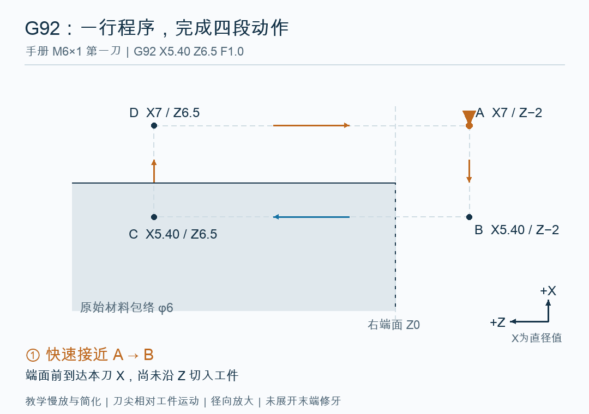
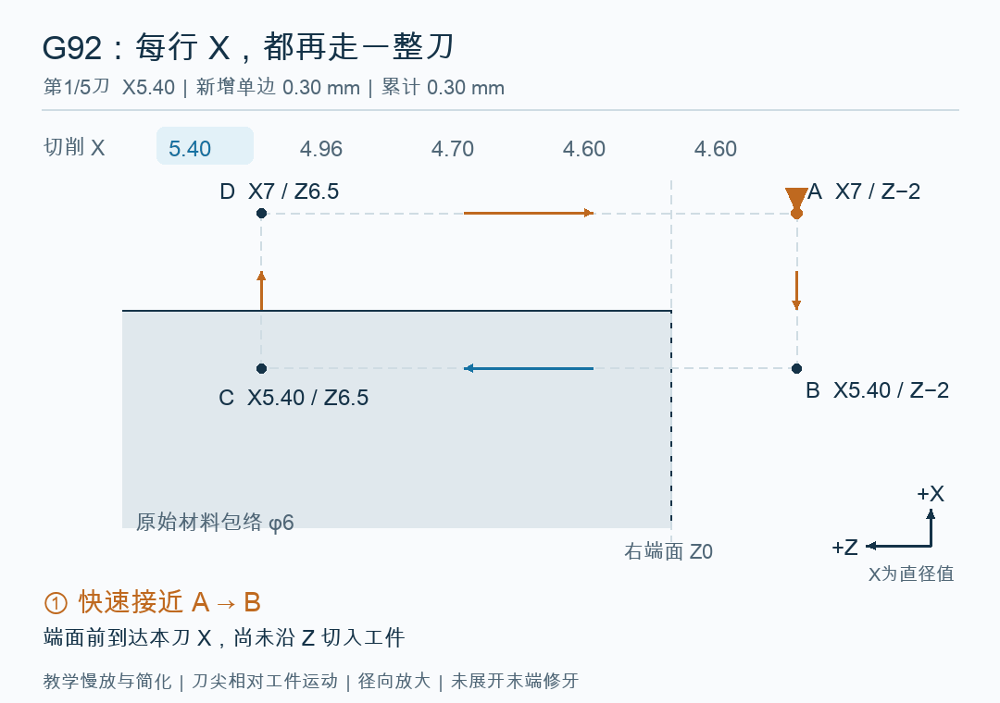
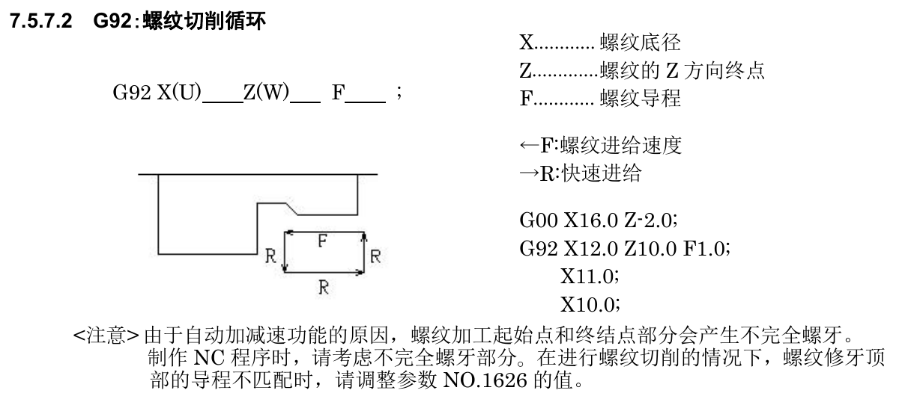
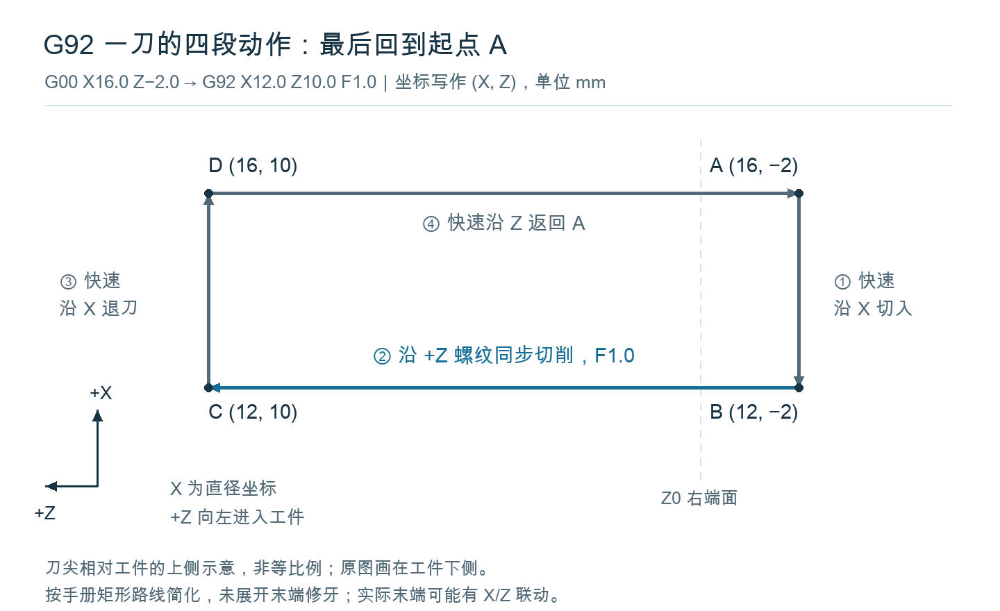
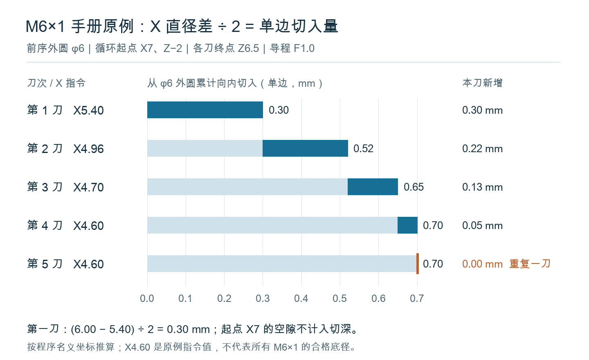
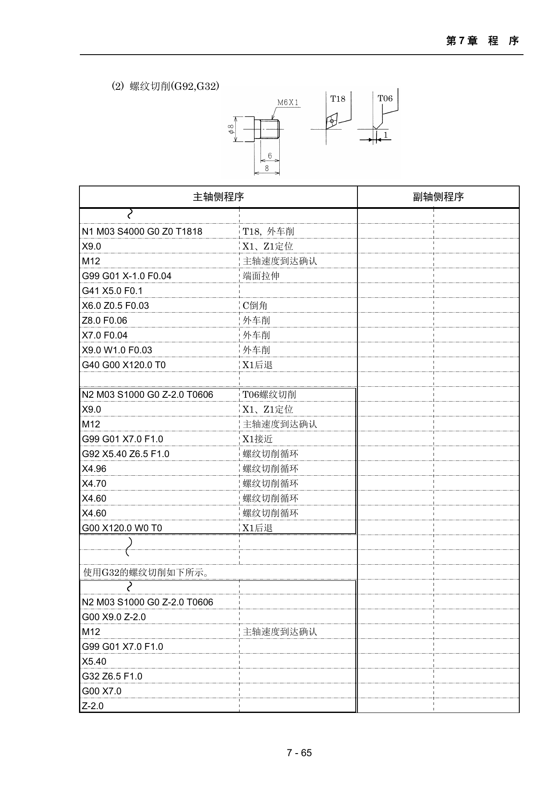

# G92 螺纹切削循环图文详解

依据：津上 S205A/S206A，3281-LTQ0C-05 中文手册。主讲主轴侧、圆柱外螺纹、公制、X 直径编程。封面控制器为 FANUC 0iTF Plus，但文件名机号与封面、前言存在适用性差异；实际执行前须核对机型、控制器和 G 代码制。

以下把厂家原例、由原例计算的数值、教学简化分开。原例没有完整指定材料、刀片牌号、现场装夹与控制状态，因此不是可直接投产的通用程序。

## 动图学习入口

先记一句：**一行一整刀，X定深、Z定终、F定导程；切完回起点，下一刀再加深。**

下面两张动图沿用手册M6×1原例：主轴侧、公制、X直径编程；右端面Z0，+Z向左、+X向上。它们是刀尖相对工件的轴向侧视图，径向放大；矩形路线未展开末端修牙、同步等待及加减速，不是实际速度仿真，也不是整机运动演示。





看图时注意三个区别：

- **X7是循环起点，φ6才是本例螺纹切前外径。** 第一刀名义单边切入是(6−5.40)/2=0.30 mm。
- 每次切削后先沿X退出，再沿Z回到X7/Z−2；不是让刀沿螺纹原路倒车回来。
- 最后一行X4.60仍然触发完整循环；与前刀相同坐标，所以新增名义切深为0。实际是否出切屑取决于前刀让刀等因素。

记忆自测：第一刀结束时在哪里？答案是X7、Z−2；不是X5.40、Z6.5。

## 1. 一行 G92 做什么

G92 把一刀螺纹的“切入—同步车螺纹—退刀—返回”组成一个循环。每执行一个循环程序段，切一刀并回到循环起点。逐刀切多深，仍由程序员给出各刀 X 值；只写一次最终 X，不会自动替你分成多刀。

机床控制器根据主轴位置同步轴向运动，使各刀在相同条件下沿同一条螺旋加深。G01 的普通直线进给不能直接当作螺纹同步进给来替换。

本机 G 代码表中 G92 是螺纹切削循环；不要套用其他系统里 G92 的坐标设定意义。

依据：§7.5.7.2，纸面7-43（原PDF第311页）；G代码表，纸面7-26（第294页）。同步原理另见文末 FANUC 补充来源。

## 2. 格式：X 管本刀深度，Z 管终点，F 管导程

```gcode
G92 X(U)___ Z(W)___ F___;
```

括号是手册的选用写法：X/U 二选一、Z/W 二选一，不是让你照录括号。

| 地址 | 本教程中的含义 | 重点 |
|---|---|---|
| X | 本刀切削的绝对 X 坐标，按直径表示 | 外螺纹逐刀减小；最后一刀的目标仍须依据图样、刀片和实测确定 |
| Z | 螺纹切削段的绝对 Z 终点 | 不是自动保证的完整螺纹长度 |
| U | 相对循环起点的 X 增量，按直径变化量表示 | 不是相对上一刀的追加切深 |
| W | 相对循环起点的 Z 增量 | 起点不是 Z0 时，W 与最终 Z 不同 |
| F | 螺纹导程 | 公制下是主轴每转的轴向前进量，单位 mm/rev |

手册把 X 简写为“螺纹底径”。在多刀例程中，应读作“这一刀的目标 X”，不能认为第一刀已经达到最终牙底。

单头螺纹：导程 = 螺距。因此单头 M6×1 的 F 为 1.0。

多头螺纹：导程 = 头数 × 螺距。两头、螺距1 mm时，导程为2 mm。但只改成 F2.0 还不会自动得到两头螺纹，各头起始相位也必须另行编程；此处不展开该机未核实的多头程序。

G92 的 F 已被定义为导程，不能因为前面有 G98 就把 F1.0 解释为1 mm/min，也不能因为想降低切削负荷就把单头 M6×1 的 F 随意改小。正常 G01 的 F 才需要结合 G98/G99 解释。

若仅用原例的 S1000 和 F1.0 作算术演示，同步切削时名义轴向速度为：1000 rev/min × 1 mm/rev = 1000 mm/min。程序仍写 F1.0，不写 F1000。S1000 是该原例数值，不是未知材料的推荐转速。

依据：§7.5.7.2，纸面7-43（第311页）；程序原点与地址功能，纸面7-6、7-8（第274、276页）。

## 3. 手册基础原例：先把四段动作读懂



```gcode
G00 X16.0 Z-2.0;
G92 X12.0 Z10.0 F1.0;
X11.0;
X10.0;
```

沿用手册的程序坐标：右端面为 Z0，+Z 向左进入工件，X 为直径值。图示是刀尖相对工件的轨迹；走心机的实际 Z 运动不能仅凭图认定由刀架完成。

坐标按 (X,Z) 写，第一刀简化为：

| 路段 | 起点→终点/mm | 动作 |
|---|---|---|
| A→B | (16,−2)→(12,−2) | 快速沿 X 切入，在端面前到达本刀目标直径 |
| B→C | (12,−2)→(12,10) | 按导程1.0沿 +Z 同步车螺纹 |
| C→D | (12,10)→(16,10) | 快速向外退刀 |
| D→A | (16,10)→(16,−2) | 快速返回轴向起点 |



这是照手册矩形路线作的教学简化，未展开末端修牙、加减速及实际刀尖形状。启用末端修牙时，实际末端会有 X/Z 联动，不能把这里的理想 C 点当作现场必经停点。

执行第二行后，刀尖回到 A，不是留在 X12、Z10。

第三行 X11.0 继承 G92、Z10.0、F1.0，再完成一整刀；第四行 X10.0 同理。三刀的切削直径不同，但循环起点都为 X16、Z−2。

X16 是返回/起点直径，原例没有在此声明毛坯直径，因此不能从 (16−12)/2 推断第一刀实际吃刀2 mm。

原图 R 表示 Rapid，即快速移动；不是这一行程序里需要额外填写的 R 参数。G92 的横向退出在此图标为快速，而同页 G90 的横向退出为切削进给，两者不能混画。

依据：§7.5.7.2，纸面7-43（第311页）；程序原点，纸面7-6（第274页）。

## 4. 手册加工实例：M6×1，逐刀加深

来源：§7.9.1(2)，纸面7-65～7-66（原PDF第333～334页）。原图明确标 M6×1、螺纹部位长度6；前序把外圆车到 X6.0。螺纹刀为 T06，原例转速 S1000。原例准备段最后把刀尖置于 X7.0、Z−2.0。

原文中的螺纹工序如下，保留原行；它仍只是整机程序的局部，不是独立可运行程序：

```gcode
N2 M03 S1000 G0 Z-2.0 T0606
X9.0
M12
G99 G01 X7.0 F1.0
G92 X5.40 Z6.5 F1.0
X4.96
X4.70
X4.60
X4.60
G00 X120.0 W0 T0
```

| 原行或部分 | 在原例中的作用 |
|---|---|
| N2…T0606；X9.0；M12 | 原例螺纹工序准备；页中 M12 旁注明“主轴速度到达确认” |
| G99 G01 X7.0 F1.0 | 在 Z−2 处沿 X 接近，建立循环起点；这一行的 F 是普通 G99 进给 |
| G92 X5.40 Z6.5 F1.0 | 第一刀车到 X5.40，轴向终点 Z6.5，导程1.0，再回起点 |
| X4.96 | 第二刀，继承 G92/Z/F，切得更深后回起点 |
| X4.70 | 第三刀，切得更深后回起点 |
| X4.60 | 第四刀，达到本例最后给定 X 后回起点 |
| X4.60 | 第五刀，按相同 X 再走一整刀，没有新增名义切深 |
| G00 X120.0 W0 T0 | 原例离开螺纹工序的程序段；明确切换 G00，不能把 X120 作为任意现场的通用退刀位置 |

### 单边切深怎样算

下面是根据名义坐标的计算，不是手册另外给出的材料切削推荐。

第一刀：本刀单边切入 = (切前外径 − 本刀 X)/2。

后续刀：本刀新增单边切入 = (上刀 X − 本刀 X)/2。

累计单边切入 = (切前外径 − 本刀 X)/2。



第一刀从 φ6 外圆算：(6.00−5.40)/2=0.30 mm。不能从 X7 算0.80 mm，X7 到 φ6 之间有0.50 mm的名义单边空隙。

后面逐刀新增为0.22、0.13、0.05、0 mm；累计为0.30、0.52、0.65、0.70、0.70 mm。

末尾重复 X4.60 从程序上确定的事实是“相同深度再走一刀”。工艺上常用于修整前刀因弹性让刀留下的余量，俗称光刀/弹簧刀；手册本页未明确说明重复刀的目的。没有新增名义切深，也不代表实际一定不出切屑。

### 为什么不能把 X4.60 当成 M6×1 通用答案

X4.60 仅是该厂家示例的最后指令值。真实螺纹还需依据公差等级、刀片牙型/刀尖、实际大径、中径与小径、刀具补正及量规/测量结果确定。G92 不会根据“我想做 M6×1”自动查标准并保证成品合格。

同一本手册 §7.10.2、纸面7-94（第362页）的 P=1.0 列“高度”为0.65，且分有色金属、铁材安排不同次数。本例按 X 坐标计算累计0.70，两组内容不能拼成同一套通用切深或尺寸保证。

### Z6.5 与图纸长度6有什么关系

原例循环从 Z−2 到 Z6.5，指令轴向行程为8.5 mm；图纸螺纹部位标6 mm。三者含义不同：空中导入也计入轴向行程，首尾又会有不完整螺牙。

第334页给出 T06 的 Z 补正为1.0，配合第333页刀具基准图阅读。不要忽略刀尖基准，直接把程序中的 Z6.5 判为成品有效螺纹长度6.5。



## 5. 模态与 U/W：最常见的编程误读

“模态”就是前面选中的功能继续有效。因此 G92 之后单独写 X，是再做一次螺纹循环，不是普通 X 定位。

教学中可在完成本例、已回到 X7/Z−2 后，用下列单独的补充行明确切换到快速定位模式：

```gcode
G00 X7.0 Z-2.0;
```

此行是教学补充，不是厂家原例结尾的逐字替换建议。因刀尖已在该起点，它主要用于说明“必须明确离开 G92 模式”。现场下一步的位置仍由完整刀路决定。不要套用钻孔循环的 G80 作为本例的通用取消方法。

对基础例 A(X16,Z−2)：

```gcode
G92 U-4.0 W12.0 F1.0;
```

其几何目标等同 X12、Z10：U=12−16=−4；W=10−(−2)=12。

刀尖完成循环后仍回 A。下一刀若要到 X11，相应 U 为−5，不是−1。重复 U−4 会再次到 X12，不会自动再减4。

同组运动码取消及模态细节参见 FANUC 补充来源 §4.1.2.1、§4.1.6；本机现场仍需核对对应控制器版本。

## 6. 起点、终点和转速怎样理解

- 起点 X 要为整把刀具提供返回间隙；起点 Z 要在能安全切入并建立同步的位置。原例 Z−2 不是任何导程、转速都适用的固定安全值。
- 手册明确首尾会因自动加减速产生不完整牙。应按有效牙长、导入距离、末端修牙/退刀空间及刀具基准审查，靠近台肩时尤其不能只看最终 Z 是否到了。
- 手册 §7.5.8 明确螺纹切削不使用一般恒线速控制。FANUC补充手册§3.2要求从粗切到精切保持相同主轴转速，并说明同步起始相位的原理。用固定转速思路理解 G97；不要用普通车削调倍率的方式想当然地调螺纹。
- 本机手册中的 G50 S 最高转速锁定对 G96 有效、G97 无效，不能用它假定 G97 的任意 S 值会被自动兜住。
- 原页提到参数1626处理特定修牙问题，但这不是初学 G92 时应尝试的调整项。尚无现场异常、原参数与对应版本依据，不能据此给出修改数值。
- 控制器手册说明单段运行的一次启动可能完成四段动作；不能假设刀尖会在 A/B/C/D 每个角停下。进给保持的螺纹退刀行为也应按现场功能核对。

依据：§7.5.7.2、§7.5.8，纸面7-43～7-44（第311～312页）；不完整螺纹长度资料见原PDF第363页，该页无可见纸面页码。单段行为参见 FANUC §4.1.2.1，纸面38（其PDF第52页）。

## 7. G32、G92、G76 怎样分清

| 指令 | 教学中如何理解 | 需要自己安排什么 |
|---|---|---|
| G32 | 指定螺纹同步切削运动段 | 每刀切入、退出、返回与深度需另写 |
| G92 | 包含切入、螺纹切削、退刀和返回的一刀循环 | 各刀目标 X 要自己逐行给出 |
| G76 | 复合螺纹切削循环 | 根据专门格式给条件，由循环组织多刀；不能套用 G92 格式 |

第333页同时给出 G32 对照：其 G32 Z6.5 F1.0 之后另写 G00 X7.0、Z−2.0。这正说明 G32 本身没有替你完成 G92 的全部返回动作。不要把 G92 直接改写成 G01 来车螺纹。

此处只完整讲解圆柱外螺纹。内螺纹通常向孔壁逐步增大 X，不能照搬外螺纹递减值；锥螺纹的 R 与原图“快速 R”不是同一概念；左右旋须结合主轴方向、进给方向及刀具安装确定。这些均需单独核对。

## 8. 自测

1. G92 X5.40 Z6.5 F1.0 执行完成后，本例刀尖在哪里？
2. 从 X5.40 到下一刀 X4.96，本刀新增单边切深多少？
3. 单头螺纹螺距1 mm，转速1000 min⁻¹，程序应该写 F1.0 还是 F1000？
4. 连写两次 X4.60，第二次会不会再走一整刀？
5. Z6.5 能否直接证明完整牙长为6.5 mm？

答案：① X7、Z−2；② 0.22 mm；③ F1.0；④ 会，但没有新增名义切深；⑤ 不能。

## 9. 原文与运行前仍需确认的条件

原文索引：

- 程序原点：纸面7-6（原PDF第274页）；地址功能：纸面7-8（第276页）。
- G代码表：纸面7-26（第294页）。
- §7.5.7.2 G92：纸面7-43（第311页）。
- §7.5.8 G96/G97：纸面7-44（第312页）。
- §7.9.1(2) 主轴螺纹原例及刀具补正：纸面7-65～7-66（第333～334页）。
- §7.10.2 螺纹切削计算表：纸面7-94（第362页）；不完整螺纹长度资料：原PDF第363页。

补充来源为 FANUC 原厂编写的 B-64604EN-1/01《0i-MODEL F 车床操作手册》，用于核对同步、模态及单段原理，不替代现场 0iTF Plus 对应版本：[制造商公开镜像](https://www.vmclathe.com/wp-content/uploads/2024/06/Fanuc-controller-%E5%8F%91%E9%82%A3%E7%A7%91%E8%8B%B1%E6%96%87.pdf)。相关章节为 §3.2、§4.1.2.1、§4.1.6。

实际程序仍需确认：具体机型/控制器/G代码制、主副侧与旋向、公差与有效牙长、材料与刀片、真实外径/补正/坐标、夹持导套与末端空间、转速及双通道状态，并完成对应的程序检查、空运行、试切与螺纹测量。
