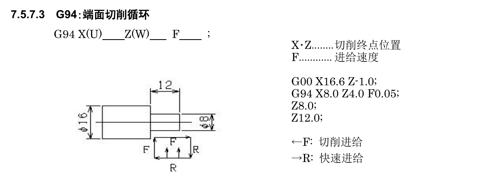
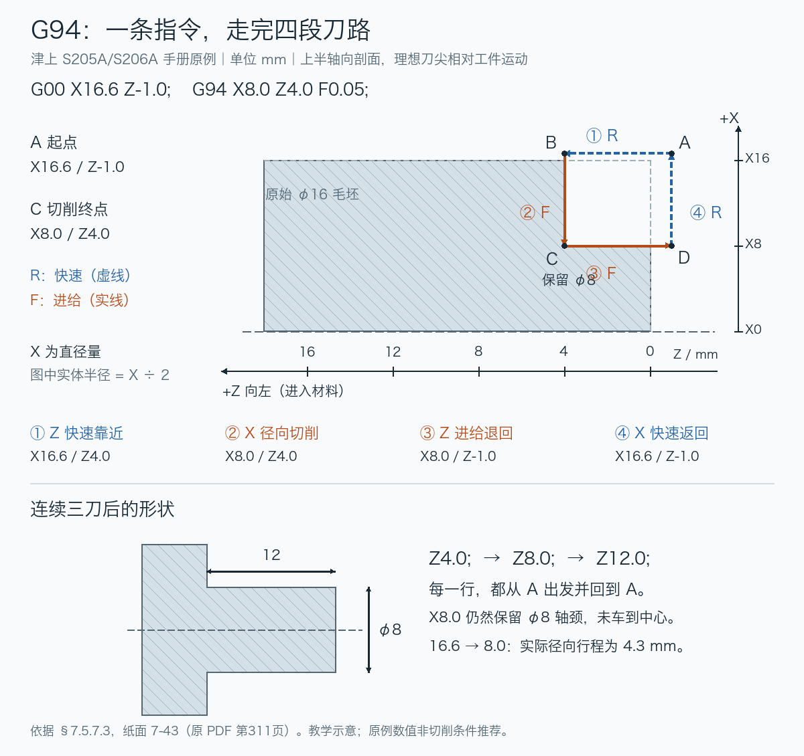

# G94 端面切削循环｜S205A / S206A

依据：津上 3281-LTQ0C-05 中文手册，§7.5.7.3，纸面7-43（原PDF第311页）。概念学习按该手册的车削代码体系解释；封面为FANUC 0iTF Plus，前言另提旧控制器资料，实际机台的控制器与代码体系仍需核对。

## 1. G94 做什么

G94把一次端面车削的四段刀路写在一个程序段中。主切削动作是沿X方向径向移动；需要多刀时，再给出不同的Z终点。

本机G94为端面切削循环；每分钟进给由G98选择，每转进给由G99选择。G94决定刀路，G98/G99决定F的单位，两者职责不同。

本机手册格式：

```gcode
G94 X(U)___ Z(W)___ F___;
```

| 地址 | 含义 |
|---|---|
| X | 径向切削终点的绝对直径坐标 |
| U | 对应X的增量，按本例直径编程约定计算 |
| Z | 端面切削所在的绝对Z坐标 |
| W | 对应Z的增量，从本轮循环起点计算 |
| F | 切削进给量；单位取决于G98/G99 |

X/Z是切削终点，不是循环最后停下的位置。循环结束还会返回循环起点。

## 2. 先看手册原图



原文：§7.5.7.3，纸面7-43（原PDF第311页）。上图中F表示切削进给，R表示快速进给；图上的R是运动方式标记。

手册原例，保持原数值与顺序：

```gcode
G00 X16.6 Z-1.0;
G94 X8.0 Z4.0 F0.05;
Z8.0;
Z12.0;
```

本例按G99每转进给状态讲解，F0.05对应0.05 mm/rev。原例没有单列G99，解释这一单位依赖当前模态。材料、刀片型号和适用切深未在这段示例中给出，这些数值用于读懂刀路。

## 3. 坐标与观察方向

- 主轴侧的X-Z剖面，Z0为加工开始时棒料右端面。
- +Z向左进入材料；+X径向向外。沿用本机程序原点图，不套用其他车床的Z符号。
- X为直径值：X16是直径16 mm，X8是直径8 mm。
- 重绘示意把刀尖放在工件上侧，说明刀尖相对工件的运动，不表示实机某个部件照图平移。图示可对轴向和径向分别缩放；径向位置按X/2计算。

依据：程序原点图，纸面7-6（原PDF第274页）；地址表，纸面7-8（原PDF第276页）。

## 4. 第一刀的四段动作

起点A为 X16.6、Z-1.0，第一刀切削终点C为 X8.0、Z4.0。

| 段 | 从哪里到哪里 | 运动方式 | 作用 |
|---|---|---|---|
| ① A→B | (X16.6,Z-1)→(X16.6,Z4) | Z快速，R | 保持外径避让，移到本刀Z位置 |
| ② B→C | (X16.6,Z4)→(X8,Z4) | X切削进给，F | 径向车端面，直到直径8的位置 |
| ③ C→D | (X8,Z4)→(X8,Z-1) | Z切削进给，F | 沿X8这一母线返回起始Z位置 |
| ④ D→A | (X8,Z-1)→(X16.6,Z-1) | X快速，R | 返回起始直径，结束本轮 |

顺序是 **R → F → F → R**。第三段仍按F运动，可能沿已形成的圆柱表面运动，不能改画成快速退刀。



第一刀在刀路层面可展开理解为以下四行；这是教学展开，不是津上手册另给的完整生产程序：

```gcode
G00 Z4.0;
G01 X8.0 F0.05;
G01 Z-1.0;
G00 X16.6;
```

前提仍为已经位于A、G99有效，刀具和补正等条件已经正确建立。这里只比较理想刀尖路径，不把不同写法的加减速、停顿和刀尖补正处理视为完全相同。

## 5. 后两刀为什么只写Z

执行第一行G94后，循环方式保持有效。后面的`Z8.0;`沿用X8.0和F0.05，把本轮Z终点改到8，再执行完整四段循环；`Z12.0;`同理。

三轮都从A出发并回到A：

1. 到Z4，切到X8，返回A。
2. 到Z8，切到X8，返回A。
3. 到Z12，切到X8，返回A。

根据原图和程序，Ø16棒料前端形成 **Ø8、长度12 mm的轴颈/凸台**，后方仍保留Ø16。由于X终点是8，中心部分会保留；该例没有车到X0。


动图采用理想几何去料示意，忽略刀具形状、刀尖R、弹性变形、切屑和实机机构。动画时间为了观察而设置，不是实际加工节拍。

## 6. 哪些数值是切深，哪些是进给

由原例计算：

- 起点X16.6相对Ø16毛坯的直径间隙为0.6 mm，实际单边径向间隙为0.3 mm。
- 第一刀的总径向移动量：(16.6−8)/2＝4.3 mm；其中起始0.3 mm位于毛坯外。
- 三次Z终点为4、8、12 mm，相邻轴向加工层厚度为4 mm。
- F0.05不是切深，而是G99状态下每转0.05 mm的进给量。

G94不会根据最终Z12自动分配三刀。这里是程序员明确写出三次终点。手册例中的4 mm层厚没有绑定当前材料与刀具，不能直接作为现场推荐切深。

一般换算示例：若假设转速为2000 r/min，G99 F0.05对应的实际进给速度为2000×0.05＝100 mm/min。2000 r/min只是计算假设，不是本例新增的推荐转速。

进给依据：§7.5.9，纸面7-45（原PDF第313页）。

## 7. X/Z与U/W怎么换

X/Z按绝对终点写；U/W按每轮循环共同起点A计算。根据本例坐标推导，第一刀为：

```gcode
G94 U-8.6 W5.0 F0.05;
```

因为U＝8−16.6＝−8.6，W＝4−(−1)＝5。U的直径差8.6对应实际径向移动4.3 mm。

三刀若统一改写为增量形式，在本例共同起点与模态条件下可推导为：

```gcode
G94 U-8.6 W5.0 F0.05;
W9.0;
W13.0;
```

后两刀的W分别是8−(−1)＝9、12−(−1)＝13。每轮已经回到Z-1，因此不能把后两行都写成W4来表示“再加深4”。上面是教学坐标推导，未作为实机程序验证。

依据：纸面7-6、7-8、7-28（原PDF第274、276、296页），结合§7.5.7.3循环图计算。

## 8. 循环如何结束

“一轮动作结束”与“G94模式取消”是两回事。每轮返回A后，若继续给适用的坐标指令，仍可能执行循环。改变加工方式前，应明确切换到G00或G01等其他01组运动代码。

本机§7.5.1说明模态代码由同组代码替换，但未在G94示例中展开退出细节。补充依据为FANUC原版《0i-MODEL F For Lathe System》B-64604EN-1/01，§4.1.3.1，纸面43（该FANUC PDF第57页）；此为相近控制器资料，实际执行仍以本机对应控制器版本为准。

教学补充可以在原例最后单列：

```gcode
G00;
```

这行仅示意切换模式，不指令新的移动，也不是津上原例中的第五行。G80在本机代码表中用于开孔固定循环取消，不能拿它代替这里明确切换运动模式。

FANUC上述手册另指出：其G94在实机单段模式下，一次循环启动会完成全部四段。交互动画“下一步”只是教学分解，不能据此认为实机每个拐点都会停。

[FANUC原版手册（机床商托管副本）](https://www.vmclathe.com/wp-content/uploads/2024/06/Fanuc-controller-%E5%8F%91%E9%82%A3%E7%A7%91%E8%8B%B1%E6%96%87.pdf)

## 9. 与G90的区别

本机的G90同样是车削循环，其主要切削行程沿Z方向，多刀通常改变X终点；G94的主要端面切削行程沿X方向，多刀通常改变Z终点。不要把本机G90当作铣床式的绝对编程开关。X/Z和U/W自身区分绝对/增量。

## 10. 学习后应能核对的内容

- 循环前是否已建立明确起点A，第一段快速运动是否有毛坯外的径向避让。
- X终点是直径还是半径、保留中心凸台还是需要切到中心。
- Z正负方向、Z0位置、每刀终点与层厚是否正确。
- F单位取决于G98/G99；G99下需要相应主轴旋转。
- 四段运动均无夹头、导套、刀具或其他轴干涉，第三段是切削进给。
- 后续程序是否明确退出G94模式。

这些示例没有提供现场刀具、刀尖补正、材料、装夹、双通道状态和验证结果，仅作为学习资料；完成刀路理解不等于可以直接上机加工。

## 原文定位

- §7.5.7.3 G94端面切削循环，纸面7-43（原PDF第311页）。
- 程序原点图，纸面7-6（原PDF第274页）；地址功能表，纸面7-8（原PDF第276页）。
- §7.5.2 G00与增量距离，纸面7-28（原PDF第296页）。
- G代码表，纸面7-26（原PDF第294页）；§7.5.1模态，纸面7-27（原PDF第295页）。
- §7.5.9 G98/G99，纸面7-45（原PDF第313页）。
- 补充FANUC B-64604EN-1/01 §4.1.3.1，纸面43（该FANUC PDF第57页）。该PDF的页序与津上手册原PDF页序分别计算。
