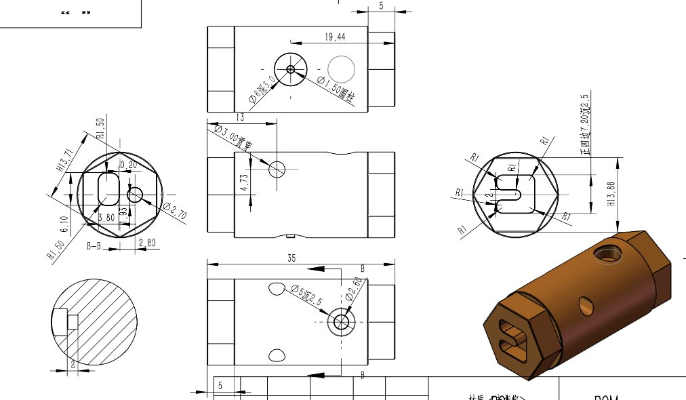

# 双端六方舌形槽多孔件（O1001 / O0101 / O2001 / O0201）学习与编程文档

> 本目录依据 `cnc-learn-nc-programs` 仓库分组规范建立，归档用户提供的 V2 版双通道四程序与工程图纸，并补充图纸几何识读与上机前调机核对要点。**当前所有程序逐字保留用户 V2 原稿，尚未经过控制器仿真与实机验证，禁止直接传输上机生产。**

## 概况与关联文件索引

| 项目 | 规格与约定 |
| :--- | :--- |
| **适用机型 / 系统** | 津上（TSUGAMI）S205A / S206A（无导套塑料干切规划；副轴无 `Y2` 轴，使用 `X2-C2` 极坐标插补 `G12.1`） |
| **零件与材料** | 双端六方舌形槽多孔件；图纸标题栏右下角可见 `POM` 字样（左侧“材质”栏存在文字重叠） |
| **毛坯与总长** | V2 程序预设 `Ø18.5 mm` 棒料；成品总长 `35 mm`，左右两端外六方各长 `5 mm` |
| **程序结构** | 主轴 `O1001`（调用子程序 `O0101`）+ 副轴 `O2001`（调用子程序 `O0201`） |
| **编程状态** | V2 审阅存档稿（保留原稿 `G42` 及 `G12.1` 下 `G41 R=0` 写法，与仓库默认 `G40` 规范的差异见第四节） |

| 文件分类 | 文件路径 | 说明 |
| :--- | :--- | :--- |
| **主轴主程序（审阅版）** | [O1001_主轴主程序_带注释审阅版.nc](commented/O1001_主轴主程序_带注释审阅版.nc) | 带中文注释，含定寸、外圆、左六方、左舌形槽、三组侧加工及 4 点握手切断（189 行） |
| **左端槽子程序（审阅版）** | [O0101_左端舌形方槽子程序_带注释.nc](commented/O0101_左端舌形方槽子程序_带注释.nc) | `Ø1.5` 立铣刀清腔并走 `G41`（`R=0`）精铣左端 `7.20` 舌形方槽（24 行） |
| **副轴主程序（审阅版）** | [O2001_副轴主程序_带注释审阅版.nc](commented/O2001_副轴主程序_带注释审阅版.nc) | 带中文注释，含 `/GOTO99`、平右端面、`G12.1` 铣 `H13.71` 六方、偏心槽/孔及接料（107 行） |
| **右端槽子程序（审阅版）** | [O0201_右端偏心槽子程序_带注释.nc](commented/O0201_右端偏心槽子程序_带注释.nc) | `Ø2.0` 立铣刀在 `G12.1` 下走 `G41`（`R=0`）精铣右端 `3.80×6.10` 偏心槽（14 行） |
| **主轴主程序（纯净版）** | [O1001.nc](production/O1001.nc) | 由审阅版自动剥离括号注释生成，纯 ASCII（176 行） |
| **左端槽子程序（纯净版）** | [O0101.nc](production/O0101.nc) | 由审阅版自动剥离括号注释生成，纯 ASCII（24 行） |
| **副轴主程序（纯净版）** | [O2001.nc](production/O2001.nc) | 由审阅版自动剥离括号注释生成，纯 ASCII（97 行） |
| **右端槽子程序（纯净版）** | [O0201.nc](production/O0201.nc) | 由审阅版自动剥离括号注释生成，纯 ASCII（14 行） |
| **工程图纸** | [工程图纸.jpg](工程图纸.jpg) | 零件多视图、B-B 剖视图及三维渲染图 |
| **调机核对清单** | [README_调机核对清单.txt](README_调机核对清单.txt) | 排刀表、与仓库规范差异及上机前逐项核对清单 |
| **工作区通用规范** | [AGENTS.md](../AGENTS.md) | 本仓库津上 S205A/S206A NC 编程与审查工作区规范 |

---

## 一、工程图纸与坐标基准

图纸采用第一角画法：主视图右侧视图展示左端 `H13.86` 六方及舌形方槽，主视图左侧视图展示右端 `H13.71` 六方及偏心槽/孔。

- **主轴侧（`O1001` / `O0101`）**：左端成品端面为 `Z1 = 0`，`+Z` 向棒料内部延伸；`X` 按直径编程。
- **副轴侧（`O2001` / `O0201`）**：右端成品端面为 `Z2 = 0`，`-Z` 向工件内部延伸；由于确认本机副轴无 `Y2` 轴且具备极坐标插补功能，右端六方与偏心槽均采用 `X2-C2` 的 `G12.1` / `G13.1` 编程。

### 图纸尺寸、计算与 V2 假设对照表

| 特征部位 | 数值与标注 | 证据分类 | 程序对应与几何计算说明 |
| :--- | :--- | :--- | :--- |
| **零件总长与毛坯** | 总长 `35`；毛坯 `Ø18.5` | 图纸明示（总长）+ V2 假设（毛坯） | `O1001` 定寸 `G300 X-2.0 Z37.3 T0808`（`35.0 + 0.2` 背平 `+ 2.0` 刀宽 `+ 0.1` 正平），`G150 Z-0.1` |
| **主圆柱外径** | `Ø16.0`（左端 `H13.86` 外接圆 `13.86 / cos30° ≈ 16.004`） | 计算 + V2 假设 | `O1001` 模块 1 粗车 `X17.2`、精车 `X16.0` 至 `Z37.5`（含端面 `C0.3` 去毛刺倒角） |
| **左端外六方** | 对边 `H13.86`、长 `5` | 图纸明示 | `O1001` 模块 2 用 `T2121`（`Ø6.0` 侧铣刀）分度 `C0~C300` 铣 `X13.86`，`Z2.0` 配半径 `3.0` 到 `Z5.0` |
| **左端舌形方槽** | `正四边7.20沉2.5`、舌宽 `2`、6 处 `R1` | 图纸明示 | `O1001` 模块 3 + `O0101` 用 `T1111`（`Ø1.5` 端铣刀）分 `Z1.25`、`Z2.50` 两层；刀心边界 `±2.85`（半宽 `2.85 + 0.75 = 3.60`）、内角 `R0.25 + 0.75 = R1.0`、舌头半圆中心 `X_rad = -1.00`、刀心 `R1.75` |
| **侧面偏心通孔** | `Ø3.00贯穿`、距左端 `13`、偏心 `4.73` | 图纸明示 | `O1001` 模块 4 用 `T2222`（`Ø3.0` 钻头）分度 `C90.0`，在 `Z13.0`、`Y4.73` 钻穿至 `X-17.5` |
| **侧面环槽与中心柱** | `Ø6深3.0`、`Ø1.50圆柱`、距右端 `19.44` | 图纸明示 + 计算 | `Z1 = 35 - 19.44 = 15.56`；`O1001` 模块 5 在 `C0.0` 用 `T2424`（`Ø1.5` 平底立铣刀）按 `G19` 切外圈 `R2.25` 与内圈 `R1.50` |
| **对面平底阶梯孔** | `Ø5沉2.5`、`Ø2.60`、`B-B` 剖视续深 `2`（总深 `4.5`） | 图纸明示（孔径/深度）+ V2 假设（`Z15.0`） | 图纸未直标轴向定位（视图投影居中偏右端）；`O1001` 暂取 `Z15.0` 并留修改注释 |
| **右端外六方** | 对边 `H13.71`、长 `5` | 图纸明示 | `O2001` 模块 2 用 `T3232`（`Ø6.0` 端铣刀）`G12.1` 分 `Z-2.5`、`Z-5.0` 两层；刀心对边 `13.71 + 6.0 = 19.710`，外接圆顶点 `C = 9.855 / cos30° ≈ 11.380` |
| **右端偏心槽** | `3.80×6.10`、角 `R1.50`、偏置 `0.20` 与 `1.93` | 图纸明示（轮廓）+ V2 假设（深 `3.0`） | `O2001` 模块 3 + `O0201` 用 `T3333`（`Ø2.0`）分 `Z-1.50`、`Z-3.00` 两层；槽宽方向刀心 `X-6.00 ~ X-2.40`（实体 `X_rad: -4.00 ~ -0.20`）、长方向 `C-0.93 ~ C3.17`（实体 `C: -1.93 ~ +4.17`） |
| **右端偏心孔** | `Ø2.70`、偏心 `2.80` | 图纸明示（孔径/偏心）+ V2 假设（深 `3.0`） | `O2001` 模块 4 用 `T3434`（`Ø2.7` 钻）在 `C0.0`、`X5.60` 钻至 `Z-3.85`（按 `118°` 钻尖补 `0.85` 保全径深 `3.0`） |

---

## 二、刀具清单与双通道同步流程

### 1. V2 程序预设刀位（实机须对照机台刀排核准）

| 通道 | 刀位补正 | 刀具描述 | 加工内容与对刀要点 |
| :--- | :--- | :--- | :--- |
| **主轴** | `T0404` | 外圆正手刀 | 平左端面、粗精车 `Ø16.0`、`C0.3` 倒角（启用了 `G42`） |
| **主轴** | `T0808` | `2.0 mm` 切断刀 | `G300` 挡料与切断（按低 `Z` 刃角对刀，切断位 `Z37.2` 留背面 `0.2 mm` 余量） |
| **主轴** | `T1111` | 正面端面 `Ø1.5` 立铣刀 | `G12.1` 铣左端 `7.20` 舌形方槽（`O0101` 启用 `G41`，要求 `T=0`、`R=0.000`） |
| **主轴** | `T2121` | 前横侧面 `Ø6.0` 立铣刀 | 分度铣左端 `H13.86` 六方 |
| **主轴** | `T2222` | 前横侧面 `Ø3.0` 麻花钻 | 钻 `Z13.0`、`Y4.73` 偏心贯穿孔 |
| **主轴** | `T2424` | 前横侧面 `Ø1.5` 平底立铣刀 | `G19` 铣 `Ø6/Ø1.50` 环槽及 `Ø5/Ø2.60` 平底阶梯孔 |
| **副轴** | `T3131` | 背面端面车刀 | 平右端面去除 `0.2 mm` 余量，保总长 `35.0 mm` |
| **副轴** | `T3232` | 背面端面 `Ø6.0` 立铣刀 | `G12.1` 铣右端 `H13.71` 六方（启用 `G41`，要求 `T=0`、`R=0.000`） |
| **副轴** | `T3333` | 背面端面 `Ø2.0` 立铣刀 | `G12.1` 铣右端 `3.80×6.10` 偏心槽（`O0201` 启用 `G41`，要求 `T=0`、`R=0.000`） |
| **副轴** | `T3434` | 背面端面 `Ø2.7` 麻花钻 | 钻右端 `Ø2.70` 偏心 `2.80` 孔 |
| **副轴** | `T9900` | 同轴接料基准号 | 接料前重置与夹持坐标对齐 |

### 2. 双通道 4 点握手顺序

1. **首件跳段**：`O2001` 开头的 `/GOTO99;` 在开启跳段时跳过背面加工直接前往 `N99`（吹气吐料动作与回原点）。
2. **`M501`**：主轴移至 `Z37.2` 后发出 `M22001;`（待核为 `M92001;`），等待副轴完成上一件背面加工、吐料并 `G28 W0.0` 回零。
3. **`M502`**：主轴开 `M56`（转速同步）、`M54`（相位同步）、`M53`（到速确认）后放行副轴上前。
4. **`M503`**：副轴快进至 `Z250.0`、工进夹持到 `Z24.0`（夹持 `11.0 mm`）并以 `M20` 夹紧后反馈主轴。
5. **`M504` → `M599`**：主轴切断至 `X-2.0`、检测 `M42` 并解除 `M55`/`M57` 同步后放行副轴带料 `G28 W0.0` 退回，双方在 `M599` 同步收尾。

---

## 三、上机前必核清单与仓库规范差异

1. **副轴调用及专用 M 码核对（对照津上手册 `3281-LTQ0C-05`）**：
   - `O1001` 模块 6 写的 `M22001;` 与手册 §7.4（纸面 7-12、原 PDF 第 280 页）及本仓库 `极坐标练习件` 所用 `M9****`（`M92001;`）不一致，须先核本机映射。
   - `O2001` 的 `M150`/`M151`、`M123 S... P22`/`M125`、`M17`/`M18` 未见于标准手册对应表或与手册定义不同（手册中 `M18` 为工件传送装置启动 `[选配]`、副轴喷气为 `M72`/`M73`、前方排出为 `M78`/`M79`，纸面 7-9～7-10 / 原 PDF 第 277～278 页；`G12.1`/`G13.1` 仅列在主轴侧选配栏，纸面 7-25 / 原 PDF 第 293 页），上机须实机逐一验证。
   - `M94` 与 `M95`/`/M92`/`M96`（手册纸面 7-10、7-18 / 原 PDF 第 278、286 页）须对照本机切料头及料尾检出程序 `O9002` 实机核对。
2. **与本仓库 [AGENTS.md](../AGENTS.md) 规范的差异**：
   - **40 mm 行程红线**：`O1001` 放料 `G300 X-2.0 Z37.3`，需结合本机侧铣动力头实测落刀距核算是否突破 `40 mm` 行程上限。
   - **刀尖补偿模式**：仓库默认按理想刀尖 `G40` 编程（不启用 `G41`/`G42`）；本套 V2 程序在 `O1001` 模块 1 使用了 `G42`，在 `O0101`、`O2001` 模块 2、`O0201` 的 `G12.1` 中使用了“混合法 `G41`（要求 `R=0.000`、`T=0`）”。上机前必须确认补正表已正确设置/清零，并核实控制器允许 `G12.1` 下开启 `G41`。
   - **保底关液与 `G19` 小内弧进给**：建议开机/收尾补核 `M09` 关液；`O1001` 模块 5 在 `Ø2.60` 平底孔（刀心 `R0.55`，墙弧倍率 `1.30 / 0.55 ≈ 2.36`）使用 `F220`，试切时视排屑与刀痕决定是否下调进给。
3. **图纸未直标尺寸与实机调试**：
   - 核实 `Ø5/Ø2.60` 侧阶梯孔的真实轴向位置（`O1001` 暂写 `Z15.0`）、右端 `3.80×6.10` 槽深与 `Ø2.70` 孔深（`O2001` 暂均取 `3.0 mm`）。
   - 无棒料空运行验证 `M56`/`M54`/`M53`/`M42` 与接料位置 `Z24.0`；首件试切后按实测确认是否需要在 `O2001` 的 `G00 C0.0` 处补入两端六方 `30°` 相位差。
