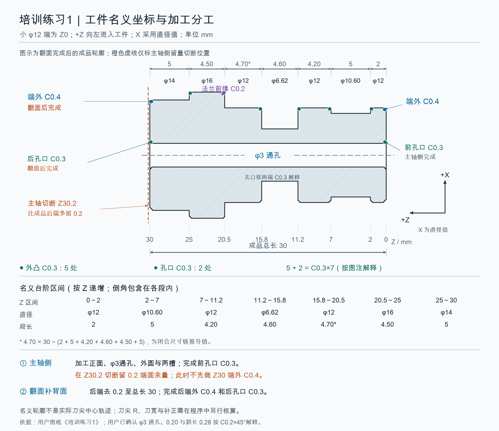

# 培训练习1：津上 S205A/S206A 教学加工程序

本资料按用户确认采用“学习练习、φ3通孔”的解释，编写津上主轴侧 X/Z 加工核心段。材料未指定，刀具与装夹没有现场数据；S、F、刀号、毛坯和刀具几何均为下文明确列出的教学假设，不是经材料及刀具厂家审核的切削条件。

交付文件：

- [O8101 主轴侧教学程序](O8101_主轴侧教学程序.nc)：车端面、φ3通孔、前孔口倒角、外圆粗精车、两处G75粗槽及槽精加工、留0.2 mm背面余量切断。
- [O8102 翻面背端教学程序](O8102_翻面背端教学程序.nc)：另一次主轴装夹，车去0.2 mm背面余量，完成后外缘C0.4和后孔口C0.3。
- [培训练习1原图](培训练习1_原图.pdf)。

O8102是翻面后在主轴侧重新装夹的教学段，不是可直接发送到副轴通道的程序。两段均以正确工件坐标、刀具补正、夹持和经检查的换刀入口已经建立为前提；没有编造自动送料、夹头开闭、主副轴接料或同步M码。

## 1. 图纸识读与坐标

采用原图上方侧视图方向：右侧小φ12端面为Z0，+Z向左进入工件；X为直径值。下方侧视图与上方视图左右相反，不要直接照搬其画面左右来赋Z正负。

| 成品名义区间/mm | 外径/mm | 区间长度/mm |
|---|---:|---:|
| Z0～2 | 12 | 2 |
| Z2～7 | 10.60 | 5 |
| Z7～11.2 | 12 | 4.20 |
| Z11.2～15.8 | 6.62 | 4.60 |
| Z15.8～20.5 | 12 | 4.70，按总长30减其余段推导 |
| Z20.5～25 | 16 | 4.50 |
| Z25～30 | 14 | 5 |

上表按名义肩面分段；倒角占用相应区间，不另外增加总长。尺寸相加：2+5+4.2+4.6+4.7+4.5+5=30。



倒角按如下解释编入：

- 前端小φ12外缘C0.4：端面直径X11.2，经Z0.4接φ12。
- 后端φ14外缘C0.4：翻面后端面直径X13.2，经新Z0.4接φ14。
- φ16法兰靠小端的前缘C0.2：X15.6/Z20.5到X16/Z20.7。图上的0.28与0.20满足0.2√2≈0.28，是斜边长度与轴向投影，不是另一个槽。
- 五处外凸C0.3：Z2、7、11.2、15.8对应φ12凸缘，以及Z25对应φ16凸缘。
- 余下两处C0.3解释为两端φ3孔口倒角，合计七处。两孔口之间的φ3圆柱长度30−2×0.3=29.4，与图注29.40相符。这是结合图形与C0.3×7作出的几何解释；用户已明确孔为通孔，但没有另行指定孔口倒角分配。

## 2. 教学毛坯与刀具假设

毛坯取φ18棒料。主轴先把外圆及切断带粗到φ16.2、Z32.3。成品背面在Z30；主轴在Z30.2切断，留0.2供翻面修端面。2 mm切断刀覆盖Z30.2～32.2，因此准备范围延伸到32.3，不能只准备成品长度30后就假定整片切断刀前方都是φ14。

所有刀号为本次自拟分工；手册列出这些格式与部分刀位原例，不表示现场已安装对应刀具。

| 刀号/补正 | 本例配置 | 刀具及基准假设 |
|---|---|---|
| T0606 | 外圆粗精车、端面刀 | 能加工本轮廓的两向肩面，有足够侧面让空；按理想尖角参考点教学 |
| T0707 | 2.00 mm可车槽刀 | 两刃角按理想零圆角；低Z刃角为参考点；刀具占据[Z参考点，Z参考点+2]；允许本例侧向精车 |
| T0808 | 2.00 mm切断刀 | 低Z刃角为参考点；刀具占据[Z参考点，Z参考点+2]；切断带的有效径向切深需满足本例约6.1 mm及退让条件 |
| T1515 | φ3长钻 | 118°钻尖；以钻尖最前端设Z刀长基准；有效刃长、排屑、入口导向须适用约10D深孔 |
| T1414 | 理想90°孔口倒角刀 | 以完整尖锥的理论顶点为Z基准，最大可用直径至少3.6；实际平头/截尖刀不能直接照用Z1.8 |

T07必须是允许侧向车削的槽刀，不能把只允许径向切入的普通切断刀直接当作它使用。实际刀尖圆角、刃形及切削宽度改变时，必须重新生成补偿后的轨迹；本程序不是完成真实刀尖R补偿的生产程序。

控制前提：公制、G18的ZX平面、X直径方式、G99、FANUC代码制A的G90及双行G75；G75的P/Q按IS-B、整数单位0.001 mm处理。未使用G41/G42；几何与磨耗补正号仍按T的后两位建立，不等于取消全部刀具补正。

程序中的S1000、F0.02～F0.08仅为便于阅读和仿真的教学数字。G97固定转速下，S1000表示1000 min⁻¹；G99下F为mm/rev。未给材料，所以不把这些数值写成任何材料的推荐条件。

## 3. 主轴侧程序按工序解读

| 程序段 | 加工任务 | 主要状态与判读 |
|---|---|---|
| N010 | 车前端面 | Z0是已设定的成品前端面；X-0.2让理想刀尖越过中心完成端面 |
| N100 | φ3通孔 | 以显式G01/G00分段啄钻，钻尖最终Z31.4；先钻孔再做细颈，保留较好毛坯刚性 |
| N200 | 前孔口C0.3 | 理想90°倒角刀到Z1.8，对应孔口φ3.6 |
| N300 | 粗φ16.2至Z32.3 | G90分两刀，包含后续切断带 |
| N320 | 粗前部φ12.2至Z20.5 | 多个X值继承G90后各完成一刀，再用G00明确退出循环模式 |
| N400 | 粗后部φ14.2 | T07宽2，从参考Z25.1到30.3，覆盖实际材料25.1～32.3 |
| N500 | 精车外形包络 | 暂保留两处槽为φ12；完成前外C0.4、法兰前C0.2、法兰后C0.3、φ14后段 |
| N600 | 粗φ10.6槽 | 两侧各留0.1 mm，槽底径向留0.1 mm |
| N620 | 粗φ6.62槽 | 同样留两侧0.1、槽底径向0.1 |
| N640 | 精浅槽与两侧C0.3 | 把刀具远侧刃角Z=参考Z+2计入 |
| N660 | 精深槽与两侧C0.3 | 同样用刀宽转换远侧肩面和倒角 |
| N700 | Z30.2切断 | 留背面0.2；X2进入已存在的φ3通孔，接料/支承由另行验证的机台流程承担 |

本核心段采用M13为主轴正转并开切削液，M12为主轴速度到达确认；刀具刃向须与该旋转方向相配。M05同时停止主轴及切削液，下工序用M13重新建立。这里没有调用副轴或夹头开闭码。

### φ3通孔为什么不写钻尖Z29.4

用户已确认通孔，成品总长30。主轴切断毛面在Z30.2，还留0.2余量，因此钻孔全直径部分至少应越过30.2。

按本例φ3、118°理想钻尖：

```text
钻尖轴向高度 h = (3/2) / tan(118°/2) ≈ 0.901 mm
钻尖最终位置  = Z31.4
完整φ3到达位置 ≈ 31.4 − 0.901 = Z30.499
```

这让完整φ3超过30.2切断面约0.299 mm。Z31.4是本例的计算选择，不是原图指定值，也不表示对未知长钻具有排屑或稳定性保证。

程序每次全退至Z-1，再快速到上次最深钻尖前0.5 mm，再按F向前钻。啄钻增量3 mm和再接近间隙0.5 mm均为教学设定；实际长钻的引导孔、转速/进给、啄钻与冷却应按钻具要求重做。程序没有把90°孔口倒角当作已验证的长钻导向工序。

## 4. 两处G75为什么不是直接写Z7和Z15.8

T07低Z刃角作参考，刀宽2。给G75的Z是最后一列低Z参考角；真正高Z边界还要加刀宽。

粗槽保留每侧0.1 mm，槽底保留径向0.1 mm：

| 槽 | 成品范围 | 粗切实际覆盖 | G75参考点起止 | 粗底直径 |
|---|---|---|---|---:|
| 浅槽 | Z2～7 | Z2.1～6.9 | 2.1→4.9 | 10.80 |
| 深槽 | Z11.2～15.8 | Z11.3～15.7 | 11.3→13.7 | 6.82 |

```gcode
(T07 WIDTH 2.0 - LOW Z EDGE REFERENCE)
G00 X13.0;
G00 Z2.1;
G75 R0.2;
G75 X10.8 Z4.9 P300 Q1000 R0 F0.03;
G00 X18.0;

G00 Z11.3;
G00 X13.0;
G75 R0.2;
G75 X6.82 Z13.7 P300 Q1000 R0 F0.03;
G00 X18.0;
```

P300表示径向0.3 mm；Q1000表示轴向1.0 mm。第一行R0.2仍是径向回退0.2 mm；第二行R0令槽底附加轴向让刀为零。G75后先明确径向退到X18，再沿Z移位，不依赖未核实的循环最终Z返回方式。

粗槽底φ10.8到成品φ10.6的直径差0.2，对应单边0.1；φ6.82到φ6.62同理。

## 5. 2 mm槽刀精加工的参考点转换

浅槽精加工片段：

```gcode
G00 Z1.7;
G00 X13.0;
G01 X12.0 F0.02;
G01 X11.4 Z2.0;
G01 X10.6;
G01 Z5.0;
G01 X11.4;
G01 X12.0 Z5.3;
G00 X18.0;
```

- 低Z刃角从(X12,Z1.7)到(X11.4,Z2)，形成近侧C0.3。径向差(12−11.4)/2=0.3，轴向差0.3。
- 低Z参考角在Z2处切到φ10.6，再向Z5侧向精车槽底；高Z刃角同时由Z4移动到Z7，完整覆盖Z2～7。
- 参考角固定Z5径向升到X11.4时，高Z刃角正好在Z7，控制远侧壁。
- 最后到参考角Z5.3、X12，高Z刃角到Z7.3，形成远侧C0.3。不是把参考角直接开到Z7.3。

深槽同理：低Z参考角从10.9开始，经11.2下到φ6.62；底部参考角终点13.8对应远侧刃角15.8；最后参考角14.1对应远侧倒角终点16.1。

这是有限刀宽下的名义几何刀路，不是忽略刀宽的单点轮廓直接照录。真实刀片两端圆角与刃形必须另算；G75本身不能套用G41/G42刀尖R补偿。

## 6. 外形包络和最终轮廓

N500暂时把两处槽都保留为φ12，先完成外圆包络。其关键点为：

```text
(X11.2,Z0) → (X12,Z0.4) → (X12,Z20.5)
→ (X15.6,Z20.5) → (X16,Z20.7) → (X16,Z24.7)
→ (X15.4,Z25) → (X14,Z25) → (X14,Z30.2)
```

前φ12的两处凹槽由T07后续加工。由于法兰两侧肩面方向不同，T06的刃形和侧面让空必须满足此轮廓；不能仅看刀尖路径正确就保证整片刀具无干涉。

最终成品外形的名义点如下，便于纸面校核；其中背端最后两点在翻面程序完成：

```text
(11.2,0) → (12,0.4) → (12,1.7) → (11.4,2)
→ (10.6,2) → (10.6,7) → (11.4,7) → (12,7.3)
→ (12,10.9) → (11.4,11.2) → (6.62,11.2)
→ (6.62,15.8) → (11.4,15.8) → (12,16.1)
→ (12,20.5) → (15.6,20.5) → (16,20.7)
→ (16,24.7) → (15.4,25) → (14,25)
→ (14,29.6) → (13.2,30)
```

每组写作(X直径,Z)，不是(Z,X)。这些是设计轮廓点，不是已经处理真实刀尖圆角的中心轨迹。

## 7. 切断与翻面不能混用坐标

主轴T08宽2，低Z参考角在Z30.2切断，刀体占据Z30.2～32.2。该带已粗至φ14.2；成品一侧在切断面有完整φ3通孔，因此切到X2.0即可进入孔内，使零件端部环形壁完全断开。这个X2.0不能推广到实心棒料，也不能在通孔未贯通切断面时照用。

本程序没有未经核实的自动接料指令。零件支承、接料和切断时的通道状态必须由独立验证的机台流程建立。它不等同于带主副轴同步接料的量产程序。

翻面后重新建立工件坐标：**成品背端面是新Z0，+Z仍向工件内部。**主轴留下的粗背端面位于新Z−0.2，而不是新Z+0.2。新Z0必须由定位及长度链建立，不能把粗面随意清零后直接照用O8102，否则不能保证总长30。

O8102先在新Z0车端面，再做外缘C0.4，然后用90°理想尖锥做孔口C0.3。此时新的(X13.2,Z0)→(X14,Z0.4)，对应主轴旧坐标的(X13.2,Z30)→(X14,Z29.6)。夹具需让出背端面及相邻外缘；具体夹持位置、夹紧力和定位方式没有凭图纸猜定。

## 8. 当前完成了什么、仍缺什么

已完成图纸尺寸重建、各倒角名义坐标计算、2 mm刀宽转换、两处G75粗槽、显式啄钻与通孔钻尖深度计算，以及切断后翻面的坐标转换。刀路经过独立读图和程序审阅。

本资料尚未经过真实控制器仿真、整刀具/导套/夹头干涉验证或试切。要改成实机程序，还需要实际材料、毛坯、刀具及刀尖R、补正、主副通道框架、送料/接料与夹持条件、相应S/F条件，以及图纸公差和表面要求。图纸未给这些条件，不能宣布该程序已经可投产。

首件测量至少核对总长30，各肩面位置2/7/11.2/15.8/20.5/25，两槽底φ10.60和φ6.62，最大φ16、后φ14、三处φ12，以及通孔φ3、两端孔口与各外缘倒角。未给公差的项目不自行设定合格范围。

## 9. 手册依据

津上3281-LTQ0C-05，S205A/S206A：

- §7.3，纸面7-6、7-8（原PDF第274、276页）：程序坐标、X直径值、X/U与Z/W。
- §7.4，纸面7-13（原PDF第281页）：主轴M03/M13、M05与冷却液关系；本例采用M13正转开冷却。
- §7.5，纸面7-26（原PDF第294页）：G75为外径/内径切断循环。
- §7.5.7.1，纸面7-43（原PDF第311页）：G90直线车削循环及连续X重复刀次。
- §7.5.8～7.5.9，纸面7-44～7-45（原PDF第312～313页）：G97固定转速、G99单位。G50主轴限速仅对G96有效，不能替代本例G97固定转速的审核。
- §7.7，纸面7-62（原PDF第330页）：T刀号与X/Z补正号格式；不得T与M00/M01同段。
- §7.8，纸面7-63（原PDF第331页）：完整主副轴程序起止涉及坐标、夹持、等待及送料；本例没有照搬其中G300/G150数值。
- §7.9.2，纸面7-67（原PDF第335页）：T1515、X0、主轴转速到达M12和显式Z向啄钻原例；纸面7-69（第337页）有G18平面指令实例。

G75完整格式补充依据与前一份G75讲解相同：FANUC B-64694EN-1/01 §4.2.6，纸面66～67；以及FANUC B-64604EN-1/01 §4.2.6，纸面80～81（该PDF第94～95页）。本地参照见[前次保存的FANUC手册](../G75学习资料/参考资料/FANUC_0i-F_车床操作手册_B-64604EN-1.pdf)。

全部零件尺寸来自用户本次图纸；φ3按用户确认的通孔解释。毛坯φ18、刀宽2、余量、钻尖角、理论倒角刀顶点和S/F数字均为本次教学假设，未冒充津上手册针对该工件的原厂工艺。
