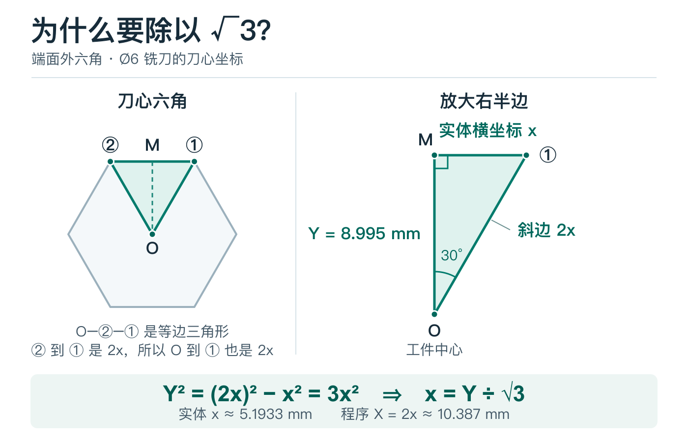

# 端面外六角刀心坐标计算

本例从端面看，正六角中心为 `X0 Y0`，上、下两边平行于 X 轴。主轴定在原例的 `C0.0`，铣刀中心用 X、Y 两轴走六段直线。程序 X 取实体横坐标的两倍，Y 按实体坐标填写。以下坐标已计入刀具半径。

## 先算刀心六角的对边

设成品对边为 `S`，铣刀直径为 `D`。刀心在每条成品边外侧偏移 `D ÷ 2`，一对平行边各加一个刀具半径，所以**刀心六角的对边 `B = S + D`**。

## 为什么除以 √3



把中心 `O` 连到上边两个刀心点 ①、②。六个角均匀绕一圈，相邻点在中心夹 `60°`，两条连线又等长，所以 `O–②–①` 是等边三角形。

从 `O` 向上边中点 `M` 画垂线。设右半条上边 `M→①` 长 `x`，整条上边就长 `2x`。等边三角形的边 `O→①` 也长 `2x`。在右半个直角三角形里，`O→①` 是斜边，竖边 `O→M` 就是 `Y`。

```text
Y² = (2x)² − x² = 3x²
Y  = √3 × x
x  = Y ÷ √3
```

`x` 是 ① 点的实体横坐标。换成直径编程值要乘 2，所以 `X = 2x = 2Y ÷ √3 = B ÷ √3`。左右尖点 ③、⑥ 的实体横坐标绝对值等于 `O→①` 的长度 `2x`，它们的 X 直径值绝对值就是 `4x = 2B ÷ √3`。

| 要算的数 | 直接公式 | 用在哪些点 |
|---|---|---|
| Y 的绝对值 | `B ÷ 2` | ①② 为正，④⑤ 为负 |
| 较小的 X 绝对值 | `B ÷ √3` | ①⑤ 为正，②④ 为负 |
| 较大的 X 绝对值 | `2B ÷ √3` | ⑥ 为正，③ 为负，两个点的 Y 都为 0 |

Gemini 的写法先算 `Y₀ = (S + D) ÷ 2`，再算 `Y₀ × tan 30° × 2` 得到较小的 X 绝对值。因为 `tan 30° = 1 ÷ √3`，两式可以合成 `(S + D) ÷ √3`，计算时少记一个系数。

## 代入本例

| 对边 S（mm） | 刀径 D（mm） | B（mm） | Y 绝对值 | 较小的 X 绝对值 | 较大的 X 绝对值 |
|---:|---:|---:|---:|---:|---:|
| 12.00 | 10.00 | 22.00 | 11.000 | 12.702 | 25.403 |
| 11.99 | 6.00 | 17.99 | 8.995 | 10.387 | 20.773 |
| 12.00 | 6.00 | 18.00 | 9.000 | 10.392 | 20.785 |

Gemini 用对边 12.00 mm 和 Ø10 解释原程序，第一行取到一位小数就是 `Y11.0`、`X12.7` 和 `X25.4`。用原图标注的 11.99 mm 配 Ø10，取到一位小数也会得到这组指令。本例 Ø6 按图上的 11.99 mm 计算，坐标取第二行。第三行供成品明确要求对边 12.00 mm 时查用。

每个 X 用原算式算完，再保留三位小数。以对边 11.99 mm 为例，较小的 X 未圆整值约为 `10.386531`，较大的 X 由 `2 × 17.99 ÷ √3` 得出 `20.773`。如果先把较小的 X 写成 `10.387` 再翻倍，会得到 `20.774`。

## Ø6 六点坐标表

成品对边 11.99 mm。按原图的点号在 `Z10.0` 走一圈。

| 点位 | 位置 | 程序 X | 程序 Y |
|---|---|---:|---:|
| ① | 右上 | 10.387 | 8.995 |
| ② | 左上 | -10.387 | 8.995 |
| ③ | 最左 | -20.773 | 0.000 |
| ④ | 左下 | -10.387 | -8.995 |
| ⑤ | 右下 | 10.387 | -8.995 |
| ⑥ | 最右 | 20.773 | 0.000 |
| 回到 ① | 右上 | 10.387 | 8.995 |

用上边做复核。刀心在 `Y8.995`，刀刃向内到 `8.995 − 3 = 5.995`，上下对边就是 `2 × 5.995 = 11.99 mm`。这张表给出六条边的刀心坐标，① 点的轴向进刀位置仍要结合毛坯外径确定。

点号和尺寸取自本例的两张图。 [端面铣六角原图](</Users/wanghu/Desktop/practice/端面铣六角.png>) [Gemini 坐标计算图](</Users/wanghu/Desktop/practice/针对此例端面六角坐标计算方式.jpg>)
