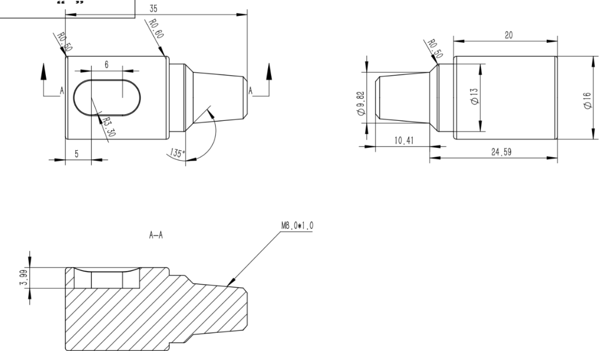

# 锥螺纹腰槽轴（O8104 / O8105 / O8106）学习与编程文档

> 本文档基于津上 S205A / S206A 走心机练习件“锥螺纹腰槽轴”的完整程序审查、工艺改版、几何推导与实机首件试切优化过程整理而成，可作为后续同类走心机复合加工练习件的编程规范与排错模板。

## 概况与关联文件索引

| 项目 | 规格与约定 |
| :--- | :--- |
| **适用机型 / 系统** | 津上（TSUGAMI）S205A / S206A，FANUC 0i-TF（仅 Path 1 主轴，无副轴同步） |
| **零件名称** | 锥螺纹腰槽轴（`M8.0×1.0` 5° 锥外螺纹 + 侧面盲腰形槽） |
| **材料与毛坯** | 工程塑料棒（如 POM），棒料直径 `Ø18.5 mm` |
| **冷却与刀尖模式** | **干切**（无 `M08`，仅首尾保留 `M09`）；**理想刀尖编程**（不开 `G41/G42`，补正表 `R=0`） |
| **程序结构** | 主程序 `O8104`（149 行审阅版 / 136 条有效指令）+ 粗铣 `O8105` + 精铣 `O8106` |

| 文件分类 | 文件路径 | 说明 |
| :--- | :--- | :--- |
| **主程序（审阅版）** | [O8104_主程序_带注释审阅版.nc](commented/O8104_主程序_带注释审阅版.nc) | 带中文逐行注释，供核对工艺、对刀与坐标 |
| **腰槽粗铣（审阅版）** | [O8105_腰槽粗铣子程序_带注释.nc](commented/O8105_腰槽粗铣子程序_带注释.nc) | `Ø6.0` 铣刀粗铣轮廓，单边留余量 `0.15 mm` |
| **腰槽精铣（审阅版）** | [O8106_腰槽精铣子程序_带注释.nc](commented/O8106_腰槽精铣子程序_带注释.nc) | `Ø6.0` 铣刀切向圆弧进退刀精铣槽宽 `6.60 mm` |
| **主程序（生产版）** | [O8104.nc](production/O8104.nc) | 纯净无注释 ASCII，可直接传机床 |
| **腰槽粗铣（生产版）** | [O8105.nc](production/O8105.nc) | 纯净无注释 ASCII，可直接传机床 |
| **腰槽精铣（生产版）** | [O8106.nc](production/O8106.nc) | 纯净无注释 ASCII，可直接传机床 |
| **工程图纸** | [工程图纸.png](工程图纸.png) | 零件原始工程视图与 A-A 剖面标注 |
| **调机核对清单** | [README_调机核对清单.txt](README_调机核对清单.txt) | 上机前排刀、对刀、直螺纹改法与首件提醒 |
| **工作区通用规范** | [AGENTS.md](../AGENTS.md) | 本仓库津上 S205A/S206A 跨会话长期开发与审查规则 |

---

## 一、图纸几何拆解与加工基准



### 1. 关键图纸尺寸一览表

全零件长度基准：**`Z0` 设于小头成品端面，`+Z` 向棒料内部（夹头方向）延伸，`+X` 为直径编程。**

| 特征部位 | 图纸标注 | 轴向范围（`Z`） | 径向 / 深度尺寸 | 关键几何推导 |
| :--- | :--- | :--- | :--- | :--- |
| **总长与分段** | 总长 `35`，`10.41 + 24.59 = 35` | `Z0.000 ~ Z35.000` | 最大成品外圆 `Ø16.00` | 小端面 `Z0.000`，大端面 `Z35.000` |
| **小端外锥与螺纹** | `M8.0×1.0`，长 `10.41`，大端 `Ø9.82` | `Z0.000 ~ Z10.410` | `Z0` 理论大径 `Ø8.00` → `Z10.41` 大径 `Ø9.82` | 反推半锥角 $\alpha = \arctan\frac{9.82 - 8.00}{2 \times 10.41} = 4.996^\circ \approx 5.00^\circ$ |
| **45° 斜肩与圆角** | 夹角 `135°`（与 `Ø13` 呈 `45°`），`R0.50` | `Z10.410 ~ Z12.207` | `Ø9.82` → `Ø13.00` | 斜肩交 `Ø13` 理论尖点在 `Z = 10.41 + (13 - 9.82)/2 = 12.000` |
| **Ø13 圆柱段** | `Ø13` | `Z12.000`（尖点）~ `Z15.000` | `Ø13.00` | 台阶端面距小端面 `35 - 20 = 15.000` |
| **Ø16 圆柱与肩角** | `Ø16`，长 `20`，肩 `R0.60`，尾端 `R0.50` | `Z15.000 ~ Z35.000` | `Ø16.00` | 根部 `R0.60` 终点 `Z15.600`；大端 `R0.50` 起点 `Z34.500` |
| **侧面腰形盲槽** | 大端圆心距尾端 `5`，圆心距 `6`，`R3.30`，A-A 剖面深 `3.99` | 圆心 `Z24.000` / `Z30.000`；槽壁 `Z20.700 ~ Z33.300` | 槽宽 `6.60`（`Y±3.30`）；槽底 `X8.020` | 大端圆心 `35 - 5 = 30.000`；槽底直径 `16.000 - 2×3.990 = 8.020` |

### 2. 轴向坐标总图

```text
  引入段   小端端面  倒角终点       锥段终点/斜肩  R0.50尖点  台阶   R0.60终点   腰槽左壁   小圆心    大圆心    腰槽右壁   大端R0.50  成品切断线   切断右刃   外圆过切
Z: -2.0      0.0     0.985          10.410        12.000   15.000  15.600     20.700    24.000    30.000    33.300     34.500    35.000      37.000     37.200
    |---------|--------|--------------|--------------|-------|-------|----------|---------|---------|---------|----------|---------|-----------|----------|---------|--> +Z (料内)
              |<----- C1.0x45° ------>|<-- 5° 锥 --->|45°斜肩|<-Ø13->|          |<---------------- 侧面腰形盲槽 --------------->|         |<-- 切断刀宽 2.0 -->|
              |<----- M8.0×1.0 有效牙区 (至Z9.000) ->|                          |<-- R3.30 ->|<-- 6.00 -->|<- R3.30 -->|
                                                                                                   (Ø6铣刀最远刀心 Z30.300)
```

### 3. 排刀与对刀基准表

| 刀位号 | 刀具规格 | 对刀与补正基准 |
| :--- | :--- | :--- |
| **`T0101`** | 前刀架横向动力头，`Ø6.0 mm` 中心刃平底立铣刀 | 刀心对工件中心；**实机已确认落刀距 `15.00 mm`**（注：当前 [README_调机核对清单.txt](README_调机核对清单.txt) 仍写旧估算值 `16.0 mm`，见文末备忘） |
| **`T0606`** | 60° 外螺纹车刀 | **必须按 60° 刀尖中心对 `Z0`**（若误对前侧刃，实际牙尾会整体向 `+Z` 多偏 `1~1.5 mm` 导致撞肩） |
| **`T0707`** | 35° 外圆车刀 | **理想刀尖编程**，不开 `G41/G42`，补正表设 `R=0.000` |
| **`T0808`** | `2.0 mm` 宽切断刀 | **较小 Z 零件侧刃对 `Z0`**（刀宽向 `+Z` 伸，刀片占 `[Z, Z + 2.0]`）；10 mm 刀柄配合 `G150 Z9.900` 留 `0.1 mm` 平端面余量 |

---

## 二、开机初始化、`G300`/`G150` 与 40 mm 行程红线

### 1. 单主轴标准初始化模板（`O8104` L8–L25）

```nc
M09 (关切削油 塑料干切);
M94 (送料机自动送料有效);
M60 (送料机转矩OFF);
G00 T0 G40 G97 G99 G18 (快速定位 取消刀补 恒转速 每转进给 XZ平面);
M05 (主轴停 - 必须在 G300 松夹之前停转);
M11 (主轴夹头松开);
G04 U0.5 (延时0.5s);
G300 Z____ T0808 (待填: 原点复位Z行程);
G150 Z9.900 (较小Z侧刃对刀 10mm刀柄留0.1mm平端面余量);
M61 (送料机推料顶紧);
G04 U0.5 (延时0.5s);
M10 (主轴夹头夹紧);
G04 U0.5 (延时0.5s);
M60 (送料机转矩OFF);
G00 Z-2.000 (轴向退至端面外安全位);
G00 X38.000 (径向退至换刀安全位);
T0 (取消刀补);
M01 (选停);
```

- **初版误区修复**：原程序将 `M05` 错写在 `G300` 之后且缺少 `M11`/`M10` 松夹与送料动作，也不退安全位直接换刀。若按量产改成 `M99`，第 2 件不会拉料直接撞机或空切。

### 2. 核心概念辨析：`G300 Z` 与 `G150 Z` 的分工

- **`G150 Z9.900`**：建立工件 `Z0` 原点。10 mm 宽刀柄的切断刀以**较小 Z 侧刃**（零件侧）定零时，若写 `G150 Z10.000`（或错写 `G150 Z0.000`），平端面吃刀量为 0，无法清净切断料头；留 `0.1 mm` 余量即设为 `9.900`。
- **`G300 Z____ T0808`**：只决定主轴每次原点复位时预留的**轴向有效行程空间（推料/抓取行程）**。
  > **重要结论**：修改或暂留空 `G300 Z____`，**不会影响程序中任何车削、螺纹、铣槽、切断的 `Z` 坐标数值计算**（因为所有加工坐标均以 `G150` 建立的 `Z0` 为基准）。

### 3. `40 mm` 行程红线核算与实机案例

$$Z_{\text{总需行程}} = \max\left(Z_{\text{车削/切断最远}} ,\ Z_{\text{动力头最大刀心}} + \text{动力头落刀距}\right)$$

- **车削与切断段**：外圆终点 `Z37.200`、切断刀右刃 `Z35.0 + 2.0 = 37.000 mm`，均在 `40 mm` 红线以内。
- **横向铣槽段（超限预警）**：
  - 本件用 `Ø6.0 mm` 铣刀加工 `R3.30` 腰槽，最大刀心仅到 `Z30.300`（已比用 `Ø4.0` 铣刀的 `Z31.300` 节省 `1.0 mm`）；
  - 实机确认 `T0101` 落刀距为 **`15.00 mm`**，因此实际需要主轴 Z1 总行程为：
    $$30.300 + 15.000 = 45.300\text{ mm}$$
  - **矛盾点**：本机台单次加工最大行程上限约 `40 mm`（无导套模式常见限制），`45.300 mm` 超出 `5.300 mm`；若直接填 `G300 Z40.000` 强行加工，铣槽最多走到 `Z25.0` 就会触发 Z1 正向软限位报警。
- **三类通用应对策略**：
  1. **核实实机极限**：若机台处于有导套模式或实际可给到 `G300 Z46.5~47.0`，可直接验证单次跑完；
  2. **换短落刀距刀位 / 微缩练习件**：在保证几何比例前提下压缩非关键段长，使总行程 `<= 40 mm`；
  3. **二次送料 / 分段加工**：第 1 段先车完外圆与螺纹，再松夹头二次拉料重设 Z 偏置后铣槽切断（本件目前保持 `G300 Z____` 留空，待后续按实机模式决定）。

---

## 三、模块 2：外圆粗精车（`T0707`）—— 坐标系、`G71/G70` 与几何计算

### 1. 津上 `G18` 平面铁律（`+Z` 向料内、`+X` 直径编程）

在津上 `G18`（右手系从 `+Y` 看向 `-Y`，`+Z` 向右、`+X` 向上）中：
- **圆弧方向**：从前端向主轴（`+Z` 方向）走刀时，**外圆凸圆角必须用 `G02`**，**内凹圆角用 `G03`**。
  - *踩坑教训*：初版将 `Ø16` 台阶根部 `R0.60` 写成 `G03 X16.000 Z15.600 R0.600`，导致圆心跑出工件外，直接在 `Ø16` 肩部啃出一条内凹沟槽。
- **理想刀尖 vs 刀尖半径补偿（`G41/G42`）**：
  - 真实车刀带有刀尖圆弧（如 `R0.20`），精车锥面与圆弧时若不加补偿会有少切偏差，生产中可在刀补表设 `R=0.200 / T=4`，并在**沿 `+Z` 向车削外圆**时（刀具在工件左侧 `+X` 侧）使用 **`G41`**（初版误用 `G42` 会把刀尖反向偏入工件内部，直径直接过切 `4R = 0.80 mm`）。
  - 根据本仓库练习规范，统一按**理想尖点**编程：补正表 `R=0.000`、不开 `G41/G42`，直接采用标准 `G71 + G70`。

### 2. `G71` + `G70` 五条编程硬规范

1. **轴向精车余量 `W` 必须为负**：如 `G71 P110 Q190 U0.300 W-0.050 F0.120;`（`+Z` 向车削若写成正 `W`，会向料内过切 `Z15.0` 等台阶）。
2. **`P-Q` 段单调性与起点安全关系**：`P110..Q190` 中 `X`（`5.8 -> 18.8`）与 `Z`（`0.0 -> 37.2`）必须严格单调递增，且须满足 `X_end + U <= X_start`（本件 `18.8 + 0.3 = 19.1 <= 19.5`，且 `X18.8 > Ø18.5` 毛坯外径）。
3. **禁止在 `P-Q` 段内开关 `G41/G42/G40`**：FANUC 0i-TF 在 `G71` 循环段内开关刀补易报 `PS0325` 报警。
4. **`G70` 行尾不写非标 `F`**：标准写法为 `G70 P110 Q190;`；精车进给在 `N110` 段内通过 `G01 Z0.000 F0.060;` 以模态方式给定。
5. **避免 `,R` / `,C` 选配**：统一展开为显式圆弧切点坐标，避免不同系统选配不兼容导致报警。

### 3. 显式圆弧切点手算模板

#### （1）45° 斜肩接 Ø13 凸圆角 `R0.50`（`O8104` L44–L45）
- 45° 斜肩与 `Ø13` 圆柱交角为 `45°`，两切线对称切点距理论尖点 `(X13.000, Z12.000)` 的切线长：
  $$t = R \tan\left(\frac{45^\circ}{2}\right) = 0.500 \times \tan 22.5^\circ = 0.2071\text{ mm}$$
- **起点（斜肩侧切点）**：
  - $Z_1 = 12.000 - t \cos 45^\circ = 12.000 - 0.1464 = 11.854$
  - $X_1 = 13.000 - 2 t \sin 45^\circ = 13.000 - 0.2929 = 12.707$
- **终点（圆柱侧切点）**：
  - $X_2 = 13.000$，$Z_2 = 12.000 + t = 12.207$
- **NC 指令**：
  ```nc
  G01 X12.707 Z11.854;
  G02 X13.000 Z12.207 R0.500;
  ```

#### （2）Ø13 上台阶接 Ø16 凸圆角 `R0.60`（`O8104` L47–L48）
- 90° 外圆角切点直接在理论尖点 `(X16.000, Z15.000)` 往回退 `R0.60`：
  - 起点：`X = 16.000 - 2×0.600 = 14.800`，`Z = 15.000`
  - 终点：`X = 16.000`，`Z = 15.000 + 0.600 = 15.600`
  ```nc
  G01 X14.800;
  G02 X16.000 Z15.600 R0.600;
  ```

### 4. 实机试切案例 1：前端倒角被切没 → `C1.0×45°` 与 `Z0~0.272` 推导

- **现象与根因**：第一版程序前端仅车 `C0.5×45°`（起点 `X7.086`），实机加工后发现前端倒角被切没了。因为 `M8.0×1.0` 在 `Z0` 处的螺纹底径已切深到 **`Ø6.696`**，比倒角起点 `Ø7.086` 深了近 `0.39 mm`，车牙时把整段 `C0.5` 倒角吃穿切掉。
- **通用设计法则**：**外螺纹前端引入倒角起点直径，必须低于小端面处的螺纹理论底径（建议直径小 `0.4 ~ 0.5 mm`）。**
- **本件计算过程**（`O8104` L39–L43）：
  1. 取低于 `Ø6.696` 约 `0.5 mm` 的倒角起点 `X6.200`（`N110` 轮廓起点同步下移至 `X5.800`）。
  2. 联立 `45°` 倒角直线与 `5°` 外锥直线求交点：
     - `45°` 倒角：$D_{\text{倒角}}(Z) = 6.200 + 2Z$
     - `5°` 外锥（由 `(Z10.410, X9.820)` 反推至 `Z0` 大径为 `7.9985`）：$D_{\text{锥}}(Z) = 7.9985 + 2Z\tan 5^\circ$
     - 解得精确交点 **`(X8.171, Z0.985)`**（相当于 `C1.0×45°` 引入倒角，实算倒角 `45.015°`，锥半角 `4.9995°`）。
  3. **`Z0 ~ Z0.272` 是怎么算出来的？**
     - 联立 45° 倒角线与终刀螺纹牙底线 $D_{\text{牙底}}(Z) = 6.696 + 2Z\tan 5^\circ$：
       $$6.200 + 2Z = 6.696 + 2Z \times 0.08749 \implies Z = \frac{6.696 - 6.200}{2(1 - 0.08749)} \approx 0.272\text{ mm}$$
     - **物理含义**：
       - **`Z0.000 ~ Z0.272`**：倒角直径（`Ø6.200 ~ Ø6.744`）完全低于螺纹牙底，车牙时螺纹刀**碰不到**，留出一圈干净不带毛刺的纯 45° 倒角；
       - **`Z0.272 ~ Z0.985`**：从 `Z0.272` 开始牙底切入倒角斜面，第一扣牙由浅入深平滑起扣，避免硬切起扣飞边。

---

## 四、模块 3：5° 锥外螺纹编程与防撞肩（`T0606`、`G92`）

### 1. 锥度螺纹大径与小径计算原理（三种口径对照）

锥度螺纹的大径和小径随轴向位置 `Z` 线性变化，必须先算**指定截面 `Z` 处的大径**，再减去**对应牙深得到同一截面的小径**。

#### （1）第 1 步：算任意截面 `Z` 处的大径 $d(Z)$

计算前须明确**名义基准面位置**及**半锥角 $\alpha$（或锥度比 $C$）**：

$$d(Z) = d_{\text{基准}} + 2(Z - Z_{\text{基准}})\tan\alpha = d_{\text{基准}} + C \cdot (Z - Z_{\text{基准}})$$

- **本练习件（非标 `5°` 半锥角，`Z0` 理论大径 `Ø8.00`，大端 `Z10.41` 为 `Ø9.82`）**：
  - $\tan 5^\circ \approx 0.08749$（每走 `1 mm`，直径增大 `2 × 0.08749 = 0.1750 mm`）：
  - 小端面 `Z0` 大径：`8.000 mm`（由大端反算为 `7.999 mm`）；
  - 螺纹终点 `Z9.000` 处大径：`9.820 - 2 × (10.410 - 9.000) × 0.08749 = 9.573 mm`。
- **国标公制锥螺纹 `ZM8×1`（标准 1:16 锥度）**：
  - 锥度比 $C = \frac{1}{16} = 0.0625$（半锥角 $\alpha = 1^\circ 47'24''$，每走 `1 mm` 直径变 `0.0625 mm`），同样代入上式即可推算。
- *(注：实车外圆时，金属件外圆大径常按 `6g` 公差或经验微缩 `0.05 ~ 0.10 mm` 防挤高起毛刺；塑料件可按理论大径或微负 `0.05 mm`。)*

#### （2）第 2 步：算同一截面 `Z` 处的小径（牙底径）$d_{\text{小}}(Z)$

对 **60° 牙型、螺距 $P = 1.0\text{ mm}$**（原始三角形高 $H = 0.866P$），不同口径减去的值不同：

| 计算口径 | 公式（$P = 1.0$ 时减去的直径量） | 本件 `Z0` 小径 | 本件 `Z9.0` 终点小径 | 用途说明 |
| :--- | :---: | :---: | :---: | :--- |
| **CNC 编程经验公式（最常用）** | $d(Z) - 1.3P$（减 `1.300 mm`，单边 `0.650`） | `6.700 mm` | `8.273 ≈ 8.270 mm` | **车削编程首选**（近似 $d - \frac{3}{2}H$），本件终刀 `X8.270` 即按此算得 |
| **ISO/国标外螺纹理论小径 $d_3$** | $d(Z) - 1.2269P$（减 `1.227 mm`，单边 `0.613`） | `6.773 mm` | `8.346 mm` | 牙底带标准圆弧 $R = H/6 \approx 0.144P$ 时的设计理论值 |
| **公制基本小径 $d_1$（内螺纹基准）** | $d(Z) - 1.0825P$（减 `1.083 mm`，单边 `0.541`） | `6.918 mm` | `8.491 mm` | 对应有效牙高 $\frac{5}{8}H$（内螺纹底孔基准）；**车外螺纹勿按它下刀**，会牙太浅拧不进 |

- **小锥角误差说明**：本件半锥角 `5°`（$\cos 5^\circ = 0.9962$），按垂直轴线还是垂直锥面算牙深，直径差仅约 `0.005 mm`，**可忽略**，直接按 `d(Z) - 1.3P` 计算即可（半锥角 `≥ 15°` 再修正）。

> [!IMPORTANT]
> **重点提醒：`G92 X__ Z__ R__ F__;` 里填的 `X` 永远是终点 `Z` 处的小径（如 `Z9.000` 处 `X8.270`），不是小端 `Z0` 处的小径！**
>
> 此外，`1.3P` 是按常规带小圆弧刀尖（`R0.10~0.14`）估算的；若实装螺纹刀尖磨得很尖（接近理想尖点 `R≈0`），车完中径会略偏紧，直接调 `T06` X 磨耗负修至通止规顺滑即可。

### 2. `G92` 锥外螺纹通用 5 步计算法（`O8104` L60–L78）

1. **第 1 步：算半锥角与螺纹终点处的毛坯大径**
   - 已知半锥角 $\alpha = 5^\circ$，当安全终点取 **`Z9.000`** 时，该位置外圆大径为：
     $$D_{\text{大}}(9.0) = 9.820 - 2 \times (10.410 - 9.000) \times \tan 5^\circ = 9.820 - 0.2467 = 9.573\text{ mm}$$

2. **第 2 步：确定安全的螺纹终点 `Z`**
   - 必须保证 60° 刀片 `+Z` 侧后刀面与刀体肩部不碰撞 `Z10.410` 的 45° 斜肩。
   - 取 `Z_end = 9.000`：距 `Z10.410` 斜肩留 **`1.410 mm`**；按标准 `P=1.0` 60° 刀片算，后刀面在 `Ø9.82` 处距斜肩仍有 **`0.879 mm`** 间隙，有效螺纹长度约 `8.0 mm`（约 8 扣）。

3. **第 3 步：计算 `G92` 锥度参数 `R`**（三条铁律）
   - **铁律 1**：`R` 是**半径差**（不是直径差）；
   - **铁律 2**：符号固定为 $R = \text{起点半径} - \text{终点半径}$；从 `Z0` 小头车向 `+Z` 大头时，起点小、终点大 → **`R` 必须为负**；
   - **铁律 3**：计算长度 $L$ **必须包含 `Z-2.000` 引入段**，否则牙型锥度会与外圆锥面不平行：
     $$L = Z_{\text{终点}} - Z_{\text{起点}} = 9.000 - (-2.000) = 11.000\text{ mm}$$
     $$R = -L \times \tan 5^\circ = -11.000 \times 0.087489 = -0.96238 \approx \mathbf{-0.962}$$

4. **第 4 步：算终刀底径 `X`**
   - **再次确认：`G92 X__ Z__ R__ F__;` 中的 `X` 始终是终点 `Z9.000` 处的小径（底径），不是小端 `Z0` 处直径。**
   - 按第 1 节 CNC 编程经验公式 `d(Z) - 1.3P`（单边 `0.65 mm`，`P = 1.0`）：
     $$X_{\text{终底}} = D_{\text{大}}(9.0) - 1.3P = 9.573 - 1.300 = 8.273 \approx \mathbf{8.270\text{ mm}}$$
   - 折算回 `Z0` 处底径：`8.270 - 2 × 9.0 × tan5° = 6.696 mm`（吻合 `M8×1.0` 理论底径 `6.700 mm`）。
   - *现场微调提示*：首件可在 `T06` **X 磨耗**先偏正试拧通止规/配对螺母，再逐步下修。

5. **第 5 步：7 刀递减分层明细表**（单边进给：`0.20 → 0.15 → 0.12 → 0.09 → 0.06 → 0.03 → 0`）

| 刀次 | 程序 `X`（`Z9.0` 终点径） | `Z-2.0` 起刀径（`X + 2R`） | `Z0` 处直径 | 单边切深 `ap` | 累计单边牙深 |
| :---: | :---: | :---: | :---: | :---: | :---: |
| 第 1 刀 | `X9.170` | `7.246` | `7.596` | `0.202 mm` | `0.202 mm` |
| 第 2 刀 | `X8.870` | `6.946` | `7.296` | `0.150 mm` | `0.352 mm` |
| 第 3 刀 | `X8.630` | `6.706` | `7.056` | `0.120 mm` | `0.472 mm` |
| 第 4 刀 | `X8.450` | `6.526` | `6.876` | `0.090 mm` | `0.562 mm` |
| 第 5 刀 | `X8.330` | `6.406` | `6.756` | `0.060 mm` | `0.622 mm` |
| 第 6 刀 | `X8.270` | `6.346` | `6.696` | `0.030 mm` | `0.652 mm` |
| 第 7 刀 | `X8.270`（光刀） | `6.346` | `6.696` | `0.000 mm` | `0.652 mm` |

### 3. 实机试切案例 2：尾端 `Z10.41` 撞肩根因复盘与微调速查

- **现象与 4 个叠加诱因**：实机按 `Z9.600` 试切时在 `Z10.41` 斜肩处发生非正常车牙撞肩：
  1. `Z9.600` 距斜肩仅 `0.81 mm`，而实际 `T0606` 螺纹刀片在 `+Z` 侧除 60° 刃口外，刀片肩部/刀体通常宽出 **`1.0 ~ 1.5 mm`**；
  2. `S800` 下 Z 轴末尾退尾存在**伺服滞后与过冲**；
  3. 原循环退刀定位径为 `X12.000`，小于 `Ø13.00` 台阶，回退时存在刮碰斜肩风险；
  4. 原程序写的 `M34/M35`（部分系统才有效的螺纹退尾倒角码）在本机 PLC 未经核实可能根本未生效；且若对 Z0 时误对刀片前侧刃，牙尾还会再往 `+Z` 整体偏移 `1~1.5 mm`。
- **演进定稿措施**：
  - 终点由 `Z10.000` → `Z9.600`（撞肩）→ `Z8.200`（太保守、少牙）→ 最终定稿 **`Z9.000`**；
  - 转速降至 **`G97 S600`** 减小伺服退尾过冲；
  - 循环起始/退刀径抬高至 **`G00 X14.000`**（高于 `Ø13.00` 台阶）；
  - 移除未核实的 `M34/M35`（与同机台验证程序保持一致）。
- **现场微调速查表**：

| 终点 `Z` | 距 `Z10.41` 斜肩 | 锥度 `R`（含 `Z-2.0`） | 7 刀终径 `X` | 适用场景 |
| :---: | :---: | :---: | :---: | :--- |
| `Z8.800` | `1.61 mm` | `R-0.945` | `X8.240` | `Z9.000` 仍有轻微蹭肩时退用 |
| **`Z9.000`** | **`1.41 mm`** | **`R-0.962`** | **`X8.270`** | **当前定稿值（已写入程序）** |
| `Z9.200` | `1.21 mm` | `R-0.980` | `X8.310` | 确认 `Z9.000` 安全且想再延长一扣 |

- **直螺纹快速改法**：若客户确认为直螺纹而非 5° 锥螺纹，只需改 `O8104` 模块 2（`P110-Q190` 前端倒角与锥段改为 `G01 X6.200; -> G01 X8.000 Z0.900; -> G01 X8.000 Z10.410;`）及模块 3（删去 `R-0.962`，保持 `Z9.000`，分刀 `X7.600 -> 7.300 -> 7.050 -> 6.880 -> 6.760 -> 6.700 -> 6.700`）。

---

## 五、模块 4：横向动力头铣腰形盲槽（`T0101` `Ø6.0`、`G19` + `O8105`/`O8106`）

### 1. 三轴坐标与槽包络推导

- **轴向 `Z` 坐标**：
  - 大头圆心：`Z = 35.00 - 5.00 = 30.000`；小头圆心：`Z = 30.00 - 6.00 = 24.000`；
  - 槽壁包络（两端 `R3.30`）：`Z20.700 ~ Z33.300`（距 `Ø16` 台阶 `R0.60` 留 `5.10 mm`，距大端 `R0.50` 留 `1.20 mm`）。
- **径向 `X` 坐标（直径编程）**：
  - 津上横向铣削 `X` 仍按**直径编程**：$X_{\text{槽底}} = 16.000 - 2 \times 3.990 = \mathbf{8.020\text{ mm}}$（槽底半径 `4.010 mm`）；
  - **圆柱曲率校核**：在槽最宽边缘 `Y = ±3.30` 处，`Ø16` 圆柱外表面半径为 $\sqrt{8.0^2 - 3.3^2} = 7.288\text{ mm} > 4.010\text{ mm}$，全周均为完整盲槽，无穿破或露底；
  - **调机提醒**：若实测槽深浅 `0.05 mm`，在 `T01` **X 磨耗须输入 `-0.100`**（直径编程需乘 2）。
- **`Y-Z` 刀心轨迹偏置（用 `Ø6.0 mm` 铣刀加工 `R3.30` / 宽 `6.60` 腰槽）**：

| 工序子程序 | 单边余量 | 刀心偏置半径 | 小端圆心刀心 `Z` | 大端圆心刀心 `Z` | 实际切除范围 |
| :--- | :---: | :---: | :---: | :---: | :--- |
| 粗铣 [O8105](commented/O8105_腰槽粗铣子程序_带注释.nc) | `0.150 mm` | `3.30 - 3.00 - 0.15 = 0.150`（`Y0.150` / `Y-0.150`） | `Z23.850` | `Z30.150` | 宽 `6.30`，`Z20.85 ~ 33.15` |
| 精铣 [O8106](commented/O8106_腰槽精铣子程序_带注释.nc) | `0.000 mm` | `3.30 - 3.00 = 0.300`（`Y0.300` / `Y-0.300`） | `Z23.700` | `Z30.300` | 宽 `6.60`，`Z20.70 ~ 33.30` |

### 2. `G19` 平面圆弧与顺铣方向判断

- **观察视角**：在 `G19`（Y-Z 平面）中，从 **`+X` 看向 `-X`**，**`+Y` 向右、`+Z` 向上**。
- **内腔顺铣**：配合 `M23` 动力头正转，沿逆时针方向走内壁即为顺铣 → **`O8105` 与 `O8106` 全部圆弧统一使用 `G03`**。
- **两段 90° 拆分**：两端 `180°` 半圆均拆成两段 `90°` `G03`（如粗铣 `G01 Y0.150 -> G03 Y0.000 Z30.150 R0.150 -> G03 Y-0.150 Z30.000 R0.150`；精铣 `Y0.300 Z30.000 -> Y0.000 Z30.300 -> Y-0.300 Z30.000`），避免整半圆插补的数值奇异报警。

### 3. 两大核心工艺技巧

#### （1）小半径内弧进给折算（防止刃口过快弹刀/融屑）
当用 `Ø6.0` 铣刀铣 `R3.30` 小圆弧时，刀心轨迹半径极小（`R0.15` / `R0.30`），刀刃贴壁线速度被放大 $R_{\text{槽壁}} / R_{\text{刀心}}$ 倍！按公式折算（且 `G98` 每分钟进给**不带小数点**）：

$$F_{\text{刀心}} = F_{\text{目标壁面}} \times \frac{R_{\text{刀心}}}{R_{\text{槽壁}}}$$

- **粗铣 `O8105`**：刀心 `R0.150` 对应粗壁 `R3.150`（倍率 **`21×`**），内弧进给降速至 **`F15`**（等效壁面进给 `315 mm/min`）；
- **精铣 `O8106`**：刀心 `R0.300` 对应精壁 `R3.300`（倍率 **`11×`**），内弧进给降速至 **`F20`**（等效壁面进给 `220 mm/min`），直壁则用 `F180`。

#### （2）温和往复斜坡下刀 + 切向圆弧进退刀
- **解决陡坡断刀隐患**：初版单程切入 `1.00~1.25 mm` 导致斜坡角高达 `9.5°~11.8°`，极易折断立铣刀。定稿改为在 `Z24 ↔ Z30`（`6 mm` 中心距）做**往复双程温和斜坡**，接近位 `X16.200`（距 `Ø16` 表面留 `0.10 mm`）：

| 层次 | `X` 轨迹（`Z24 → Z30 → Z24`） | 去程 / 回程单边切深 `ap` | 斜坡角 | 调用子程序 |
| :---: | :--- | :---: | :---: | :--- |
| 第 1 层 | `X16.200 → X15.000(Z30) → X14.000(Z24)` | `0.60 mm` / `0.50 mm` | `5.71°` / `4.76°` | 清平中心线后调 `M98 P8105` |
| 第 2 层 | `X14.000 → X13.000(Z30) → X12.000(Z24)` | `0.50 mm` / `0.50 mm` | `4.76°` / `4.76°` | 清平中心线后调 `M98 P8105` |
| 第 3 层 | `X12.000 → X11.000(Z30) → X10.000(Z24)` | `0.50 mm` / `0.50 mm` | `4.76°` / `4.76°` | 清平中心线后调 `M98 P8105` |
| 第 4 层 | `X10.000 → X9.100(Z30) → X8.220(Z24)` | `0.45 mm` / `0.44 mm` | `4.29°` / `4.19°` | 清平中心线后调 `M98 P8105`（槽底留 `0.10`） |
| 精修层 | `X8.220 → X8.020(Z30) → Z24.000 → Z26.700` | `0.10 mm` | `0.95°` | `M98 P8106` |

- **切向圆弧进退刀（[O8106](commented/O8106_腰槽精铣子程序_带注释.nc)）**：先移至 `(Y0, Z26.700)`，用 `90°` `G03 Y0.300 Z27.000 R0.300 F20` 平滑切入 `+Y` 精壁；绕完整槽后多走 `0.30 mm` 过切闭合至 `Z27.300`，再用 `90°` `G03 Y0.000 Z27.600 R0.300 F20` 平滑退回中心线，彻底消除精壁接刀痕。

### 4. 横向动力头标准安全动作链（`O8104` L81–L121）

```nc
N300 T0101;
G18 G40 G98;       (切换 G98 每分钟进给)
G00 X38.000;       (换刀后先确保径向安全位，再回零分度)
M50;               (C轴模式开)
M83;               (回零前先确认主轴刹车已松开，防抱闸回零报警)
G28 H0;            (C轴回零)
G00 C0.000;
M82;               (主轴刹车夹紧)
G19;               (切换YZ平面)
M23 S4000;         (动力头正转 塑料干切推荐4000rpm)
M312;              (横向动力头到速确认，防未到速直接下刀断刀)
... (加工子程序) ...
G00 X38.000;       (完全退出至安全位)
M25; M83; M51;     (停动力头 -> 松刹车 -> 关C轴)
G18 G99;           (恢复XZ平面与每转进给)
G00 Z-2.000; T0; M01;
```

---

## 六、模块 5：切断刀对刀基准、大端 `R0.50` 倒角与安全切断（`T0808`）

### 1. 切断刀两种对刀基准对比（严禁混用）

| 对刀基准 | 刀片覆盖区间 | 适用切断位写法 | 初版混用灾难复盘 |
| :--- | :---: | :---: | :--- |
| **较小 Z 零件侧刃对 Z0**（**本机推荐**） | `[Z, Z + W]` | `Z = 成品总长`（`Z35.000`） | 初版注释写“左刃对 Z0”，程序却用 `Z37.000 (35+2.0)`（实际变成了 `+Z` 侧对刀 `[Z-2.0, Z]`）：结果 `Z36.0` 预切实际切到 `Z34.0~36.0` 毁掉大端，`Z34.5` 倒角实际切到 `Z32.5~35.0` **直接削穿 `Z33.3` 腰槽大端**！ |
| 较大 Z 棒料侧刃对 Z0 | `[Z - W, Z]` | `Z = 成品总长 + W` | |

### 2. 本机规范四步安全切断法（`O8104` L124–L148）

1. **外圆必须车过完整切断槽宽**：模块 2 外圆车至 `Z37.200`（`> 35.0 + 2.0 = 37.0`），避免切断刀右刃单侧啃未车毛坯导致让刀或崩刃；
2. **成品端面位预切让刀**：定位 `Z35.000`（刀片占 `Z35.0 ~ 37.0`），径向切至 `X14.400`，为倒大端 `R0.50` 让出无干涉空间；
3. **倒大端 `R0.50` 并顺切入槽**：退至 `X17.000` → 移 `Z34.500` → `G01 X16.000` → `G02 X15.000 Z35.000 R0.500 F0.040` → `G01 X14.600`（刀背全程位于已预切槽 `[35.0, 37.0]` 内，绝对不伤腰槽且消除圆角接痕）；
4. **低进给切断 + 旋转退刀后再停转**：`G01 X-1.000 F0.030` 过中心切断防止塑料端面拉毛，**在主轴旋转状态下先 `G00 X38.000` 退出棒料外，再 `M05` 停转与 `M09` 关液**（严禁先停转再退刀导致蹭崩刀尖）；接料篮须垫软胶/海绵保护塑料外螺纹。

---

## 七、全流程问题排查与演进复盘总表

| 阶段 | 问题 / 现象 | 根因分析 | 最终解决方案 | 可复用的通用防呆原则 |
| :---: | :--- | :--- | :--- | :--- |
| **初版** | 外圆直径过切 `0.8 mm`、`G71/G70` 报错 | `+Z` 车外圆误用 `G42`；`P-Q` 内开关刀补；`G70` 末尾带 `F` | 改用理想刀尖 `G71 + G70 P110 Q190;`；删非标 `F` | 走心机 `+Z` 外圆用 `G41`；练习件默认理想刀尖不加补偿；`G70` 进给写段内 |
| **初版** | `Ø16` 肩部 `R0.60` 啃出内凹沟槽 | `G18` 凸圆角误写成 `G03` | 改为 `G02 X16.000 Z15.600 R0.600;` | 牢记 `G18` `+Z` 方向：**外凸 `G02`、内凹 `G03`** |
| **初版** | 切断预切与倒角削穿腰槽 | 切断对刀基准注释与坐标（`[Z,Z+W]` 与 `[Z-W,Z]`）自相矛盾；外圆长度不够 | 统一**较小 Z 侧刃对 Z0**；外圆车至 `Z37.200`；`Z35.000` 预切再倒角 | 编程前先在注释锁定切断对刀边，并核验外圆过切 `>= 成品长 + 刀宽` |
| **初版** | `G300 Z37.5` 超程、`G150 Z0` 无余量、缺送料闭环 | 漏算动力头落刀距；`G150` 未留平端面余量；`M05` 写在 `G300` 后且缺 `M11/M10` | 补齐标准初始化与退刀顺序；`G150 Z9.900`；`G300 Z____` 留空并核查 `40 mm` 红线 | `M05` 必在 `G300` 前；核对 `最大 Z + 落刀距 <= 40 mm` |
| **初版** | `G71` 终点小于起刀点、`N190` 未脱出毛坯 | `X17.8 + 0.3 = 18.1 > 18.0` 且未出 `Ø18.5` 棒料 | 改为 `G00 X19.500` 起刀、`N190 X18.800` 退刀 | 校验 `X_end + U <= X_start` 且 `X_end > 毛坯直径` |
| **初版** | `T2121` 刀号错位、铣槽 `11.8°` 陡坡断刀风险、缺 `M312/M83` | 混淆机台刀号；单程深切 `1.25 mm`；回零未松刹车、动力头缺到速确认 | 回归 `T01/T06/T07/T08`；`Ø6` 铣刀改双程 `4.2°~5.7°` 斜坡 + 内弧降速 + 圆弧进退刀；补 `M83/M312` | 换刀先 `X38.0`；回零先 `M83`；动力头必加 `M312`；小内弧必须按比降速 |
| **初版** | 切断后先 `M05` 再退刀、`,R0.50` 依赖选配 | 静止退刀易崩刃；`,R` 依赖系统选配 | 先旋转退 `X38.0` 再 `M05`；展开显式切点 `G02` | 切断必先退刀再停转；圆弧全展开显式坐标 |
| **规范** | 练习件不需要刀尖 R 补正与切削液 | 初版保留了量产湿切与 `R=0.20` 补正 | 去除全部 `M08`（留首尾 `M09`）；取消 `G41/G42`；通过 `/learn` 固化至 [AGENTS.md](../AGENTS.md) | 默认“塑料棒 `Ø18.5` + 干切 + 理想刀尖 + 单主轴” |
| **实机** | `T0101` 实测落刀距 `15.00 mm` 与 `40 mm` 限位冲突 | `30.300 + 15.000 = 45.300 > 40.000 mm` | `G300 Z____` 保持留空预警，不强填 `Z50` | 不确定或超限时留空 `Z____` 并算清物理行程 |
| **实机** | **试切问题 1**：M8 前端倒角被切没 | 原 `C0.5` 起点 `X7.086 > Z0` 螺纹底径 `Ø6.696`，车牙把倒角吃穿 | 改为 `C1.0×45°`（起点 `X6.200`，交锥面于 `X8.171 Z0.985`），保留 `Z0~0.272` 纯倒角 | **螺纹倒角起点必须小于螺纹底径 `0.4~0.5 mm`** |
| **实机** | **试切问题 2**：`Z10.41` 斜肩处螺纹刀撞肩 | `Z9.600` 距肩仅 `0.81 mm` + 刀片肩宽 + `S800` 过冲 + 退刀径 `X12 < Ø13` + 未核实 `M34` | `Z8.2` 保守试算后定稿 **`Z9.000`**（`R-0.962`、`X8.270`）、降速 **`S600`**、抬高 **`X14.000`**、删 `M34/M35` | 螺纹终点预留 `>= 1.4 mm` 肩距、退刀径高于相邻大台阶 |

---

## 八、双版本交付校验、调机速查与后续备忘

### 1. 审阅版 vs 纯净版一致性校验标准

根据 [AGENTS.md](../AGENTS.md) 规范，每次修改程序后必须同步更新 `commented/`、`production/` 与 `README_调机核对清单.txt`，并用脚本校验**去注释后逐行完全一致**且 `production/` 为**纯 ASCII**（本件定稿校验：`O8104` 136 条、`O8105` 13 条、`O8106` 14 条，全部通过）：

```bash
python3 -c '
import re
strip = lambda p: [re.sub(r"\s+"," ",re.sub(r"\s+;",";",re.sub(r"\([^)]*\)","",l).strip())) for l in open(p) if re.sub(r"\([^)]*\)","",l).strip() not in ("",";")]
for c, p in [("commented/O8104_主程序_带注释审阅版.nc","production/O8104.nc"),("commented/O8105_腰槽粗铣子程序_带注释.nc","production/O8105.nc"),("commented/O8106_腰槽精铣子程序_带注释.nc","production/O8106.nc")]:
    assert strip(c) == strip(p), f"Mismatch: {c}"
    assert all(b < 128 for b in open(p,"rb").read()), f"Non-ASCII: {p}"
print("ALL PARITY & ASCII CHECKS PASSED")
'
```

### 2. 上机首件与磨耗微调速查

| 核对 / 现象 | 处理方法 |
| :--- | :--- |
| **`G300 Z____`** | 上机前必须根据当前是否使用导套及实机极限填入确认值（注意 `30.3 + 15.0 = 45.3 mm` 与 `40 mm` 上限核查） |
| **`G150 Z9.900`** | 若实机切断刀柄不是 `10 mm`，按 `刀柄宽度 - 0.1` 修改（如 12 mm 刀柄改 `Z11.900`） |
| **对刀核对** | `T0707` 补正表 `R=0.000`；`T0606` 必须按 **60° 刀尖中心**对 Z0；`T0808` **较小 Z 侧刃**对 Z0 |
| **牙型偏紧 / 偏松** | 先保持 `T06` X 磨耗偏正试拧，再逐步负向微调至通止规顺滑 |
| **腰槽偏浅 `0.05 mm`** | 直径编程需乘 2：`T01` **X 磨耗输入 `-0.100`** |
| **防磕伤与量产切换** | 接料篮垫软胶防磕伤塑料外螺纹；首件单段确认无误后，再关闭 `/M92` 跳段并确认送料闭环后改 `M99` |

### 3. 后续可选项备忘

- **实机数据待同步项**：目前实机已确认 `T0101` 落刀距为 **`15.00 mm`**，而 [README_调机核对清单.txt](README_调机核对清单.txt) 中仍保留早期的估算描述 `16.0 mm`，[O8104](commented/O8104_主程序_带注释审阅版.nc#L15) 中的 `G300 Z____ T0808` 也按你的要求暂保持留空；如后续确认好最终机台行程处理方案，可再一并填入更新。
